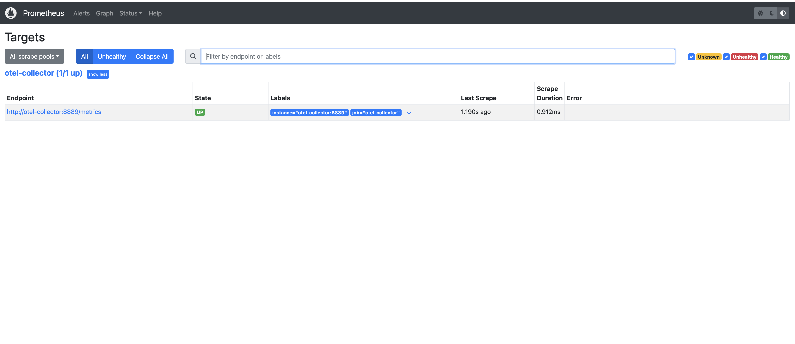
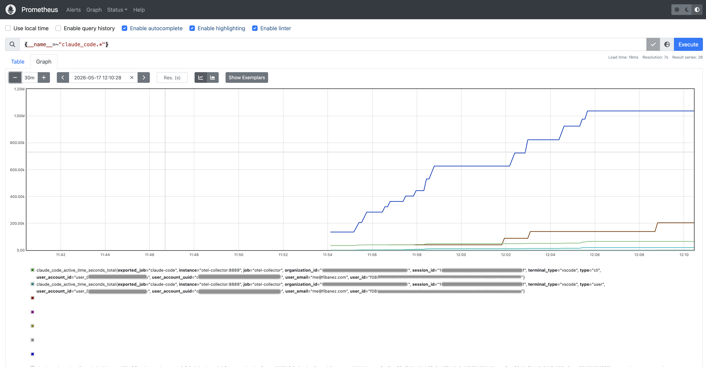
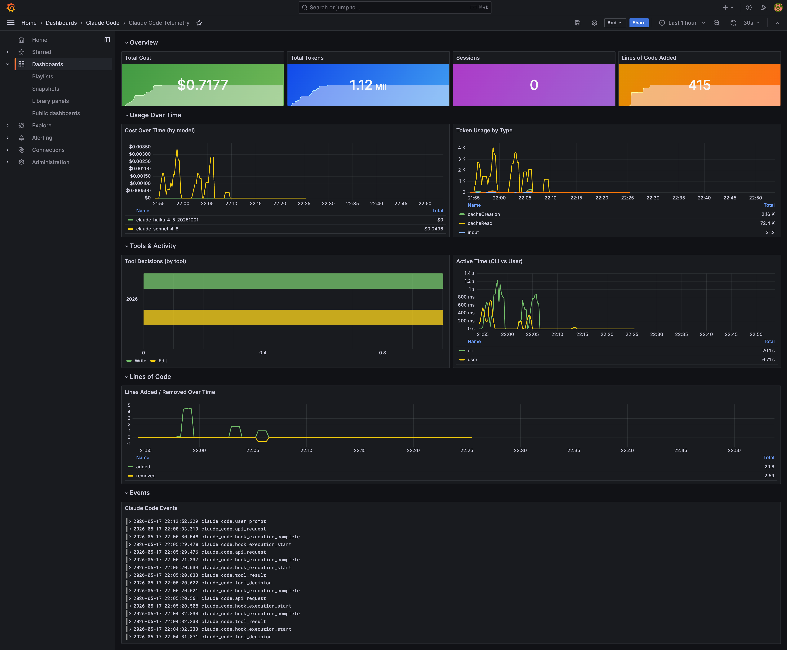

# Dev Container — Observability Stack

## Introduction

This dev container gives you a one-command development environment for the
Bedrock Cost Dashboard. Alongside the Next.js app it bundles a full
observability pipeline so that **Claude Code telemetry** — sessions, tokens,
cost, tool use, and API events — is captured automatically while you work.

Every time the `claude` CLI runs inside the container it exports
OpenTelemetry data: metrics flow into Prometheus, events/logs flow into Loki,
and a pre-built Grafana dashboard surfaces all of it. The result is a live,
local view of what Claude Code is doing and what it costs — no external
accounts, no SaaS, everything on your machine.

DynamoDB Local is included as well, so the dashboard itself can be developed
end-to-end against a local data store (see the root `CLAUDE.md` and `/seed`).

## Architecture

```
        ┌─────────────────────────────┐
        │  app  (devcontainer)        │
        │  Next.js + claude CLI       │
        └──────────────┬──────────────┘
                       │ OTLP / gRPC :4317
                       ▼
        ┌─────────────────────────────┐
        │  otel-collector             │
        │  receives OTLP, batches,    │
        │  fans out by signal type    │
        └───────┬─────────────┬───────┘
        metrics │             │ logs / events
   (Prometheus  │             │ (OTLP HTTP)
    exporter    ▼             ▼
    :8889) ┌──────────┐  ┌──────────┐
           │Prometheus│  │   Loki   │
           │  :9090   │  │  :3100   │
           └────┬─────┘  └────┬─────┘
                │             │
                └──────┬──────┘
                       ▼
              ┌─────────────────┐
              │     Grafana     │
              │      :3001      │
              │  Claude Code    │
              │   dashboard     │
              └─────────────────┘

   dynamodb-local :8000  ── started on demand, used by the app
```

### Services

| Service | Image | Local port | Purpose |
|---|---|---|---|
| `app` | `devcontainers/javascript-node:22` | 3000 | Dashboard dev server + the `claude` CLI |
| `otel-collector` | `otel/opentelemetry-collector-contrib:0.107.0` | 4317 (gRPC) / 4318 (HTTP) | OTLP ingest; routes metrics → Prometheus, logs → Loki |
| `prometheus` | `prom/prometheus:v2.54.1` | 9090 | Metrics storage; scrapes `otel-collector:8889` |
| `loki` | `grafana/loki:3.1.2` | 3100 | Log/event storage |
| `grafana` | `grafana/grafana:11.2.2` | 3001 | Dashboards over Prometheus + Loki |
| `dynamodb-local` | `amazon/dynamodb-local:2.5.4` | 8000 | Local DynamoDB — started on demand |

All images are pinned to explicit tags for reproducible builds. The
`dynamodb-local` service is optional and not started by default — bring it up
only when you need to seed or query data.

## How it works

1. **Telemetry is enabled by environment.** The `app` service in
   `docker-compose.yml` sets `CLAUDE_CODE_ENABLE_TELEMETRY=1` plus the
   `OTEL_*` exporter variables. Any `claude` command running in the container
   picks these up automatically — no per-command flags.

2. **Claude Code exports OTLP over gRPC** to `otel-collector:4317`. Metrics
   are sent with `cumulative` temporality (Claude Code defaults to `delta`;
   Prometheus requires cumulative counters) and flushed every 10 seconds.

3. **The collector fans out by signal type** (`otel/otel-collector-config.yaml`):
   - **metrics** → `prometheus` exporter, exposed on `:8889` for scraping.
   - **logs/events** → `otlphttp/loki` exporter, pushed to Loki's OTLP endpoint.
   A `batch` processor sits in front of both pipelines.

4. **Prometheus scrapes the collector** every 5 seconds
   (`prometheus/prometheus.yml`, job `otel-collector`, target
   `otel-collector:8889`).

5. **Grafana is provisioned at startup** from `grafana/provisioning/`:
   - Prometheus + Loki data sources (`datasources/datasources.yaml`).
   - The **Claude Code Telemetry** dashboard under the **Claude Code** folder
     (`dashboards/claude-code.json`).

> **Label note:** the Grafana dashboard filters metrics by
> `exported_job="claude-code"`. `exported_job` is the OTLP resource `job`
> that Claude Code sets *internally* — the Prometheus exporter renames it to
> `exported_job` because Prometheus's own scrape job is `otel-collector`.
> This is independent of `OTEL_SERVICE_NAME` (which is set to
> `bedrock-cost-dashboard` for the app's own telemetry).

## Configuration files

Every service is configured from a file checked into `.devcontainer/`. This
section is the reference for what each file does.

### `docker-compose.yml`

Defines the whole stack with pinned image tags. Each service has a healthcheck
and explicit port mappings.

```yaml
services:
  app:
    # Node.js 22 LTS
    image: mcr.microsoft.com/devcontainers/javascript-node:22
    volumes:
      - ..:/workspace:cached
    command: sleep infinity
    environment:
      OTEL_SERVICE_NAME: bedrock-cost-dashboard

      # Claude Code telemetry — exports metrics + events when `claude` runs
      CLAUDE_CODE_ENABLE_TELEMETRY: "1"
      OTEL_METRICS_EXPORTER: otlp
      OTEL_LOGS_EXPORTER: otlp
      OTEL_EXPORTER_OTLP_PROTOCOL: grpc
      OTEL_EXPORTER_OTLP_ENDPOINT: http://otel-collector:4317
      # Prometheus needs cumulative counters; Claude Code defaults to delta.
      OTEL_EXPORTER_OTLP_METRICS_TEMPORALITY_PREFERENCE: cumulative
      OTEL_METRIC_EXPORT_INTERVAL: "10000"

      # DynamoDB Local — placeholder values only.
      DYNAMODB_ENDPOINT: http://dynamodb-local:8000
      AWS_ACCESS_KEY_ID: local
      AWS_SECRET_ACCESS_KEY: local
      AWS_REGION: us-east-1
    depends_on:
      - otel-collector
    healthcheck:
      test: ["CMD", "node", "-v"]
      interval: 30s
      timeout: 10s
      retries: 5

  dynamodb-local:
    # Optional — start on demand: `docker compose up -d dynamodb-local`
    image: amazon/dynamodb-local:2.5.4
    command: ["-jar", "DynamoDBLocal.jar", "-sharedDb", "-dbPath", "/data"]
    volumes:
      - dynamodb-data:/data
    ports:
      - "8000:8000"

  otel-collector:
    image: otel/opentelemetry-collector-contrib:0.107.0
    command: ["--config=/etc/otelcol/config.yaml"]
    volumes:
      - ./otel/otel-collector-config.yaml:/etc/otelcol/config.yaml
    ports:
      - "4317:4317"
      - "4318:4318"
    depends_on:
      - prometheus
      - loki
    healthcheck:
      test: ["CMD", "otelcol-contrib", "--version"]
      interval: 30s
      timeout: 10s
      retries: 5

  prometheus:
    image: prom/prometheus:v2.54.1
    volumes:
      - ./prometheus/prometheus.yml:/etc/prometheus/prometheus.yml
    ports:
      - "9090:9090"
    healthcheck:
      test: ["CMD", "wget", "--spider", "http://localhost:9090/-/healthy"]
      interval: 30s
      timeout: 10s
      retries: 5

  loki:
    image: grafana/loki:3.1.2
    ports:
      - "3100:3100"
    healthcheck:
      test: ["CMD", "wget", "--spider", "http://localhost:3100/ready"]
      interval: 30s
      timeout: 10s
      retries: 5

  grafana:
    image: grafana/grafana:11.2.2
    ports:
      - "3001:3000"
    environment:
      GF_SECURITY_ADMIN_USER: admin
      GF_SECURITY_ADMIN_PASSWORD_FILE: /run/secrets/grafana_admin_password
    volumes:
      - ./grafana/provisioning:/etc/grafana/provisioning
    depends_on:
      - prometheus
      - loki
    secrets:
      - grafana_admin_password
    healthcheck:
      test: ["CMD", "wget", "--spider", "http://localhost:3000/api/health"]
      interval: 30s
      timeout: 10s
      retries: 5

secrets:
  # Gitignored, local-only — seeded from grafana_admin_password.txt.example
  # on first start by devcontainer.json's initializeCommand.
  grafana_admin_password:
    file: ./grafana/grafana_admin_password.txt

volumes:
  dynamodb-data:
  user-home-data:
```

### `otel/otel-collector-config.yaml`

Receives OTLP and routes each signal type to the right backend — metrics to
the Prometheus exporter on `:8889`, logs to Loki — with a `batch` processor in
front of both pipelines.

```yaml
receivers:
  otlp:
    protocols:
      grpc:
        endpoint: 0.0.0.0:4317
      http:
        endpoint: 0.0.0.0:4318

exporters:
  prometheus:
    endpoint: "0.0.0.0:8889"
  otlphttp/loki:
    endpoint: http://loki:3100/otlp
    tls:
      insecure: true

processors:
  batch:

service:
  pipelines:
    metrics:
      receivers: [otlp]
      processors: [batch]
      exporters: [prometheus]
    logs:
      receivers: [otlp]
      processors: [batch]
      exporters: [otlphttp/loki]
```

> The Loki exporter type must be `otlphttp` (no underscore) — `otlp_http` is
> invalid and the collector will fail to start.

### `prometheus/prometheus.yml`

Prometheus has a single job: scrape the metrics the collector exposes on port
`8889`. A tight 5-second interval keeps the dashboard responsive.

```yaml
global:
  scrape_interval: 5s

scrape_configs:
  - job_name: otel-collector
    static_configs:
      - targets: ["otel-collector:8889"]
```

### `grafana/provisioning/datasources/datasources.yaml`

Registers Prometheus (default) and Loki, each reachable by container name on
the compose network.

```yaml
apiVersion: 1

datasources:
  - name: Prometheus
    uid: prometheus
    type: prometheus
    access: proxy
    url: http://prometheus:9090
    isDefault: true

  - name: Loki
    uid: loki
    type: loki
    access: proxy
    url: http://loki:3100
    isDefault: false
```

### `grafana/provisioning/dashboards/dashboards.yaml`

Tells Grafana to load any dashboard JSON in the provisioning folder into a
**Claude Code** folder, re-checking every 30 seconds.

```yaml
apiVersion: 1

providers:
  - name: default
    folder: Claude Code
    type: file
    disableDeletion: false
    updateIntervalSeconds: 30
    allowUiUpdates: true
    options:
      path: /etc/grafana/provisioning/dashboards
```

### `grafana/provisioning/dashboards/claude-code.json`

The pre-built **Claude Code Telemetry** dashboard, loaded by the provider
above. It auto-refreshes every 30 seconds, defaults to a 1-hour window, and
includes:

- Stat panels — total cost, tokens, API requests, and tool uses
- Cost over time and a token breakdown by type (input / output / cacheRead / cacheCreation)
- Top tools used — a horizontal bar chart
- API request latency — p50 and p95
- Live event log — Claude Code events streamed from Loki

Panels filter metrics by `exported_job="claude-code"` (see the label note
above).

## Setup

### 1. Open in the dev container

Open the repo in VS Code and **Reopen in Container**. The
`devcontainer.json` builds the `app` service, mounts the workspace at
`/workspace`, bind-mounts your `~/.ssh` and `~/.claude` into the container,
forwards all service ports, and installs the recommended VS Code extensions
(see below).

#### Recommended VS Code extensions

Installed automatically into the container from
`customizations.vscode.extensions` in `devcontainer.json`. They match the
project stack (Rule 40) so the editor's lint, format, IntelliSense, and test
tooling agree with the CLI gates.

| Extension | ID | Purpose |
|---|---|---|
| Docker | `ms-azuretools.vscode-docker` | Manage the compose stack from the editor |
| Grafana | `grafana.vscode-grafana` | Author/preview Grafana dashboards |
| Claude Code | `anthropic.claude-vscode` | Claude Code integration |
| ESLint | `dbaeumer.vscode-eslint` | ESLint v9 flat-config diagnostics |
| Prettier | `esbenp.prettier-vscode` | Format-on-save matching the Prettier gate |
| Tailwind CSS IntelliSense | `bradlc.vscode-tailwindcss` | Tailwind CSS v4 class completion |
| Vitest | `vitest.explorer` | Run/debug Vitest tests in the editor (not Jest) |
| Playwright | `ms-playwright.playwright` | Run/debug E2E specs (Phase 5+) |
| Pretty TypeScript Errors | `yoavbls.pretty-ts-errors` | Readable errors for TypeScript strict mode |
| Error Lens | `usernamehw.errorlens` | Inline diagnostics — pairs with Pretty TS Errors under strict mode |
| AWS Toolkit | `amazonwebservices.aws-toolkit-vscode` | Browse DynamoDB Local + Lambda collector work (Phase 6) |
| Conventional Commits | `vivaxy.vscode-conventional-commits` | Guided commit messages matching the commitlint gate |
| YAML | `redhat.vscode-yaml` | Validate `docker-compose.yml` + `otel-collector-config.yaml` |
| markdownlint | `davidanson.vscode-markdownlint` | Keep `docs/specs/**` consistently formatted |
| Charmed Nest Icons | `aaa-lt.charmed-nest-icons` | File icon theme — activated via `workbench.iconTheme` |

### 2. Start the observability stack

The `app` service depends on `otel-collector`, which depends on `prometheus`
and `loki` — opening the dev container brings those up. To start everything
manually:

```bash
docker compose up -d
```

Start DynamoDB Local only when needed (or use `/seed`):

```bash
docker compose up -d dynamodb-local
```

### 3. Confirm Prometheus is scraping the collector

Open `http://localhost:9090/targets` — the `otel-collector` job should show
**UP**.



### 4. Generate telemetry

Run any `claude` command inside the container. It reads the `OTEL_*` env vars
and exports OTLP over gRPC to the collector.

### 5. Confirm metrics arrived

In the Prometheus query UI at `http://localhost:9090/graph`, run:

```
{__name__=~"claude_code.*"}
```

You should see metrics such as `claude_code_cost_usage_USD_total`,
`claude_code_token_usage_tokens_total`, and
`claude_code_tool_decision_count_total`. Metrics appear only after the first
10-second export interval.



### 6. Open Grafana

Go to `http://localhost:3001` and log in:

- **Username:** `admin`
- **Password:** contents of `.devcontainer/grafana/grafana_admin_password.txt`
  (gitignored; seeded from `grafana_admin_password.txt.example` — default
  `admin` — on first start. Edit the file to change it; never commit it.)

The **Claude Code Telemetry** dashboard is pre-loaded under the **Claude
Code** folder. It includes:

- Total cost, tokens, API requests, and tool uses (stat panels)
- Cost over time and token breakdown by type (input / output / cacheRead / cacheCreation)
- Top tools used (horizontal bar chart)
- API request latency — p50 and p95
- Live Claude Code event log (from Loki)

The dashboard auto-refreshes every 30 seconds and defaults to a 1-hour
window.



## Claude Code telemetry env vars

Set on the `app` service in `docker-compose.yml` — they apply to every
`claude` run inside the container:

| Variable | Value | Purpose |
|---|---|---|
| `CLAUDE_CODE_ENABLE_TELEMETRY` | `1` | Enables OTLP export |
| `OTEL_SERVICE_NAME` | `bedrock-cost-dashboard` | Service name for the app's own telemetry |
| `OTEL_METRICS_EXPORTER` | `otlp` | Exports metrics via OTLP |
| `OTEL_LOGS_EXPORTER` | `otlp` | Exports logs/events via OTLP |
| `OTEL_EXPORTER_OTLP_PROTOCOL` | `grpc` | Uses gRPC (port 4317) |
| `OTEL_EXPORTER_OTLP_ENDPOINT` | `http://otel-collector:4317` | Collector endpoint (container → container) |
| `OTEL_EXPORTER_OTLP_METRICS_TEMPORALITY_PREFERENCE` | `cumulative` | Required by Prometheus |
| `OTEL_METRIC_EXPORT_INTERVAL` | `10000` | Export every 10 s |

When running `claude` on the **host** instead of inside the container, set the
same vars in `.claude/settings.local.json` but point the endpoint at
`http://localhost:4317`.

## Troubleshooting

**otel-collector fails to start**
Check `otel/otel-collector-config.yaml`. The Loki exporter type must be
`otlphttp` (no underscore) — not `otlp_http`.

**Prometheus target is DOWN**
The collector exposes metrics on port 8889. Confirm the `prometheus` exporter
is in the collector config's `service.pipelines.metrics.exporters` list.

**No `claude_code.*` metrics in Prometheus**
Ensure `CLAUDE_CODE_ENABLE_TELEMETRY=1` is set and that `claude` was run after
the collector started. Metrics only appear after the first 10 s export
interval.

**Dashboard shows "No data"**
The dashboard filters by `exported_job="claude-code"`. That label comes from
Claude Code's internal OTLP `job` resource attribute, surfaced by the
collector's Prometheus exporter as `exported_job`. If panels are empty,
confirm `claude_code.*` metrics exist in Prometheus first (step 5) and that
your dashboard time window covers a recent `claude` run.
