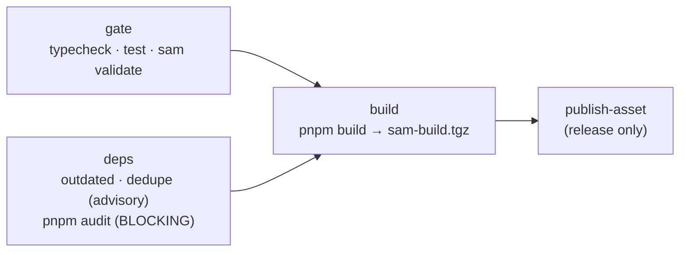
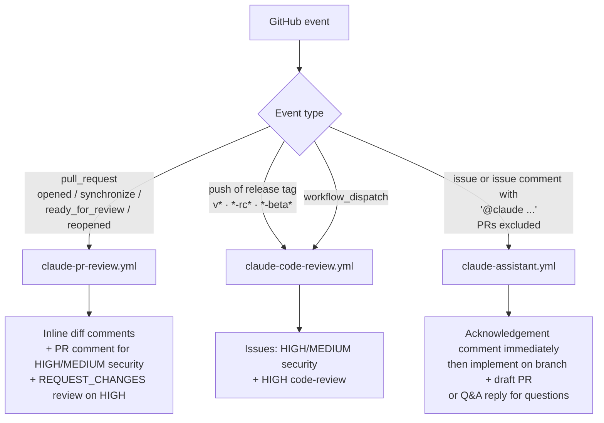
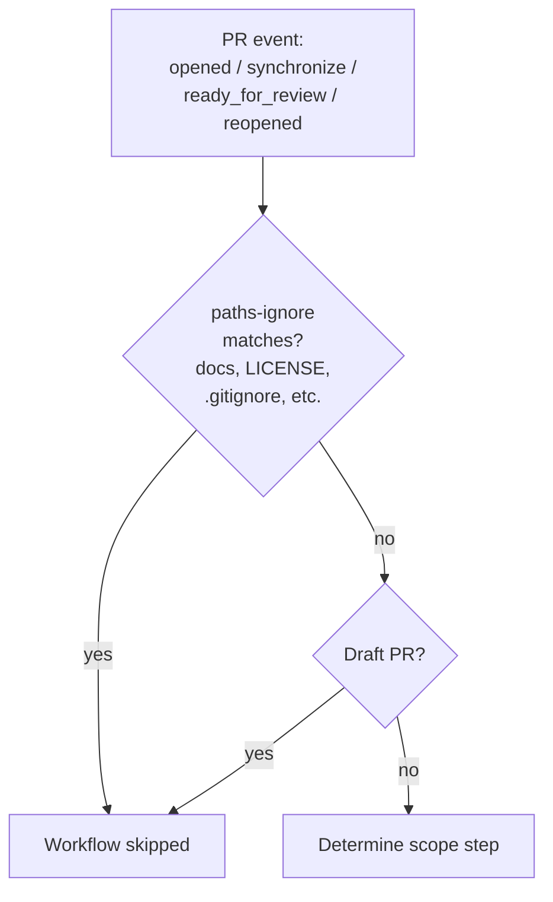
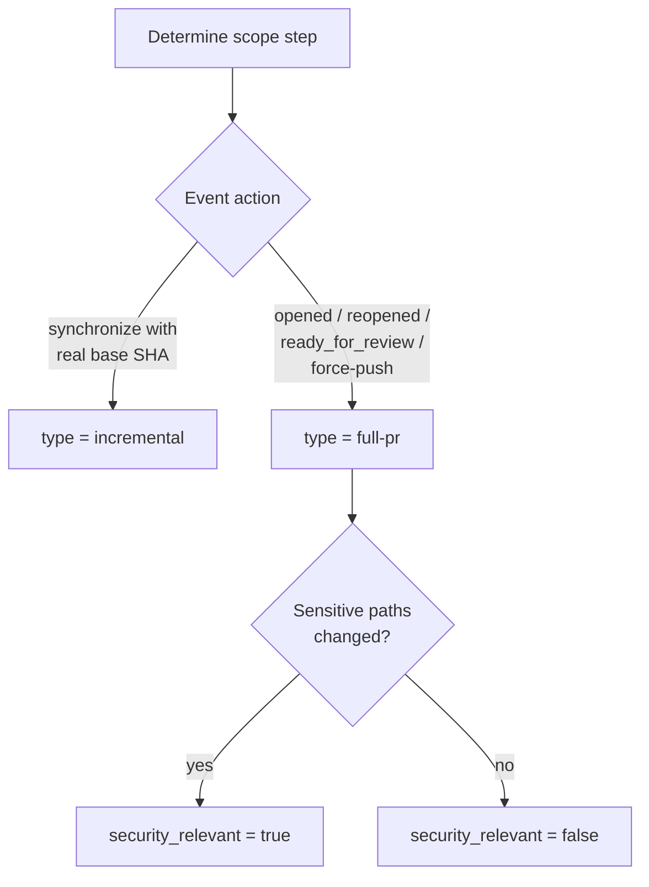
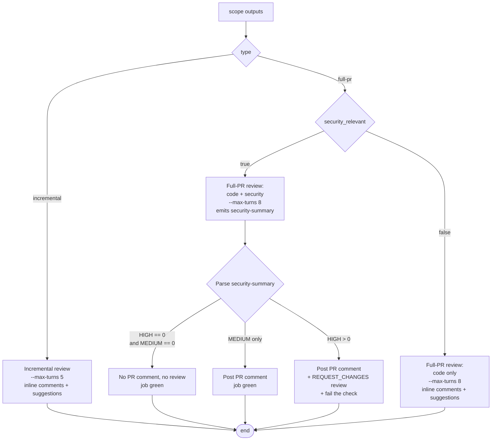
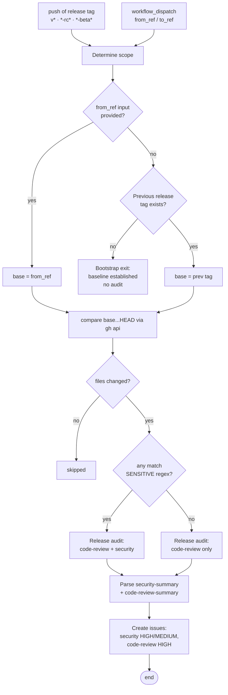

# GitHub Actions

This folder holds the project's GitHub-side automation.

| File | Trigger | Purpose |
| --- | --- | --- |
| [`workflows/llm-usage-lens-build.yml`](workflows/llm-usage-lens-build.yml) | Push to `main`; pull request | Dashboard CI: `quality` (lint, format, typecheck, gitleaks), then `test` (Vitest against DynamoDB Local), `build` (`pnpm build:ci`), `e2e` (headless Playwright, both projects, production servers, against DynamoDB Local) and `e2e-dev` (the dev-login specs on `next dev`) in parallel |
| [`workflows/llm-usage-lens-deploy.yml`](workflows/llm-usage-lens-deploy.yml) | `workflow_dispatch` (environment = dev or prod) | Builds the dashboard image, pushes it to ECR (tag = commit SHA) and runs `cdk deploy` of the DashboardServiceStack only, assuming `vars.DEPLOY_ROLE_ARN` via GitHub OIDC (no static keys). Never deploys the FoundationStack. **Running it is a user action.** |
| [`workflows/claude-pr-review.yml`](workflows/claude-pr-review.yml) | Pull request events | Inline review comments + PR comment with HIGH/MEDIUM security findings; HIGH findings submit a REQUEST_CHANGES review and fail the check |
| [`workflows/claude-code-review.yml`](workflows/claude-code-review.yml) | Push of release tags (`v*`, `*-rc*`, `*-beta*`) and `workflow_dispatch` | Release audit (code review + security) scoped to commits since the previous release tag; files GitHub issues for HIGH/MEDIUM security and HIGH code-review findings |
| [`workflows/bedrock-simulator-build.yml`](workflows/bedrock-simulator-build.yml) | `workflow_dispatch`; `release: published` | Builds the simulator SAM artifact. `gate` (typecheck + tests + `sam validate`) and `deps` (freshness/duplicates report + **blocking `pnpm audit`**) run in parallel; `build` needs both, so a vulnerability blocks the artifact. pnpm store cached. Touches no AWS |
| [`workflows/bedrock-simulator-deploy.yml`](workflows/bedrock-simulator-deploy.yml) | `workflow_dispatch` (confirm = "deploy") | Deploys the bedrock-simulator SAM stack and runs post-deploy health checks + smoke test |
| [`workflows/bedrock-simulator-destroy.yml`](workflows/bedrock-simulator-destroy.yml) | `workflow_dispatch` (confirm = "destroy bedrock-simulator") | Tears down the bedrock-simulator stack (disables MIL, empties bucket, sam delete) |
| [`workflows/bedrock-simulator-run.yml`](workflows/bedrock-simulator-run.yml) | `workflow_dispatch` (totalCalls, guardrailRatio) | Invokes the deployed simulator Lambda with the full model × service × user matrix |
| [`workflows/bedrock-simulator-deps.yml`](workflows/bedrock-simulator-deps.yml) | `workflow_dispatch` (on demand) | Full dependency-health report to the run summary: `pnpm outdated` (freshness), `pnpm audit` (vulnerabilities), `pnpm dedupe --check` (duplicate versions). **Advisory — never fails.** For inspection without a build; enforcement is the `bedrock-simulator-build.yml` gate. Touches no AWS |
| [`workflows/github-pr-title-lint.yml`](workflows/github-pr-title-lint.yml) | PR opened / edited / reopened | Validates PR title against Conventional Commits (required — PR title becomes the squash-merge commit on `main`) |
| [`workflows/labels.yml`](workflows/labels.yml) | Push to `main` touching [`labels.yml`](labels.yml) / the workflow; `workflow_dispatch` | Syncs repository labels from [`.github/labels.yml`](labels.yml) (create/update only — `skip-delete: true` protects labels created by the release audit) |
| [`workflows/claude-assistant.yml`](workflows/claude-assistant.yml) | `@claude` mention on an **issue** (opened/assigned or issue comment) | On-demand implementation bot: posts an acknowledgement comment immediately, implements the change on a Rule 31–named branch, opens a draft PR, and posts a summary; falls back to a Q&A reply for informational requests. Works on any issue type (bug, feature, task, chore, refactor, docs, etc.) |

The on-demand `claude-assistant.yml` is **scoped to issues only** — it does
not run on pull requests, where `claude-pr-review.yml` and local Claude Code
already cover the work. When `@claude` is mentioned on an issue of any type
(bug, feature, task, chore, refactor, docs, etc.), the job immediately posts
an acknowledgement comment (before Claude reads a line), then Claude reads the
issue, implements the change on a properly-named branch (Rule 31 convention),
pushes it, and opens a draft PR linking back to the issue. For informational
requests, Claude posts a reply and skips the branch/PR flow. It runs in
claude-code-action **agent mode** (a `prompt` is supplied) rather than tag
mode: tag mode always compares `main...<branch>` at the end, which 404s on
Q&A runs where nothing is pushed. The rest of this document walks through the
**automated review workflows** in detail.

### `llm-usage-lens-build.yml` job graph

`quality` runs first; `test`, `build`, `e2e` and `e2e-dev` need it and
run in parallel (`quality → test | build | e2e | e2e-dev`). The `e2e` job
(implementation-phases Phase 5, *Add Playwright to GitHub Actions CI*)
starts a `dynamodb-local` service (same image as `test`), creates and
seeds the table, installs Chromium and runs `pnpm test:e2e` (both
Playwright projects) with `E2E_LOCK=off`, since CI has no other session.
It uses no secrets: the web servers' env is pinned in
`apps/dashboard/playwright.config.ts`.

- **Concurrency:** the group is per workflow and ref, and
  `cancel-in-progress` is `${{ github.event_name == 'pull_request' }}`.
  A new push to a pull request cancels that PR's superseded run, but a
  push to `main` never cancels the `main` run in progress, so it
  finishes, e2e included. Previously every event cancelled, so
  back-to-back pushes left no completed `main` run (the runs at 39fa452
  and 5e8a5a5 were cancelled). GitHub keeps at most one pending run per
  group. A third push while one `main` run is running and one is pending
  replaces the pending one, so the newest commit is always tested.
- **Runner:** `ubuntu-24.04`, pinned rather than `ubuntu-latest`. The
  first run (43878743673) failed at the browser install because
  `ubuntu-latest` is now 26.04, which Playwright 1.60 does not support.
  Move back to `ubuntu-latest` once a Playwright release supports it.
- **Caches:** the pnpm store (`node-setup`) and the Playwright browsers in
  `~/.cache/ms-playwright`, keyed on the `@playwright/test` version.
- **Artifacts:** on failure only, `apps/dashboard/test-results` and
  `apps/dashboard/playwright-report`, kept 7 days.
- **Servers (2026-11-17):** under `CI`, each of the two web servers runs
  `next build` then `next start` instead of `next dev`, which compiled
  every route cold on the 2-vCPU runner. Each server has its own distDir:
  `.next` for the main server and `.next-probe-r5` for the role-probe
  server. That way the two tables never share a data cache. Both builds
  run at once before the first test, so the CI-only web-server timeout is
  600 s (180 s locally). Production refuses the dev-only login, so these
  servers configure the master user with a dummy Argon2id hash. Its salt
  is under Argon2's 8-byte minimum, so no password verifies. They run with
  `APP_ENV=dev` and a production `NODE_ENV`, so the `APP_ENV=prod` startup
  path is covered by unit tests only. The CI-only settings are
  `retries: 1` (was 2) and a 30 s test timeout (60 s locally). Local runs
  are unchanged.
- **`e2e-dev` job (2026-11-17):** the specs that need the dev login
  (`dev-login.spec.ts`, `sign-in-role-choice.spec.ts`, the settings-tabs
  step-up case) skip on production servers. This job runs only those
  specs, 10 cases on `next dev`, with `E2E_SERVERS=dev`. It has the same
  setup and runner pin as `e2e`, and a 15-minute timeout. Playwright's
  `--grep` follows the spec paths with no `--` separator. With `--`,
  Playwright reads every later argument as a file filter. A guard step
  then fails the job unless exactly 10 cases ran with none skipped
  (`scripts/e2e-assert-count.ts`, reading the JSON report from
  `PLAYWRIGHT_JSON_OUTPUT_FILE`). That catches a dropped filter (more
  cases) and production servers (all skipped).
- **`e2e-dev` first run (43942889368, 52f6c5b, 2026-11-16, red):** the
  job took 3m23s, with 2.1 min of tests. Ten cases ran: 4 passed, 1 was
  flaky, 2 failed and 3 did not run. Each failing sign-in waited on
  Playwright's 5 s `expect` default while the cold `next dev` compiled
  the server action and `/dashboard`. The same cases take 2.1-2.6 s once
  the routes are warm (run 43927910942). Under CI on `next dev` only, the
  `expect` timeout is now 15 s.
- **`e2e-dev` measured (43946917882, f4f3f98, 2026-11-16, green):** the
  job took 3m38s, with 2.1 min of tests. Ten cases ran: 9 passed and 1
  was flaky. `dev-login.spec.ts:28`, the first dev-login sign-in on the
  cold server, failed after 26.5 s and passed on retry in 6.5 s. The
  guard reported `e2e case count ok: 10`. In the same run `e2e` took
  11m46s (10.6 min of tests: 401 passed, 10 skipped). That is slower
  than the 4.9 min in run 43939025415, so runner speed varies between
  runs. `test` took 15m57s.
- **`e2e-dev` warm-up (2026-11-17):** before the first test, a Playwright
  `globalSetup` (`apps/dashboard/e2e/support/warm-up.ts`) loads
  `/sign-in` on both dev servers and `/dashboard` on the main one with a
  forged session. The cold compile then happens outside a test. Only
  `devServerWarmUp(env)` loads it: `CI` set with `E2E_SERVERS=dev`.
  Local runs and production servers skip it. The 15 s `expect` timeout
  stays as the safety margin. In a local cold run (Next caches moved
  aside), the first dev-login sign-in took 454 ms.
- **History on `next dev`, 2026-11-16:** run 43882190808 (1 worker)
  spent about 22.5 min on 330 of 350 cases, then stopped at 23m53s on a
  runner shutdown signal. Run 43922339732 (2 workers) finished 354 of
  411 cases in about 14.5 min before a newer push cancelled it. Two
  role-landing cases passed only on retry (`page.goto: net::ERR_ABORTED`).
  Run 43926308954 (2 workers) stayed in the E2E step for more than 55 min,
  past the 45-min job timeout. The runner had stopped responding, and its
  logs were unavailable. Run 43927910942 (2 workers) reached 351 of 411
  cases in about 13.5 min, then stopped on a runner shutdown signal. Two
  dev servers plus two browsers likely exhausted the runner's memory.
- **Timeouts:** `e2e` 45 min, `e2e-dev` 15 min and `test` 25 min. The
  `test` job (Vitest) took 11-14 min on 2026-11-16 and 16m10s in run
  43939025415, so the 25-min limit leaves about 9 min of headroom.
- **Measured on production servers (run 43939025415, a5e0bb6,
  2026-11-16, green):** the `e2e` job took 7m35s. Setup (install, browser
  from cache, table and seed) took about 1 min. The two parallel builds
  plus server start took about 1.5 min, with no sign of memory pressure,
  so the builds stay parallel. The 411 cases took 4.9 min on 2 workers:
  400 passed, 10 skipped (the dev-login cases) and 1 flaky. The flaky
  case, `role-landing.spec.ts:165`, passed on retry. In the same run,
  `quality` took 2m02s, `build` 1m09s and `test` 16m10s.
- **Cost:** about 31-35 runner-minutes per push or pull-request run.
  `test` takes about 16 min, `e2e` 7.5-12 min, `quality` and `build`
  about 3 min together, and `e2e-dev` about 3.5 min. The repository is
  private, so the minutes count against the GitHub free tier (2,000
  min/month on Free), about 55-65 runs a month, and each job bills its
  own minutes. `test` is now the
  longest job. The cost is accepted, not avoided (CLAUDE.md, *Cost
  posture*).

### `bedrock-simulator-build.yml` job graph

`gate` and `deps` run in parallel; `build` needs both, so a `pnpm audit`
vulnerability in `deps` blocks the artifact. `publish-asset` runs only on a
release. The pnpm store is cached across the three jobs.



### `llm-usage-lens-deploy.yml` configuration

The job runs in the GitHub Environment named by the `environment` input
(`dev` or `prod`) and reads only repository or environment **variables**
(no secrets; the CI role cannot read SSM secrets): `DEPLOY_ROLE_ARN`,
`AWS_ACCOUNT_ID`, `VPC_ID`, `AVAILABILITY_ZONES`, `PRIVATE_SUBNET_IDS`,
`CERTIFICATE_ARN`, `DASHBOARD_HOSTNAME`, `ALARM_TOPIC_ARN`,
`ECR_REPOSITORY_NAME`, `ENTRA_CLIENT_ID` (Entra application ID), `ENTRA_ISSUER`
(`https://login.microsoftonline.com/<tenant>/v2.0`), and either `LISTENER_ARN` + `LISTENER_RULE_PRIORITY` +
`ALB_SECURITY_GROUP_ID` (import mode) or `COMPANY_CIDRS` (create mode). The
deploy role is created by the DashboardServiceStack and trusts the account's existing
GitHub OIDC provider (adding that provider if absent is a user action), so
the first DashboardServiceStack deploy is run by the user locally. The role trust is
scoped to `repo:<owner/repo>:environment:<env>`, so GitHub environments named
`dev` and `prod` **must exist** (add required-reviewer protection rules on
`prod`). The role assumes the CDK bootstrap deploy role, so run
`cdk bootstrap` with a scoped `--cloudformation-execution-policies`, not
`AdministratorAccess`; otherwise CI inherits that breadth (recorded residual
risk). Source:
[Platform spec](../docs/specs/2026-11-10-platform.md) and the
[operations guide](../docs/guides/operations.md).

---

## Community health and meta files

| File | Purpose |
| --- | --- |
| [`CODEOWNERS`](CODEOWNERS) | Required-reviewer routing per path. The `/.github/` rule covers this entire directory (workflows, actions, scripts) recursively. |
| [`CONTRIBUTING.md`](CONTRIBUTING.md) | Single contributor entrypoint — branching, commit format, PR process. GitHub surfaces it as "Contributing guidelines" when a new PR is opened. |
| [`SECURITY.md`](SECURITY.md) | Vulnerability reporting policy. GitHub renders it under the repository's *Security policy* tab. |
| [`dependabot.yml`](dependabot.yml) | Dependabot schedule — weekly GitHub Actions bumps (workflows and the composite actions under `actions/`; every external action is pinned to a full commit SHA with a `# vX.Y.Z` comment, and Dependabot bumps both), plus weekly npm bumps for `tools/bedrock-simulator` (minor/patch grouped into one PR; majors and security updates separate). PR titles are `chore`-prefixed to pass `pr-title-lint`. |
| [`pull_request_template.md`](pull_request_template.md) | Auto-populated PR description scaffold (Summary, Linked issue, Test plan, Reviewer guidance, Phase). |

**Why these live in `.github/` and not the repo root.** GitHub auto-discovers
all three of `CODEOWNERS`, `CONTRIBUTING.md`, and `SECURITY.md` in any of
`/`, `.github/`, or `docs/` with identical UI behaviour — the *Security
policy* tab, *Contributing guidelines* prompt on new PRs, and code-owner
review requests all fire regardless of which of the three locations is used.
Keeping them under `.github/` groups every GitHub-meta concern in one place
and keeps the repo root reserved for source code and top-level project
documentation. Move them to the root only if a future contributor convention
calls for it; nothing in GitHub's tooling requires it.

---

## Composite actions

Reusable logic is extracted into composite actions under `.github/actions/`.
Each action can be called with `./.github/actions/<name>` and is designed to
be generically portable to a shared repository (see [Future work](#future-work)).

### `aws-*` family

| Action | Inputs (required \*) | Outputs | Purpose |
| --- | --- | --- | --- |
| `aws-configure-oidc` | `role-arn`\*, `aws-region` (default `us-east-1`), `role-duration-seconds` (default `1200`) | — | Assumes an IAM role via OIDC + verifies with `aws sts get-caller-identity`. Used in 3 workflows. |
| `aws-sam-deploy` | `stack-name`\*, `region`\*, `working-directory`, `parameters` (multiline `KEY=value`), `capabilities`, `resolve-s3` | — | `sam deploy` with parameter-override escaping and idempotent changeset handling. |
| `aws-s3-bucket-empty` | `bucket-name`\*, `region` | — | 4-pass cleanup: current objects → noncurrent versions → delete markers → in-progress multipart uploads. |
| `aws-lambda-invoke` | `function-name`\*, `payload`\*, `region`, `expected-status-code`, `response-path` | `status-code`, `function-error`, `response-path` | `aws lambda invoke` with payload written to a temp file internally. Used in 2 workflows. |
| `aws-capture-diagnostics` | `stack-name`\*, `lambda-name` (optional), `artifact-name`\*, `retention-days`, `region`, `output-dir` | — | Collects CloudFormation stack events + Lambda logs and uploads as an artifact on failure. Used in 2 workflows. |

### `setup-*` family

| Action | Inputs (required \*) | Outputs | Purpose |
| --- | --- | --- | --- |
| `node-setup` | `node-version` (default `22`) | — | Installs pnpm via `pnpm/action-setup@v6` then Node.js with pnpm cache via `actions/setup-node@v6`. Used in `llm-usage-lens-build.yml`. |
| `aws-sam-setup` | `node-version` (default `22`), `pnpm-version` (default `9`), `cache-pnpm` (default `false`), `cache-dependency-path` | — | Installs Node.js, pnpm, and the AWS SAM CLI for SAM build/deploy jobs. |

### `github-*` family

| Action | Inputs (required \*) | Outputs | Purpose |
| --- | --- | --- | --- |
| `github-review` | `oauth-token`\*, `prompt`\*, `model`, `max-turns`, `allowed-tools`\*, `plugin-marketplaces`, `plugins` | `result` | Wraps `anthropics/claude-code-action@v1`. Used 4 times across 2 workflows. |
| `github-post-pr-security-comment` | `review-output`\*, `pr-number`\*, `repo`\*, `head-ref`\*, `base-ref`\*, `head-sha`\*, `gh-token`\* | — | Parses the Claude `security-summary` block, posts a PR comment, submits REQUEST_CHANGES if HIGH > 0. |
| `github-create-audit-issues` | `audit-output`\*, `commit-sha`\*, `release-tag`\*, `repo`\*, `assignee`, `labels-*`, `gh-token`\* | `created-count`, `issue-urls` | Parses `security-summary` + `code-review-summary` blocks and creates GitHub issues for HIGH/MEDIUM security and HIGH code-review findings. |

### `setup-*` family

| Action | Inputs | Outputs | Purpose |
| --- | --- | --- | --- |
| `node-setup` | `node-version` (default `22`) | — | Installs pnpm via `pnpm/action-setup@v6` then Node.js with pnpm store caching via `actions/setup-node@v6`. Used in `llm-usage-lens-build.yml`. |
| `aws-sam-setup` | `node-version` (default `22`), `pnpm-version` (default `9`), `cache-pnpm` (default `false`), `cache-dependency-path` | — | Installs Node.js, pnpm, and the AWS SAM CLI. Used in the simulator build workflow (deploy/destroy install the SAM CLI directly via `aws-actions/setup-sam`, as they need neither Node nor pnpm). |

**Inclusion rule:** an action earns its directory only when its extracted logic
is more than 1–2 lines of bash AND it either appears in multiple workflows or
handles a non-obvious edge case (idempotency, multi-pass cleanup, inverted-error
matching). Single-caller ≤2-line wrappers stay inline in the workflow.

---

## GitHub Flow

This project follows [GitHub Flow](https://docs.github.com/en/get-started/using-github/github-flow)
as codified in [Rule 31](../.claude/rules/31-github-flow.md).

```
main ─────────────────────────────────────────────────────▶
      │                          ▲
      └─ feature/… or fix/… ────┘
         (commits)         (squash-merge via PR)
```

- `main` is the **only** long-lived branch.
- All work branches off `main` and returns via pull request.
- PRs are **squash-merged** — the PR title becomes the sole commit on `main`.
- PR titles **must** follow Conventional Commits (enforced by `github-pr-title-lint.yml`).
- Releases are cut by pushing a version tag from `main` (see [Release process](#release-process)).

See [Rule 31](../.claude/rules/31-github-flow.md) for the full branching
convention, including hybrid naming for phase work (`feature/phase-<n>-<slug>`
per Rule 30).

---

## Required branch protection on `main`

Configure under Settings → Branches → Branch protection rules:

| Setting | Value |
| --- | --- |
| Require pull request before merging | ❌ — Rule 31: work is squash-merged into local `main` and the user pushes it |
| Required status checks | `claude: ci - pr review`, `pr title: ci - lint` |
| Require linear history | ✅ |
| Allow squash-merge only | ✅ — disable merge commits and rebase-merge in Settings → General → Pull Requests |
| Restrict force-push to `main` | ✅ |
| Restrict direct push to `main` | ❌ — the user pushes `main` (Rule 31) |
| Require review from Code Owners | Recommended once team > 1 |

Pre-existing project rules that are the manual counterparts:
Rule 30.5 ("never commit or merge directly to `main`") and
Rule 50.5 ("never `--no-verify`").

---

## Required GitHub Environment for bedrock-simulator

The three `bedrock-simulator-*` workflows each declare
`environment: bedrock-simulator-sandbox`
([deploy](workflows/bedrock-simulator-deploy.yml),
[run](workflows/bedrock-simulator-run.yml),
[destroy](workflows/bedrock-simulator-destroy.yml)). That line only *names*
the environment — the environment itself is **not** defined in YAML and must
be created once in the GitHub UI before any of those workflows can run.

A [GitHub Actions Environment](https://docs.github.com/en/actions/managing-workflow-runs-and-deployments/managing-deployments/managing-environments-for-deployment)
is a named scope, configured under **Settings → Environments**, that holds
its own secrets/variables and gates any job referencing it behind protection
rules.

### Why it exists here

The simulator deploys to a dedicated AWS **sandbox** account, invokes **real
Amazon Bedrock models** (real spend), and the destroy workflow tears down live
infrastructure (`sam delete`) — all `workflow_dispatch`-only. Scoping these to
an environment (a) keeps the sandbox's AWS access and budget-alert details out
of repo-wide secrets, and (b) lets a **required-reviewer** rule put a human in
the loop before anything touches the account.

### Required-reviewer protection

With **Required reviewers** enabled on the environment, any job that targets it
**pauses in a "Waiting" state before its first step** until a named reviewer
clicks **Approve** in the Actions UI. If rejected, the job is cancelled. This
means no one can deploy, spend, or destroy in the sandbox — even via a manual
dispatch — without a second person approving the run. It is the human gate on
the typed-confirmation inputs (`confirm = "deploy"` / `"destroy bedrock-simulator"`).

### How to set it up

1. **Settings → Environments → New environment** → name it exactly
   `bedrock-simulator-sandbox` (must match the workflows' `environment:` value).
2. Under **Deployment protection rules**, tick **Required reviewers** and add
   yourself / the team.
3. Add the environment-scoped values the workflows read:

   | Kind | Name | Used by | Purpose |
   | --- | --- | --- | --- |
   | Variable | `SANDBOX_ACCOUNT_ID` | all three | Builds the OIDC role ARN `arn:aws:iam::<id>:role/bedrock-simulator-deployer` |
   | Secret | `BUDGET_ALERT_EMAIL` | deploy | `BudgetAlertEmail` SAM parameter for the budget alarm |

> First-deploy bootstrap: the `bedrock-simulator-deployer` OIDC role is created
> *by* the stack on the first `sam deploy`, so the very first deploy in a fresh
> sandbox account must be run locally with SSO credentials — see
> [`docs/guides/bedrock-simulator.md`](../docs/guides/bedrock-simulator.md).

---

## Why these workflows exist

Reviewing every pull request manually doesn't scale, and asking a human
reviewer to scan for security issues on top of correctness slows the
feedback loop further. These workflows use
[`anthropics/claude-code-action@v1`](https://github.com/anthropics/claude-code-action)
to run Claude as an automated reviewer at two points in the development
cycle:

1. **PR-time** (`claude-pr-review.yml`) — catches issues while the branch is
   still open and a human reviewer is already looking at it. Posts inline
   diff comments (with one-click suggestion blocks), and if HIGH security
   findings are present, posts a PR comment and submits a `REQUEST_CHANGES`
   review that blocks merge.
2. **Release audit** (`claude-code-review.yml`) — a safety net for anything
   that slips through PR review. Runs when a release tag is pushed, scoping
   the audit to commits since the previous release tag, so it never re-reviews
   the same code twice.

The trade-off with any LLM-based reviewer is **token cost**. Both workflows
put considerable effort into reviewing only what needs to be reviewed, and
only when it needs to be reviewed — see [Cost characteristics](#cost-characteristics).

---

## How the two reviewers split work

PR-time review catches issues during the human review window; the release
audit is the safety net for what slips through, and scopes automatically to
the delta between release tags.



---

## Prerequisites

Before the review workflows will run on a fresh clone of this repo, the
following has to be in place. None of this is per-PR — set it up once per
repository.

### Required repository secrets

Add these under **Settings → Secrets and variables → Actions → Repository
secrets**:

#### `CLAUDE_CODE_OAUTH_TOKEN` (required)

This is how `anthropics/claude-code-action@v1` authenticates against the
Claude API. Usage is billed pay-as-you-go to the Anthropic account that
minted the token.

To create one, run `claude setup-token` inside a local Claude Code session
and paste the resulting token into the secret. If you're starting from
scratch, the [official quickstart docs](https://code.claude.com/docs/en/github-actions)
have a `/install-github-app` slash command in Claude Code that automates
the whole setup — secret creation, GitHub App install, and a sample workflow.

#### `GITHUB_TOKEN` (built-in)

You don't need to add this yourself — GitHub Actions provides it
automatically on every workflow run. Both workflows use it for `gh api`
calls (fetching changed files, creating PR comments/reviews, creating issues).

### Required repository configuration

| Item | Why it matters | How to set it |
| --- | --- | --- |
| **Actions enabled** | Obviously the workflows can't run otherwise. | Settings → Actions → General → "Allow all actions and reusable workflows". |
| **Workflow permissions** | `claude-pr-review.yml` writes PR comments; `claude-code-review.yml` creates issues. | Settings → Actions → General → Workflow permissions → "Read and write permissions". Each job declares its own least-privilege `permissions:` block — only the job that needs a scope holds it. |
| **`fibaneza` is a collaborator** | Security and code-review issues are auto-assigned to this user. | Settings → Collaborators → Add people. If you fork this repo, change the `assignee` input on the `github-create-audit-issues` step in `claude-code-review.yml`. |

### What gets created automatically — don't pre-create these

- **Audit issue labels** (`security`, `high-severity`, `medium-severity`,
  `code-review`) are created idempotently by the release audit on first use.
  They are also listed in [`labels.yml`](labels.yml) for documentation; the
  label-sync workflow runs `skip-delete: true` so it never removes them. The
  rest of the repo's labels (the `type:` taxonomy and community labels) are
  managed by that file — see [Labels](#labels).
- **The `code-review` Claude plugin** is installed automatically by
  `claude-pr-review.yml` via its `plugin_marketplaces` and `plugins` inputs.
  `claude-code-review.yml` does NOT install the plugin — it uses direct
  prompting instead (no PR URL exists at release-audit time).
- **An `ANTHROPIC_API_KEY` secret** is *not* needed. Both workflows use
  OAuth (`CLAUDE_CODE_OAUTH_TOKEN`).

### Optional: cloud-provider authentication

Both workflows use **direct Claude API auth**. If a future variant routes
through Amazon Bedrock or Google Vertex AI, the job's `id-token` permission
has to flip from `none` to `write` and an OIDC credential step gets added.
Rule 50.1 forbids static AWS keys — OIDC is the only acceptable upgrade path.

---

## How the PR-time reviewer works (`claude-pr-review.yml`)

At a high level: when a PR event arrives, the workflow first decides whether
it should run at all, then figures out how much of the PR to look at, then
picks one of three review modes.

### Job structure — a `scope → review → security-gate` pipeline

The workflow is **three jobs wired with `needs:`**, so the Actions run page
renders it as a connected graph rather than a single box:

| Job | Depends on | Does | Permissions (least-privilege) |
| --- | --- | --- | --- |
| `scope` | — | Checkout, load the `SENSITIVE` regex, run `pr-determine-scope.sh` — which renders one scope summary (mode, security decision, collapsed file list) to the run summary and step log. The draft-PR `if` lives here (Step 1). | `contents:read`, `pull-requests:read` |
| `review` | `scope` | Runs exactly one of the three review modes via the `github-review` action (Step 3). | `contents:read`, `pull-requests:write`, `id-token:write` |
| `security-gate` | `scope`, `review` | Posts the security PR comment and `REQUEST_CHANGES` on HIGH findings (Step 4). Runs only for full-PR + security reviews. | `contents:read`, `pull-requests:write` |

Each job declares only the permissions it uses — the OIDC `id-token:write`
token is held solely by the `review` job that performs the Claude token
exchange, and write access to pull requests is held only where comments are
posted. Data flows between jobs through job `outputs:` (scope's `type` /
`files` / `security_relevant`, and the review's `review_result`). The "Step"
headings below map onto these jobs.

### Step 1: should the workflow run at all?



Two early exits keep tokens off the table:

- `paths-ignore` drops PRs whose changes are entirely docs, markdown,
  `LICENSE`, `.gitignore`, or issue templates.
- Draft PRs are skipped via a job-level `if`. When the author marks the PR
  ready, the `ready_for_review` event fires and the workflow runs once.

A `concurrency` block (group: `claude-pr-review-<pr-number>`) cancels any
in-flight review when a newer push arrives.

### Step 2: full-PR or incremental? sensitive or not?



- **`type`** is `incremental` for a `synchronize` event with a real base
  commit. Everything else is `full-pr`.
- **`security_relevant`** is `true` when any changed file matches the
  `SENSITIVE` regex (see [Sensitive paths](#sensitive-paths-current-regex)).

### Step 3: dispatch and output format



All three Claude steps instruct the model to post every finding as an
**inline review comment** via `mcp__github_inline_comment__create_inline_comment`,
anchored to the specific file and line in the diff. When a concrete fix is
obvious, the inline comment includes a GitHub suggestion block:

````markdown
```suggestion
<replacement code>
```
````

so the author can click *Apply suggestion* or *Add suggestion to batch*.

LOW-severity findings appear only as inline comments (with suggestion blocks
where applicable). They are excluded from the `security-summary` block and
from the PR comment.

### Step 4: PR comment and reject on security findings

When the full-PR + security review produces a `security-summary` block:

1. If `HIGH == 0 && MEDIUM == 0` — no PR comment is posted, no review is
   submitted, the job concludes green. Findings are still visible as inline
   comments.
2. If MEDIUM findings only — a PR comment titled `## Security review` is
   posted listing the findings. No `REQUEST_CHANGES` review; job concludes
   green.
3. If any HIGH findings — the PR comment is posted, a `REQUEST_CHANGES`
   review is submitted from `github-actions[bot]` (visible on the
   *Conversation* tab and blocking merge in the sidebar), and
   `core.setFailed()` fails the job check (red X). The PR remains open.

No GitHub issues are created from this workflow. Issue creation is the
responsibility of the release audit.

#### Known limitation — incremental pushes and security findings

Incremental review steps do **not** emit a `security-summary` block, so
the PR-comment / `REQUEST_CHANGES` flow only triggers on full-PR events
(opened, reopened, ready\_for\_review, force-push). A `synchronize` push
that introduces a new HIGH security finding will surface it as an inline
comment only; the PR comment / reject flow won't fire until the next
full-PR event.

This is deliberate: adding the security checklist to every incremental run
would roughly double its per-push token cost. The release audit is the
authoritative safety net for anything that slips through.

---

## How the release auditor works (`claude-code-review.yml`)

This workflow fires when a release tag is pushed to `main`. Its job is to
audit only the code added since the previous release — using the previous
release tag as the diff base.

It mirrors the PR reviewer's shape: **three jobs wired with `needs:`**.

| Job | Depends on | Does | Permissions (least-privilege) |
| --- | --- | --- | --- |
| `scope` | — | Checkout (full history + tags for `git describe`), load the `SENSITIVE` regex, run `release-determine-scope.sh` — which renders one scope summary (base→head, security decision, collapsed changed/removed file lists) to the run summary and step log. | `contents:read` |
| `audit` | `scope` | Runs the release audit via the `github-review` action. Skipped when `skip_audit == 'true'` (bootstrap or no changes). | `contents:read`, `id-token:write` |
| `create-issues` | `scope`, `audit` | Creates issues for HIGH/MEDIUM security + HIGH code-review findings. Runs only when the audit succeeded. | `contents:read`, `issues:write` |

The audit's `result` passes to `create-issues` via a job output; `issues:write`
is held only by the job that files issues, and `id-token:write` only by the
audit job.



### Release-tag scoping

The `Determine scope` step resolves the audit base automatically:

- **`workflow_dispatch` with `from_ref`:** use the provided ref as base.
- **Tag push (or dispatch without `from_ref`):** run
  `git describe --tags --abbrev=0 --match 'v*' --match '*-rc*' --match '*-beta*' <sha>^`
  to find the most recent release-pattern tag before the current SHA.
  The `--match` flags exclude stray ad-hoc tags (legacy `audit/last-success/*`,
  dev tags, etc.) from being selected as the base.

### Bootstrap skip — first release tag

When no previous release tag exists AND no `from_ref` dispatch input was
provided, the workflow exits cleanly after writing
`**Result:** baseline established — first release tag, no prior anchor to
diff against` to the job summary. No Claude invocation occurs, no issues
are filed. PR-time reviews cover the baseline code; subsequent releases
audit the delta.

### Ad-hoc audits via `workflow_dispatch`

Trigger `claude-code-review.yml` from the Actions tab with optional inputs:

| Input | Default | Effect |
| --- | --- | --- |
| `from_ref` | auto (git describe) | Base commit / tag / branch for the diff |
| `to_ref` | `github.sha` | Head commit / tag / branch for the diff |

This lets you audit an arbitrary range without pushing a real release tag —
useful during incident investigation or before cutting a release candidate.

### What Claude audits

The release audit does NOT use the `/code-review:code-review` plugin
(which requires a PR URL). Instead, it prompts Claude directly:

- A **code review** against project rules (Rules 10, 20, 40, 50, 60) on
  every changed file.
- A **security audit** (OWASP Top 10 + project-specific) only when
  `security_relevant == 'true'`.

Claude emits two fenced output blocks:

- `security-summary` — counts + one-line descriptions for HIGH/MEDIUM/LOW
  security findings.
- `code-review-summary` — counts + one-line descriptions for HIGH-only
  code-review findings. MEDIUM and LOW code-review issues appear in prose
  but do not generate issues.

### Issue creation

The release workflow creates GitHub issues — not PR comments — because
there is no open PR at release time:

| Finding type | Tiers that create issues | Labels |
| --- | --- | --- |
| Security | HIGH, MEDIUM | `security` + `high-severity` or `medium-severity` |
| Code review | HIGH only | `code-review` + `high-severity` |

All issues are assigned to `fibaneza` and link to the release commit. The
closing instruction asks the assignee to fix on a follow-up branch.

---

## Labels

[`labels.yml`](labels.yml) is the source of truth for repository labels.
[`workflows/labels.yml`](workflows/labels.yml) applies it on push to `main`
(create/update only — `skip-delete: true`, so labels created out-of-band are
never removed). Edit a color or description there, push to `main`, and the sync
applies it; rename via the GitHub UI first (renames preserve history), then
update the name in the file.

### Type taxonomy — one per issue

Each issue form sets exactly one `type:` label automatically. These replace the
GitHub defaults `bug` and `enhancement`, which are retired (the sync leaves any
existing copies in place; remove them manually if you want them gone).

| Label | Template | Purpose |
| --- | --- | --- |
| `type: bug` | [`bug.yml`](ISSUE_TEMPLATE/bug.yml) | Something is broken or behaving unexpectedly |
| `type: feature` | [`feature.yml`](ISSUE_TEMPLATE/feature.yml) | New functionality or capability |
| `type: task` | [`task.yml`](ISSUE_TEMPLATE/task.yml) | Defined unit of work with no user-facing change |
| `type: chore` | [`chore.yml`](ISSUE_TEMPLATE/chore.yml) | Maintenance, dependencies, config, CI/CD |
| `type: refactor` | [`refactor.yml`](ISSUE_TEMPLATE/refactor.yml) | Internal code improvement with no behaviour change |
| `type: documentation` | [`documentation.yml`](ISSUE_TEMPLATE/documentation.yml) | Docs, guides, README, or inline comments |
| `type: spike` | (manual) | Research, proof-of-concept, or investigation |
| `type: security` | (manual) | Vulnerability, auth issue, or security improvement |

Dependabot applies `type: chore` to its upgrade PRs (set in
[`dependabot.yml`](dependabot.yml)).

### Other label groups

Labels beyond `type:` are applied manually and are orthogonal — stack them freely:

| Group | Labels | When to use |
| --- | --- | --- |
| `priority:` | `critical` / `high` / `medium` / `low` | Signal urgency when triaging |
| `status:` | `triage` / `ready` / `in progress` / `blocked` / `needs review` / `on hold` | Track workflow state when not using a Project board |
| `area:` | `frontend` / `backend` / `database` / `infrastructure` / `auth` / `testing` / `ci/cd` / `performance` | Scope the affected system area |
| `effort:` | `XS` / `S` / `M` / `L` / `XL` | T-shirt size estimate before picking up an issue |
| meta | `good first issue` / `help wanted` / `wontfix` / `duplicate` / `invalid` / `tech-debt` / `breaking change` / `needs: more info` / `needs: design` / `needs: discussion` | Process and housekeeping signals |

The audit labels (`security`, `high-severity`, `medium-severity`, `code-review`)
are documented above under [Issue creation](#issue-creation).

---

## Release process

Releases are cut from `main` only, by pushing a version tag.

```bash
# Recommended: generate release notes from commit history
gh release create vX.Y.Z --generate-notes

# Alternative: create and push a tag manually
git tag -a vX.Y.Z -m "Release vX.Y.Z" && git push origin vX.Y.Z
```

| Tag pattern | Meaning |
| --- | --- |
| `vMAJOR.MINOR.PATCH` | Final release |
| `vMAJOR.MINOR.PATCH-rc.N` | Release candidate |
| `vMAJOR.MINOR.PATCH-beta.N` | Beta / preview |

Pushing any of these triggers the release audit. The first tag ever is a
bootstrap (no audit); subsequent tags audit the delta from the prior tag.

---

## A walk-through example

Four scenarios showing both workflows in action:

1. **Doc-only PR opened.** `paths-ignore` skips `claude-pr-review.yml`.
   Cost: 0 tokens. The PR merges; no tag is pushed, so the release audit
   does not run. Total cost: 0 tokens.

2. **PR adding a chart component under `apps/dashboard/components/`.** Full-PR
   review (code only) runs — non-sensitive paths, correctness review only.
   Inline suggestions posted. No security PR comment. PR merges. When `v1.1.0`
   is eventually tagged, the release audit reviews the chart files (and
   everything else merged since `v1.0.0`). No HIGH findings → no issues.

3. **PR adding a Route Handler that forgets the Auth.js check.** Full-PR review
   (code + security) runs; Claude finds a HIGH finding (missing session
   check). PR comment with `### High-Severity Findings` posted; `REQUEST_CHANGES`
   review from `github-actions[bot]` blocks merge; job check fails red.
   Author fixes, pushes → incremental review runs (inline comments only,
   no PR comment). Author marks PR ready → full-PR review (code + security)
   runs again → no HIGH → PR comment cleared (new comment), job green,
   merge unblocked.

4. **Cost-savings illustration: five PRs merge to `main` over a sprint, then
   `v1.2.0` is tagged.** The release audit runs once, reviewing only the
   files changed across all five PRs combined, de-duplicated. Compare this
   to the old per-push model which would have run five separate audits
   (one per merge), potentially re-reviewing unchanged files. The release-tag
   model reviews each file exactly once per release cycle.

---

## Configuration knobs

### PR-time review (`claude-pr-review.yml`)

| Knob | Location | What it controls |
| --- | --- | --- |
| `paths-ignore` | top of file, under `on.pull_request` | Globs that skip the workflow entirely |
| `concurrency.group` | top-level (`claude-pr-review-<pr>`) | One in-flight review per PR |
| `timeout-minutes` | per job | 25 min on `jobs.review`; 5 min on `jobs.scope` and `jobs.security-gate` |
| `max-turns` | `github-review` action `max-turns` input | 8 for full-PR reviews, 5 for incrementals |
| `model` | `github-review` action `model` input | Currently `claude-sonnet-4-6` |
| `allowed-tools` | `github-review` action `allowed-tools` input | Allowlist: `Read`, `Glob`, `Grep`, `gh pr …`, `mcp__github_inline_comment__create_inline_comment` |
| `SENSITIVE` regex | `.github/scripts/claude/lib/sensitive-paths.sh` | Which file paths trigger the security audit |

### Release audit (`claude-code-review.yml`)

| Knob | Location | What it controls |
| --- | --- | --- |
| `tags` | `on.push` trigger | Release tag patterns that trigger the audit |
| `concurrency.group` | top-level (`claude-code-review-<ref>`) | One in-flight audit per tag |
| `timeout-minutes` | per job | 25 min on `jobs.audit`; 5 min on `jobs.scope` and `jobs.create-issues` |
| `max-turns` | `github-review` action `max-turns` input | 8 for the combined audit |
| `model` | `github-review` action `model` input | Currently `claude-sonnet-4-6` |
| `allowed-tools` | `github-review` action `allowed-tools` input | `Read`, `Glob`, `Grep`, `Bash(gh api:*)` — no PR tools |
| `SENSITIVE` regex | `.github/scripts/claude/lib/sensitive-paths.sh` | Shared with PR-time review |
| **Code-review severity threshold** | `.github/scripts/claude/release-create-issues.cjs`, `parseTier` calls | Currently HIGH-only for code-review; widen to add MEDIUM |
| `assignee` | `github-create-audit-issues` action `assignee` input (in `claude-code-review.yml`) | Currently `fibaneza` on all created issues |

The `SENSITIVE` regex lives in a single file
(`.github/scripts/claude/lib/sensitive-paths.sh`) sourced by both scope scripts —
edit once, applies everywhere.

---

## Sensitive paths (current regex)

The security audit runs when any of the following paths change. Update
`.github/scripts/claude/lib/sensitive-paths.sh` when the project layout shifts
(one edit, both workflows pick it up):

- `apps/dashboard/auth.ts`, `apps/dashboard/middleware.ts`
- `apps/dashboard/app/api/**` — Route Handlers (Rule 10's HTTP boundary)
- `apps/dashboard/lib/data/**`, `apps/dashboard/lib/dynamodb.ts`,
  `apps/dashboard/lib/auth/**`
- `apps/collector/**` — the AWS Lambda collector (Phase 6)
- `infrastructure/**`
- `packages/shared/src/env/**`, `packages/shared/src/auth/**`
- Any `.env*` file
- `package.json`, `pnpm-lock.yaml`
- `.github/workflows/**` — changes to CI itself

---

## Cost characteristics

| Lever | Saving |
| --- | --- |
| Draft PR skip + `paths-ignore` | Doc-only PRs and WIP drafts: zero Claude invocations in both workflows |
| `concurrency` with `cancel-in-progress` | Rapid pushes cancel the older in-flight review |
| Always-incremental on PR `synchronize` | Subsequent pushes to a PR review only the push delta |
| Path-aware `security_relevant` | PRs/releases touching only components or tests skip the security audit |
| `--max-turns` cap | Hard ceiling: 5 for incremental, 8 for full-PR/audit |
| `--allowed-tools` allowlist | Action can't burn turns on speculative `Write`, `Edit`, or shell |
| `timeout-minutes: 25` | A stuck run dies after 25 minutes, not GitHub's 6-hour default |
| **Release-tag scoping** | After the first release, each tag audits only the delta from the previous tag. Five merges in a sprint → one audit covering the combined diff rather than five per-merge audits |
| **Post-merge `code-review` plugin omitted** | `claude-code-review.yml` doesn't install the plugin — smaller startup, fewer marketplace fetches |

See the official [cost optimisation guidance](https://code.claude.com/docs/en/github-actions#ci-costs)
for the upstream recommendations.

---

## Overriding behaviour

| You want to… | Do this |
| --- | --- |
| Skip PR review on a specific PR | Mark it as a draft. Convert back to ready when you want the review. |
| Get a fresh PR review without pushing | Close and reopen the PR — fires `reopened`, which is a full-PR event. |
| Force a release audit on an arbitrary range | Trigger `claude-code-review.yml` from the Actions tab via `workflow_dispatch`, providing `from_ref` and `to_ref`. |
| Run the release audit between tags (no real release) | Use `workflow_dispatch` — no tag push needed. |
| Block the workflow on a file class | Add the glob to `paths-ignore` at the top of `claude-pr-review.yml`. |
| Force a security audit on a non-sensitive change | Touch a tracked sensitive file (e.g. add a no-op comment in `package.json`) or widen the `SENSITIVE` regex in `lib/sensitive-paths.sh`. |
| Change who is paged on findings | Edit the `assignee:` input on the `github-create-audit-issues` step in `claude-code-review.yml`. Comma-separate multiple usernames, or leave empty for no assignment. |
| Tighten the security audit | Edit the bulleted checklist in the relevant Claude prompt. |

---

## Troubleshooting

**The workflow didn't run on a PR.**
Check: is the PR a draft? Did the changed files match a `paths-ignore` glob?
Are Actions enabled on the repo? Was the run cancelled by a newer push?
The Actions tab shows skipped and cancelled runs explicitly.

**The action failed with an authentication error.**
The `CLAUDE_CODE_OAUTH_TOKEN` secret is missing, expired, or scoped to the
wrong Anthropic account. Run `claude setup-token` locally to mint a fresh
one and replace the secret value.

**The security audit didn't run on a change you expected to be sensitive.**
The `scope` job's `Determine scope` step prints the scope summary — mode,
security-audit decision (with the sensitive-file count), and the file set under
review — to both the step log and the run summary. If your file isn't matched,
the `SENSITIVE` regex needs extending. Edit
`.github/scripts/claude/lib/sensitive-paths.sh` — one change, both scope scripts pick
it up.

**A `synchronize` push introduced a security issue but no PR comment /
`REQUEST_CHANGES` happened.**
Expected behaviour — incremental review steps do not emit a `security-summary`
block. Look for the finding in the inline review comments. To trigger the
full PR-comment / reject flow, fire a full-PR event: close + reopen the PR, or
push with `--force`.

**The release audit ran but no issues were created.**
Either Claude found no HIGH/MEDIUM findings, or the `security-summary` /
`code-review-summary` block was missing from its output (Claude added prose
after the block). The step logs `No security-summary block found.` in that
case. Re-trigger via `workflow_dispatch` to get a fresh response.

**The release audit ran with the wrong base.**
Check the `Determine scope` step summary — it logs which base was resolved.
If `git describe` picked up a stray tag, those tags predate the `--match`
pattern; delete them and re-run. Use `workflow_dispatch` with an explicit
`from_ref` to override.

**Issues are being created with the wrong assignee.**
Either `fibaneza` is no longer a collaborator on this fork, or the user
doesn't exist on this GitHub instance. Update the `assignee:` input on the
`github-create-audit-issues` step in `claude-code-review.yml`; leave it
empty for no auto-assignee.

**You want to see what the action is actually doing.**
Add `--debug` to the `claude_args` input on the relevant `github-review`
action step and re-run. Remove the flag once done — it's noisy.

---

## Related project rules and specs

The workflows' design is grounded in this repo's rules and specs:

- [`.claude/rules/31-github-flow.md`](../.claude/rules/31-github-flow.md) — GitHub Flow convention: branching, squash-merge, release tagging
- [`.claude/rules/30-phase-discipline.md`](../.claude/rules/30-phase-discipline.md) — phase branching (`feature/phase-<n>-<slug>`)
- [`.claude/rules/10-server-only-boundary.md`](../.claude/rules/10-server-only-boundary.md) — defines which paths are server-only (drives the `SENSITIVE` regex)
- [`.claude/rules/50-security-and-secrets.md`](../.claude/rules/50-security-and-secrets.md) — credential rules, no static AWS keys, gitleaks pre-commit
- [`docs/specs/2026-05-15-system-architecture.md`](../docs/specs/2026-05-15-system-architecture.md) — overall system design the security audit references

---

## Future work

The `aws-*` composite actions under `.github/actions/` are designed for
eventual promotion into a shared AWS actions library (e.g. a successor to
`fibaneza/AWS_CFN_Samples`) once they stabilise in this project.

The local actions improve on the existing reference patterns in three ways
that are worth carrying upstream:

- **Region is an input** (`aws-region`, default `us-east-1`) — no regional
  hardcode.
- **OIDC is factored out** into a single `aws-configure-oidc` step per job;
  all other actions assume credentials are already configured.
- **Small assertions stay inline** — single-resource state checks (Lambda
  state, stack-deleted verification, guardrail/profile status) are 3–6 lines
  of bash and live in the consuming workflow rather than their own action
  directories.

When the time comes, the migration path is straightforward:
1. PR the `aws-*` actions into the shared repo (adding region-as-input and
   factored-out OIDC as improvements).
2. Tag a release (`v1`).
3. In this repo, swap `./.github/actions/<name>` →
   `<org>/<shared-repo>/.github/actions/<name>@v1` at each call site.
   Workflows are otherwise unchanged.
4. Delete the migrated action directories locally.
