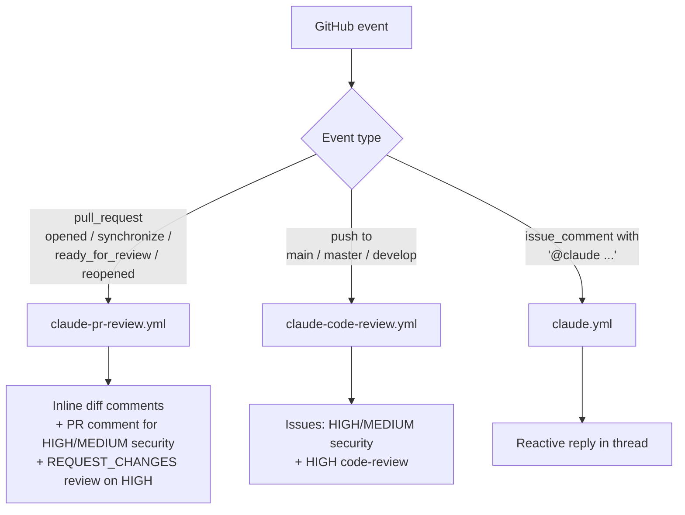
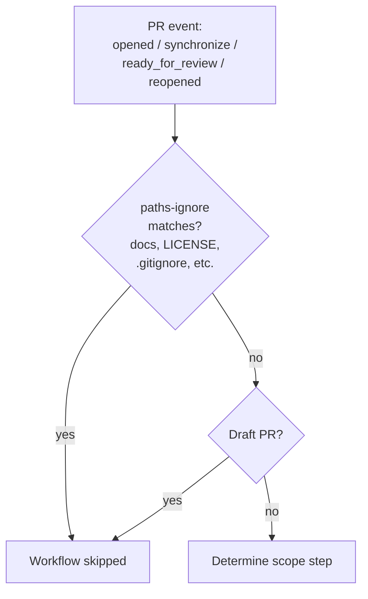
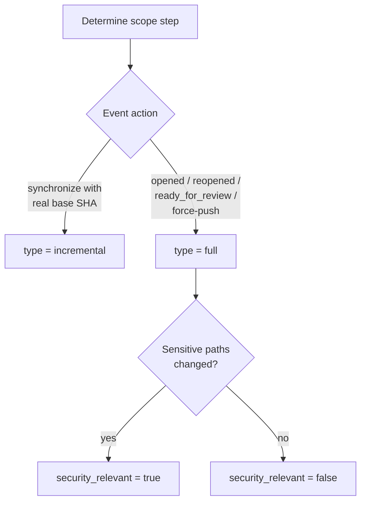
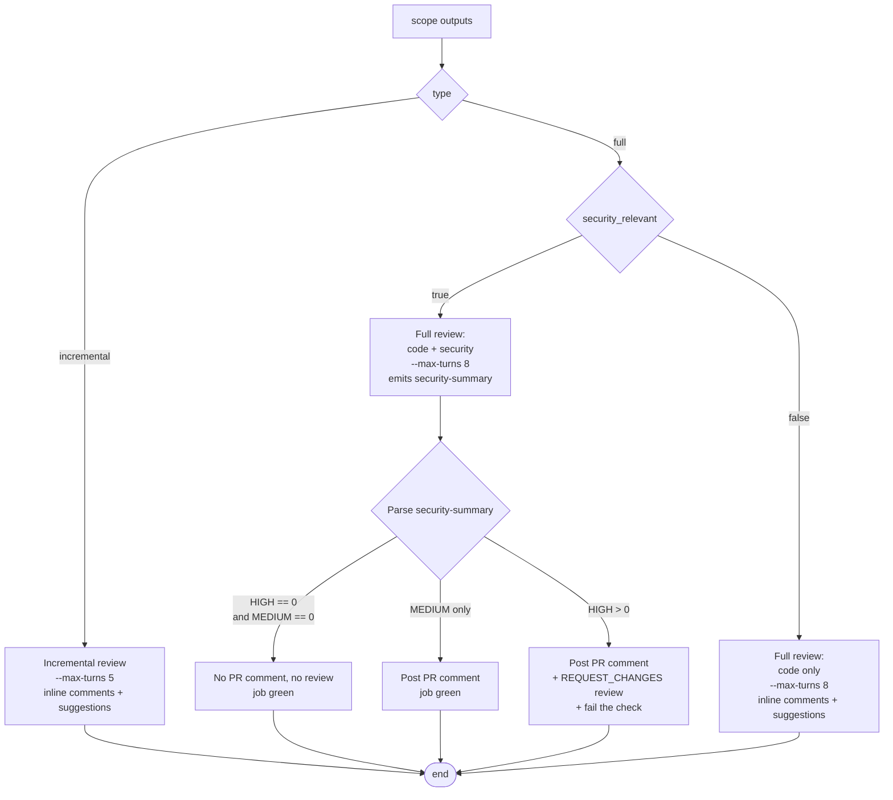
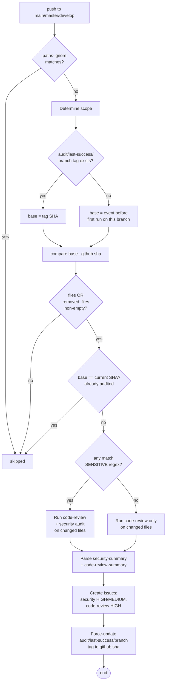

# GitHub Actions

This folder holds the project's GitHub-side automation. Today there are three
workflows; over time this is where the deployment and release pipelines will
land too.

| File | Trigger | Purpose |
| --- | --- | --- |
| [`workflows/claude-pr-review.yml`](workflows/claude-pr-review.yml) | Pull request events | Inline review comments + PR comment with HIGH/MEDIUM security findings; HIGH findings submit a REQUEST_CHANGES review and fail the check |
| [`workflows/claude-code-review.yml`](workflows/claude-code-review.yml) | Push to `main` / `master` / `develop` | Post-merge audit (code review + security) scoped to files changed since the last successful audit; files GitHub issues for HIGH/MEDIUM security and HIGH code-review findings |
| [`workflows/claude.yml`](workflows/claude.yml) | `@claude` mention in PR/issue comments | On-demand reactive bot (unchanged) |

The on-demand `claude.yml` is intentionally minimal — it does exactly what
its name says when someone writes `@claude …` in a comment. The rest of this
document walks through the two **automated review workflows** in detail.

---

## Why these workflows exist

Reviewing every pull request manually doesn't scale, and asking a human
reviewer to scan for security issues on top of correctness slows the
feedback loop further. These workflows use
[`anthropics/claude-code-action@v1`](https://github.com/anthropics/claude-code-action)
to run Claude as an automated reviewer at two points in the development
cycle:

1. **PR-time** (`claude-pr-review.yml`) — catches issues while the branch is
   still open and a human reviewer is already looking at it. Posts inline
   diff comments (with one-click suggestion blocks), and if HIGH security
   findings are present, posts a PR comment and submits a `REQUEST_CHANGES`
   review that blocks merge.
2. **Post-merge** (`claude-code-review.yml`) — a safety net for anything
   that slips through PR review. Runs on every push to protected branches,
   scoping each audit to only the files changed since the last successful
   run (via a marker git tag), so it never re-reviews the same code twice.

The trade-off with any LLM-based reviewer is **token cost**. Both workflows
put considerable effort into reviewing only what needs to be reviewed, and
only when it needs to be reviewed — see [Cost characteristics](#cost-characteristics).

---

## How the two reviewers split work

PR-time review catches issues during the human review window; post-merge
audit is the safety net for what slips through, and re-scopes incrementally
via a marker tag so it never re-reviews the same code twice.



---

## Prerequisites

Before the review workflows will run on a fresh clone of this repo, the
following has to be in place. None of this is per-PR — set it up once per
repository.

### Required repository secrets

Add these under **Settings → Secrets and variables → Actions → Repository
secrets**:

#### `CLAUDE_CODE_OAUTH_TOKEN` (required)

This is how `anthropics/claude-code-action@v1` authenticates against the
Claude API. Usage is billed pay-as-you-go to the Anthropic account that
minted the token.

To create one, run `claude setup-token` inside a local Claude Code session
and paste the resulting token into the secret. If you're starting from
scratch, the [official quickstart docs](https://code.claude.com/docs/en/github-actions)
have a `/install-github-app` slash command in Claude Code that automates
the whole setup — secret creation, GitHub App install, and a sample workflow.

#### `GITHUB_TOKEN` (built-in)

You don't need to add this yourself — GitHub Actions provides it
automatically on every workflow run. Both workflows use it for `gh api`
calls (fetching changed files, creating PR comments/reviews, creating issues,
pushing the marker tag).

### Required repository configuration

| Item | Why it matters | How to set it |
| --- | --- | --- |
| **Actions enabled** | Obviously the workflows can't run otherwise. | Settings → Actions → General → "Allow all actions and reusable workflows". |
| **Workflow permissions** | `claude-pr-review.yml` writes PR comments; `claude-code-review.yml` creates issues and pushes a tag. | Settings → Actions → General → Workflow permissions → "Read and write permissions". Each workflow also declares a per-job `permissions:` block. |
| **`fibanez6` is a collaborator** | Security and code-review issues are auto-assigned to this user. | Settings → Collaborators → Add people. If you fork this repo, change the assignee in the workflow YAML (search for `assignees:`). |

### What gets created automatically — don't pre-create these

- **Issue labels** (`security`, `high-severity`, `medium-severity`,
  `code-review`) are created idempotently by the workflows on first use.
- **The `code-review` Claude plugin** is installed automatically by
  `claude-pr-review.yml` via its `plugin_marketplaces` and `plugins` inputs.
  `claude-code-review.yml` does NOT install the plugin — it uses direct
  prompting instead (no PR URL exists at post-merge time).
- **An `ANTHROPIC_API_KEY` secret** is *not* needed. Both workflows use
  OAuth (`CLAUDE_CODE_OAUTH_TOKEN`).

### Optional: cloud-provider authentication

Both workflows use **direct Claude API auth**. If a future variant routes
through Amazon Bedrock or Google Vertex AI, the job's `id-token` permission
has to flip from `none` to `write` and an OIDC credential step gets added.
Rule 50.1 forbids static AWS keys — OIDC is the only acceptable upgrade path.

---

## How the PR-time reviewer works (`claude-pr-review.yml`)

At a high level: when a PR event arrives, the workflow first decides whether
it should run at all, then figures out how much of the PR to look at, then
picks one of three review modes.

### Step 1: should the workflow run at all?



Two early exits keep tokens off the table:

- `paths-ignore` drops PRs whose changes are entirely docs, markdown,
  `LICENSE`, `.gitignore`, or issue templates.
- Draft PRs are skipped via a job-level `if`. When the author marks the PR
  ready, the `ready_for_review` event fires and the workflow runs once.

A `concurrency` block (group: `claude-pr-review-<pr-number>`) cancels any
in-flight review when a newer push arrives.

### Step 2: full or incremental? sensitive or not?



- **`type`** is `incremental` for a `synchronize` event with a real base
  commit. Everything else is `full`.
- **`security_relevant`** is `true` when any changed file matches the
  `SENSITIVE` regex (see [Sensitive paths](#sensitive-paths-current-regex)).

### Step 3: dispatch and output format



All three Claude steps instruct the model to post every finding as an
**inline review comment** via `mcp__github_inline_comment__create_inline_comment`,
anchored to the specific file and line in the diff. When a concrete fix is
obvious, the inline comment includes a GitHub suggestion block:

````markdown
```suggestion
<replacement code>
```
````

so the author can click *Apply suggestion* or *Add suggestion to batch*.

LOW-severity findings appear only as inline comments (with suggestion blocks
where applicable). They are excluded from the `security-summary` block and
from the PR comment.

### Step 4: PR comment and reject on security findings

When the full-plus-security review produces a `security-summary` block:

1. If `HIGH == 0 && MEDIUM == 0` — no PR comment is posted, no review is
   submitted, the job concludes green. Findings are still visible as inline
   comments.
2. If MEDIUM findings only — a PR comment titled `## Security review` is
   posted listing the findings. No `REQUEST_CHANGES` review; job concludes
   green.
3. If any HIGH findings — the PR comment is posted, a `REQUEST_CHANGES`
   review is submitted from `github-actions[bot]` (visible on the
   *Conversation* tab and blocking merge in the sidebar), and
   `core.setFailed()` fails the job check (red X). The PR remains open.

No GitHub issues are created from this workflow. Issue creation is the
responsibility of the post-merge audit.

#### Known limitation — incremental pushes and security findings

Incremental review steps do **not** emit a `security-summary` block, so
the PR-comment / `REQUEST_CHANGES` flow only triggers on full events
(opened, reopened, ready\_for\_review, force-push). A `synchronize` push
that introduces a new HIGH security finding will surface it as an inline
comment only; the PR comment / reject flow won't fire until the next full
event.

This is deliberate: adding the security checklist to every incremental run
would roughly double its per-push token cost. The post-merge audit is the
authoritative safety net for anything that slips through.

---

## How the post-merge auditor works (`claude-code-review.yml`)

This workflow fires on every push to `main`, `master`, or `develop`. Its
job is to audit only the code that wasn't already audited — using a
lightweight git tag to track progress.



### Why a marker tag?

- No extra secrets needed — pushing a tag uses the workflow's built-in
  `GITHUB_TOKEN` with `contents: write`.
- Tags are git-native and persistent; visible with
  `git tag -l 'audit/last-success/*'`.
- The tag is force-updated only after a **successful** audit run. If an
  audit fails or is cancelled, the tag stays at the previously-known-good
  SHA — the next push re-audits from that base, so no coverage is lost.
- Delete the tag manually to force a full re-audit on the next push:
  `git tag -d audit/last-success/main && git push origin :refs/tags/audit/last-success/main`

### Audit scope per push

The `Determine scope` step computes:

- **Kept files** (`added`, `modified`, `renamed` — post-rename path): passed
  to Claude for review at HEAD.
- **Removed files**: passed separately so Claude can grep the tree for
  leftover imports or dead references.
- If a push consists entirely of deletions (no kept files), Claude is told
  so explicitly and asked only to check for leftover references.

### What Claude audits

The post-merge step does NOT use the `/code-review:code-review` plugin
(which requires a PR URL). Instead, it prompts Claude directly:

- A **code review** against project rules (Rules 10, 20, 40, 50, 60) on
  every changed file.
- A **security audit** (OWASP Top 10 + project-specific) only when
  `security_relevant == 'true'`.

Claude emits two fenced output blocks:

- `security-summary` — counts + one-line descriptions for HIGH/MEDIUM/LOW
  security findings. Format identical to the PR-time workflow (same parsing
  regex).
- `code-review-summary` — counts + one-line descriptions for HIGH-only
  code-review findings. MEDIUM and LOW code-review issues appear in prose
  but do not generate issues.

### Issue creation

The post-merge workflow creates GitHub issues — not PR comments — because
there is no open PR at this point:

| Finding type | Tiers that create issues | Labels |
| --- | --- | --- |
| Security | HIGH, MEDIUM | `security` + `high-severity` or `medium-severity` |
| Code review | HIGH only | `code-review` + `high-severity` |

All issues are assigned to `fibanez6` and link to the merge commit (not a
PR). The closing instruction asks the assignee to fix on a follow-up branch.

---

## A walk-through example

Five scenarios showing both workflows in action:

1. **Doc-only PR opened.** `paths-ignore` skips `claude-pr-review.yml`
   before it starts. Cost: 0 tokens. Merge triggers `claude-code-review.yml`,
   which also skips via `paths-ignore`. Total cost: 0 tokens.

2. **PR adding a chart component under `apps/dashboard/components/`.** Full
   review (code only) runs — non-sensitive paths, correctness review only.
   Inline suggestions posted. No security PR comment, no issues. Merge →
   post-merge audit runs code-review only on the chart files. No HIGH
   findings → no issues. Marker tag advances.

3. **PR adding a Route Handler that forgets the Auth.js check.** Full review
   (code + security) runs; Claude finds a HIGH finding (missing session
   check). PR comment with `### High-Severity Findings` posted; `REQUEST_CHANGES`
   review from `github-actions[bot]` blocks merge; job check fails red.
   Author fixes, pushes → incremental review runs (inline comments only,
   no PR comment). Author marks PR ready → full review (code + security)
   runs again → no HIGH → PR comment cleared (new comment), job green,
   merge unblocked. Merge → post-merge audits the now-clean files →
   no issues → marker tag advances.

4. **Hot-fix squash-merged directly from a branch.** Post-merge audit runs
   code-review on the touched files. Claude finds a HIGH code-review issue
   (e.g. unvalidated input in a utility). One `[Code Review] HIGH findings`
   issue filed and assigned to `fibanez6`. Marker tag advances.

5. **Cost-savings illustration: five sequential PRs merging to `main` through
   the afternoon, each touching ~3 files.** Without incremental scoping, each
   post-merge audit would re-review the cumulative delta from `event.before` —
   roughly 3, 6, 9, 12, 15 files as the day goes on. With the marker tag
   advancing after each successful audit, each run reviews only the new
   push's ~3 files. End-of-day token spend on the post-merge side is
   roughly **one-third of the naïve approach**.

---

## Configuration knobs

### PR-time review (`claude-pr-review.yml`)

| Knob | Location | What it controls |
| --- | --- | --- |
| `paths-ignore` | top of file, under `on.pull_request` | Globs that skip the workflow entirely |
| `concurrency.group` | top-level (`claude-pr-review-<pr>`) | One in-flight review per PR |
| `timeout-minutes` | `jobs.review` | Hard ceiling per run (25 min) |
| `--max-turns` | `claude_args` blocks | 8 for full reviews, 5 for incrementals |
| `--model` | `claude_args` blocks | Currently `claude-sonnet-4-6` |
| `--allowed-tools` | `claude_args` blocks | Allowlist: `Read`, `Glob`, `Grep`, `gh pr …`, `mcp__github_inline_comment__create_inline_comment` |
| `SENSITIVE` regex | `Determine scope` step | Which file paths trigger the security audit |

### Post-merge audit (`claude-code-review.yml`)

| Knob | Location | What it controls |
| --- | --- | --- |
| `branches` | `on.push` trigger | Protected branches that receive the audit (currently `main`, `master`, `develop`) |
| `paths-ignore` | top of file, under `on.push` | Same globs as PR-time — docs/markdown merges skip the audit |
| `concurrency.group` | top-level (`claude-code-review-<ref>`) | One in-flight audit per branch |
| `timeout-minutes` | `jobs.audit` | Hard ceiling per run (25 min) |
| `--max-turns` | `claude_args` | 8 for the combined audit |
| `--model` | `claude_args` | Currently `claude-sonnet-4-6` |
| `--allowed-tools` | `claude_args` | `Read`, `Glob`, `Grep`, `Bash(gh api:*)` — no PR tools (none exist at post-merge) |
| `SENSITIVE` regex | `Determine scope` step | Independently tunable from the PR-time regex |
| **Marker-tag namespace** | `audit/last-success/<branch>` | Delete to force a full re-audit on the next push |
| **Code-review severity threshold** | issue-creation script, `parseTier` calls | Currently HIGH-only for code-review; widen to add MEDIUM |
| `assignees` | issue-creation script | Currently `fibanez6` on all created issues |

The `SENSITIVE` regex is intentionally duplicated across both workflow files
so each can be tuned independently.

---

## Sensitive paths (current regex)

The security audit runs when any of the following paths change. Update the
regex in **both** workflow YAMLs and this list when the project's layout
shifts:

- `apps/dashboard/auth.ts`, `apps/dashboard/middleware.ts`
- `apps/dashboard/app/api/**` — Route Handlers (Rule 10's HTTP boundary)
- `apps/dashboard/lib/data/**`, `apps/dashboard/lib/dynamodb.ts`,
  `apps/dashboard/lib/auth/**`
- `apps/collector/**` — the AWS Lambda collector (Phase 6)
- `infrastructure/**`
- `packages/shared/src/env/**`, `packages/shared/src/auth/**`
- Any `.env*` file
- `package.json`, `pnpm-lock.yaml`
- `.github/workflows/**` — changes to CI itself

---

## Cost characteristics

| Lever | Saving |
| --- | --- |
| Draft PR skip + `paths-ignore` | Doc-only PRs and WIP drafts: zero Claude invocations in both workflows |
| `concurrency` with `cancel-in-progress` | Rapid pushes cancel the older in-flight review |
| Always-incremental on PR `synchronize` | Subsequent pushes to a PR review only the push delta |
| Path-aware `security_relevant` | PRs/merges touching only components or tests skip the security audit |
| `--max-turns` cap | Hard ceiling: 5 for incremental, 8 for full/audit |
| `--allowed-tools` allowlist | Action can't burn turns on speculative `Write`, `Edit`, or shell |
| `timeout-minutes: 25` | A stuck run dies after 25 minutes, not GitHub's 6-hour default |
| **Marker-tag incremental scoping on post-merge** | After the first audit, each merge to a protected branch reviews only the new push's files — not the cumulative delta from `event.before`. Typical saving on a busy day: an order of magnitude fewer tokens than re-auditing from scratch on every push |
| **Post-merge `code-review` plugin omitted** | `claude-code-review.yml` doesn't install the plugin — smaller startup, fewer marketplace fetches |

See the official [cost optimisation guidance](https://code.claude.com/docs/en/github-actions#ci-costs)
for the upstream recommendations.

---

## Overriding behaviour

| You want to… | Do this |
| --- | --- |
| Skip PR review on a specific PR | Mark it as a draft. Convert back to ready when you want the review. |
| Get a fresh PR review without pushing | Close and reopen the PR — fires `reopened`, which is a full event. |
| Force a full post-merge re-audit | Delete the marker tag: `git tag -d audit/last-success/main && git push origin :refs/tags/audit/last-success/main` |
| Block the workflow on a file class | Add the glob to `paths-ignore` at the top of the relevant YAML. |
| Force a security audit on a non-sensitive change | Touch a tracked sensitive file (e.g. add a no-op comment in `package.json`) or widen the `SENSITIVE` regex. |
| Change who is paged on findings | Edit `assignees: ['fibanez6']` in the relevant script. Remove the line for no auto-assignee. |
| Tighten the security audit | Edit the bulleted checklist in the relevant Claude prompt. |

---

## Troubleshooting

**The workflow didn't run on a PR.**
Check: is the PR a draft? Did the changed files match a `paths-ignore` glob?
Are Actions enabled on the repo? Was the run cancelled by a newer push?
The Actions tab shows skipped and cancelled runs explicitly.

**The action failed with an authentication error.**
The `CLAUDE_CODE_OAUTH_TOKEN` secret is missing, expired, or scoped to the
wrong Anthropic account. Run `claude setup-token` locally to mint a fresh
one and replace the secret value.

**The security audit didn't run on a change you expected to be sensitive.**
The `Determine scope` step writes its decision (and the count of sensitive
files matched) to the job summary. If your file isn't matched, the `SENSITIVE`
regex needs extending. Remember the regex is duplicated — update both YAMLs.

**A `synchronize` push introduced a security issue but no PR comment /
`REQUEST_CHANGES` happened.**
Expected behaviour — incremental review steps do not emit a `security-summary`
block. Look for the finding in the inline review comments. To trigger the
full PR-comment / reject flow, fire a full event: close + reopen the PR, or
push with `--force`.

**The post-merge audit re-ran everything instead of just the new commit.**
The marker tag is missing or pointed at the wrong SHA. Reset with:
`git tag -d audit/last-success/main && git push origin :refs/tags/audit/last-success/main`
The next push falls back to the full bootstrap delta and re-establishes the tag.

**The marker tag didn't advance after a successful audit run.**
The `Update last-success marker tag` step requires `contents: write`. If the
job ran with only `contents: read`, the tag push fails silently. Check the
step log in the Actions tab.

**Claude reported HIGH findings but no PR comment / issue was created.**
The downstream script parses a fenced `security-summary` block at the end
of the review output. If Claude added prose after the block, parsing fails.
The relevant step logs `No security-summary block found.` in that case.
Re-trigger a full event (close + reopen, or force-push) to get a fresh response.

**Issues are being created with the wrong assignee.**
Either `fibanez6` is no longer a collaborator on this fork, or the user
doesn't exist on this GitHub instance. Edit the `assignees` array in the
issue-creation script; remove the line entirely for no auto-assignee.

**You want to see what the action is actually doing.**
Add `--debug` to the relevant `claude_args` block and re-run. Remove the
flag once done — it's noisy.

---

## Related project rules and specs

The workflows' design is grounded in this repo's rules and specs. If you're
extending the workflows or arguing about whether a path is "sensitive," start
with these:

- [`.claude/rules/10-server-only-boundary.md`](../.claude/rules/10-server-only-boundary.md) — defines which paths are server-only (drives the `SENSITIVE` regex)
- [`.claude/rules/50-security-and-secrets.md`](../.claude/rules/50-security-and-secrets.md) — credential rules, no static AWS keys, gitleaks pre-commit, etc. Note: Rule 50.5 ("never bypass git hooks; never `--no-verify`") explicitly excludes the marker-tag force-push — that is a workflow-managed tag namespace, not a code commit.
- [`.claude/rules/30-phase-discipline.md`](../.claude/rules/30-phase-discipline.md) — branching and PR conventions the workflow audits PRs against
- [`docs/specs/2026-05-15-system-architecture.md`](../docs/specs/2026-05-15-system-architecture.md) — overall system design the security audit references
