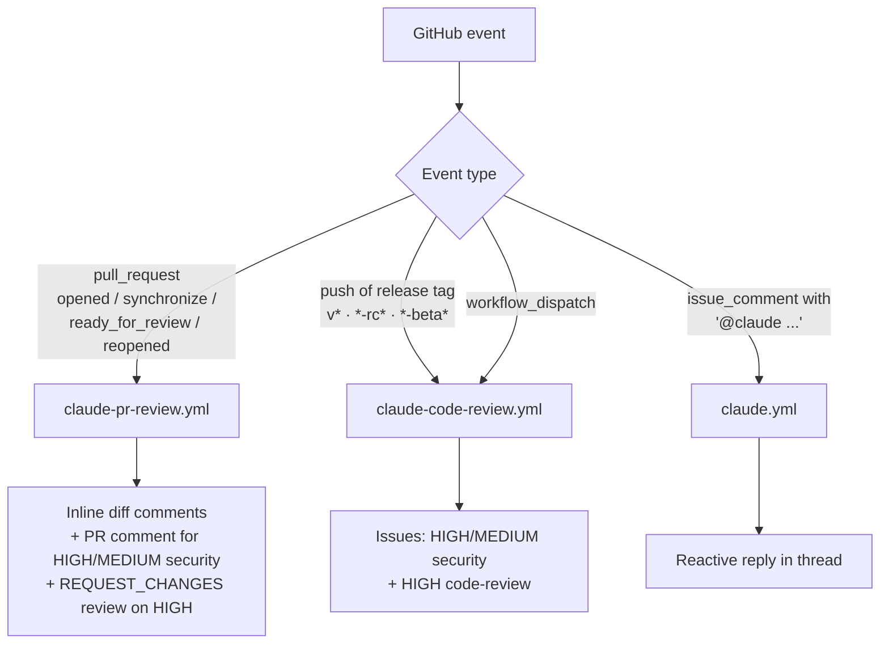
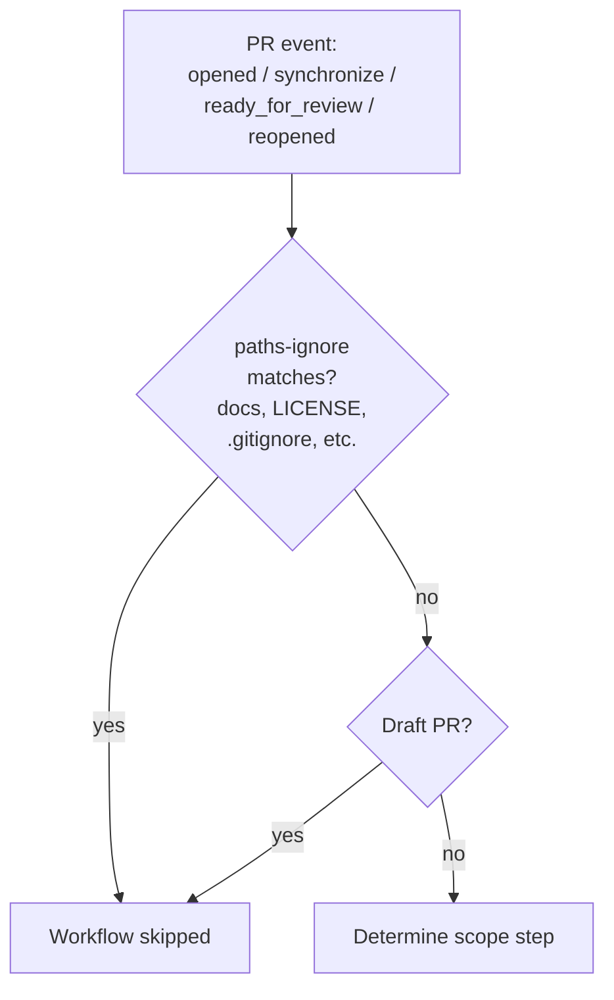
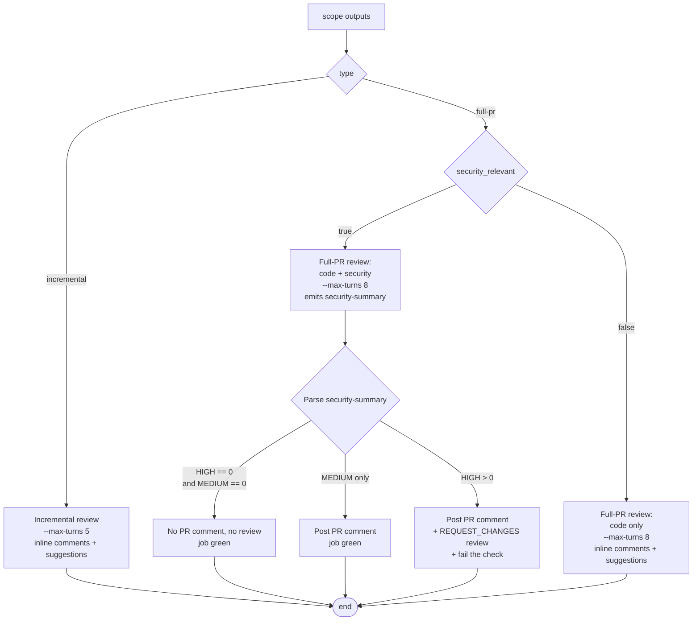
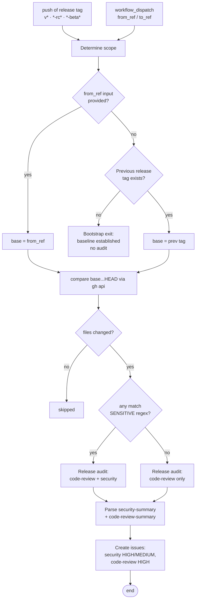

# GitHub Actions

This folder holds the project's GitHub-side automation.

| File | Trigger | Purpose |
| --- | --- | --- |
| [`workflows/claude-pr-review.yml`](workflows/claude-pr-review.yml) | Pull request events | Inline review comments + PR comment with HIGH/MEDIUM security findings; HIGH findings submit a REQUEST_CHANGES review and fail the check |
| [`workflows/claude-code-review.yml`](workflows/claude-code-review.yml) | Push of release tags (`v*`, `*-rc*`, `*-beta*`) and `workflow_dispatch` | Release audit (code review + security) scoped to commits since the previous release tag; files GitHub issues for HIGH/MEDIUM security and HIGH code-review findings |
| [`workflows/pr-title-lint.yml`](workflows/pr-title-lint.yml) | PR opened / edited / reopened | Validates PR title against Conventional Commits (required — PR title becomes the squash-merge commit on `main`) |
| [`workflows/claude.yml`](workflows/claude.yml) | `@claude` mention in PR/issue comments | On-demand reactive bot (unchanged) |

The on-demand `claude.yml` is intentionally minimal. The rest of this
document walks through the **automated review workflows** in detail.

---

## GitHub Flow

This project follows [GitHub Flow](https://docs.github.com/en/get-started/using-github/github-flow)
as codified in [Rule 31](../.claude/rules/31-github-flow.md).

```
main ─────────────────────────────────────────────────────▶
      │                          ▲
      └─ feature/… or fix/… ────┘
         (commits)         (squash-merge via PR)
```

- `main` is the **only** long-lived branch.
- All work branches off `main` and returns via pull request.
- PRs are **squash-merged** — the PR title becomes the sole commit on `main`.
- PR titles **must** follow Conventional Commits (enforced by `pr-title-lint.yml`).
- Releases are cut by pushing a version tag from `main` (see [Release process](#release-process)).

See [Rule 31](../.claude/rules/31-github-flow.md) for the full branching
convention, including hybrid naming for phase work (`feature/phase-<n>-<slug>`
per Rule 30).

---

## Required branch protection on `main`

Configure under Settings → Branches → Branch protection rules:

| Setting | Value |
| --- | --- |
| Require pull request before merging | ✅ (1 approval) |
| Required status checks | `Claude PR Review`, `PR Title Lint` |
| Require linear history | ✅ |
| Allow squash-merge only | ✅ — disable merge commits and rebase-merge in Settings → General → Pull Requests |
| Restrict force-push to `main` | ✅ |
| Restrict direct push to `main` | ✅ |
| Require review from Code Owners | Recommended once team > 1 |

Pre-existing project rules that are the manual counterparts:
Rule 30.5 ("never commit or merge directly to `main`") and
Rule 50.5 ("never `--no-verify`").

---

## Why these workflows exist

Reviewing every pull request manually doesn't scale, and asking a human
reviewer to scan for security issues on top of correctness slows the
feedback loop further. These workflows use
[`anthropics/claude-code-action@v1`](https://github.com/anthropics/claude-code-action)
to run Claude as an automated reviewer at two points in the development
cycle:

1. **PR-time** (`claude-pr-review.yml`) — catches issues while the branch is
   still open and a human reviewer is already looking at it. Posts inline
   diff comments (with one-click suggestion blocks), and if HIGH security
   findings are present, posts a PR comment and submits a `REQUEST_CHANGES`
   review that blocks merge.
2. **Release audit** (`claude-code-review.yml`) — a safety net for anything
   that slips through PR review. Runs when a release tag is pushed, scoping
   the audit to commits since the previous release tag, so it never re-reviews
   the same code twice.

The trade-off with any LLM-based reviewer is **token cost**. Both workflows
put considerable effort into reviewing only what needs to be reviewed, and
only when it needs to be reviewed — see [Cost characteristics](#cost-characteristics).

---

## How the two reviewers split work

PR-time review catches issues during the human review window; the release
audit is the safety net for what slips through, and scopes automatically to
the delta between release tags.



---

## Prerequisites

Before the review workflows will run on a fresh clone of this repo, the
following has to be in place. None of this is per-PR — set it up once per
repository.

### Required repository secrets

Add these under **Settings → Secrets and variables → Actions → Repository
secrets**:

#### `CLAUDE_CODE_OAUTH_TOKEN` (required)

This is how `anthropics/claude-code-action@v1` authenticates against the
Claude API. Usage is billed pay-as-you-go to the Anthropic account that
minted the token.

To create one, run `claude setup-token` inside a local Claude Code session
and paste the resulting token into the secret. If you're starting from
scratch, the [official quickstart docs](https://code.claude.com/docs/en/github-actions)
have a `/install-github-app` slash command in Claude Code that automates
the whole setup — secret creation, GitHub App install, and a sample workflow.

#### `GITHUB_TOKEN` (built-in)

You don't need to add this yourself — GitHub Actions provides it
automatically on every workflow run. Both workflows use it for `gh api`
calls (fetching changed files, creating PR comments/reviews, creating issues).

### Required repository configuration

| Item | Why it matters | How to set it |
| --- | --- | --- |
| **Actions enabled** | Obviously the workflows can't run otherwise. | Settings → Actions → General → "Allow all actions and reusable workflows". |
| **Workflow permissions** | `claude-pr-review.yml` writes PR comments; `claude-code-review.yml` creates issues. | Settings → Actions → General → Workflow permissions → "Read and write permissions". Each job declares its own least-privilege `permissions:` block — only the job that needs a scope holds it. |
| **`fibaneza` is a collaborator** | Security and code-review issues are auto-assigned to this user. | Settings → Collaborators → Add people. If you fork this repo, change the assignee in `.github/scripts/release-create-issues.cjs` (search for `assignees:`). |

### What gets created automatically — don't pre-create these

- **Issue labels** (`security`, `high-severity`, `medium-severity`,
  `code-review`) are created idempotently by the release audit on first use.
- **The `code-review` Claude plugin** is installed automatically by
  `claude-pr-review.yml` via its `plugin_marketplaces` and `plugins` inputs.
  `claude-code-review.yml` does NOT install the plugin — it uses direct
  prompting instead (no PR URL exists at release-audit time).
- **An `ANTHROPIC_API_KEY` secret** is *not* needed. Both workflows use
  OAuth (`CLAUDE_CODE_OAUTH_TOKEN`).

### Optional: cloud-provider authentication

Both workflows use **direct Claude API auth**. If a future variant routes
through Amazon Bedrock or Google Vertex AI, the job's `id-token` permission
has to flip from `none` to `write` and an OIDC credential step gets added.
Rule 50.1 forbids static AWS keys — OIDC is the only acceptable upgrade path.

---

## How the PR-time reviewer works (`claude-pr-review.yml`)

At a high level: when a PR event arrives, the workflow first decides whether
it should run at all, then figures out how much of the PR to look at, then
picks one of three review modes.

### Job structure — a `scope → review → security-gate` pipeline

The workflow is **three jobs wired with `needs:`**, so the Actions run page
renders it as a connected graph rather than a single box:

| Job | Depends on | Does | Permissions (least-privilege) |
| --- | --- | --- | --- |
| `scope` | — | Checkout, load the `SENSITIVE` regex, run `pr-determine-scope.sh` — which renders one scope summary (mode, security decision, collapsed file list) to the run summary and step log. The draft-PR `if` lives here (Step 1). | `contents:read`, `pull-requests:read` |
| `review` | `scope` | Runs exactly one of the three review modes via the `github-review` action (Step 3). | `contents:read`, `pull-requests:write`, `id-token:write` |
| `security-gate` | `scope`, `review` | Posts the security PR comment and `REQUEST_CHANGES` on HIGH findings (Step 4). Runs only for full-PR + security reviews. | `contents:read`, `pull-requests:write` |

Each job declares only the permissions it uses — the OIDC `id-token:write`
token is held solely by the `review` job that performs the Claude token
exchange, and write access to pull requests is held only where comments are
posted. Data flows between jobs through job `outputs:` (scope's `type` /
`files` / `security_relevant`, and the review's `review_result`). The "Step"
headings below map onto these jobs.

### Step 1: should the workflow run at all?



Two early exits keep tokens off the table:

- `paths-ignore` drops PRs whose changes are entirely docs, markdown,
  `LICENSE`, `.gitignore`, or issue templates.
- Draft PRs are skipped via a job-level `if`. When the author marks the PR
  ready, the `ready_for_review` event fires and the workflow runs once.

A `concurrency` block (group: `claude-pr-review-<pr-number>`) cancels any
in-flight review when a newer push arrives.

### Step 2: full-PR or incremental? sensitive or not?


- **`type`** is `incremental` for a `synchronize` event with a real base
  commit. Everything else is `full-pr`.
- **`security_relevant`** is `true` when any changed file matches the
  `SENSITIVE` regex (see [Sensitive paths](#sensitive-paths-current-regex)).

### Step 3: dispatch and output format



All three Claude steps instruct the model to post every finding as an
**inline review comment** via `mcp__github_inline_comment__create_inline_comment`,
anchored to the specific file and line in the diff. When a concrete fix is
obvious, the inline comment includes a GitHub suggestion block:

````markdown
```suggestion
<replacement code>
```
````

so the author can click *Apply suggestion* or *Add suggestion to batch*.

LOW-severity findings appear only as inline comments (with suggestion blocks
where applicable). They are excluded from the `security-summary` block and
from the PR comment.

### Step 4: PR comment and reject on security findings

When the full-PR + security review produces a `security-summary` block:

1. If `HIGH == 0 && MEDIUM == 0` — no PR comment is posted, no review is
   submitted, the job concludes green. Findings are still visible as inline
   comments.
2. If MEDIUM findings only — a PR comment titled `## Security review` is
   posted listing the findings. No `REQUEST_CHANGES` review; job concludes
   green.
3. If any HIGH findings — the PR comment is posted, a `REQUEST_CHANGES`
   review is submitted from `github-actions[bot]` (visible on the
   *Conversation* tab and blocking merge in the sidebar), and
   `core.setFailed()` fails the job check (red X). The PR remains open.

No GitHub issues are created from this workflow. Issue creation is the
responsibility of the release audit.

#### Known limitation — incremental pushes and security findings

Incremental review steps do **not** emit a `security-summary` block, so
the PR-comment / `REQUEST_CHANGES` flow only triggers on full-PR events
(opened, reopened, ready\_for\_review, force-push). A `synchronize` push
that introduces a new HIGH security finding will surface it as an inline
comment only; the PR comment / reject flow won't fire until the next
full-PR event.

This is deliberate: adding the security checklist to every incremental run
would roughly double its per-push token cost. The release audit is the
authoritative safety net for anything that slips through.

---

## How the release auditor works (`claude-code-review.yml`)

This workflow fires when a release tag is pushed to `main`. Its job is to
audit only the code added since the previous release — using the previous
release tag as the diff base.

It mirrors the PR reviewer's shape: **three jobs wired with `needs:`**.

| Job | Depends on | Does | Permissions (least-privilege) |
| --- | --- | --- | --- |
| `scope` | — | Checkout (full history + tags for `git describe`), load the `SENSITIVE` regex, run `release-determine-scope.sh` — which renders one scope summary (base→head, security decision, collapsed changed/removed file lists) to the run summary and step log. | `contents:read` |
| `audit` | `scope` | Runs the release audit via the `github-review` action. Skipped when `skip_audit == 'true'` (bootstrap or no changes). | `contents:read`, `id-token:write` |
| `create-issues` | `scope`, `audit` | Creates issues for HIGH/MEDIUM security + HIGH code-review findings. Runs only when the audit succeeded. | `contents:read`, `issues:write` |

The audit's `result` passes to `create-issues` via a job output; `issues:write`
is held only by the job that files issues, and `id-token:write` only by the
audit job.



### Release-tag scoping

The `Determine scope` step resolves the audit base automatically:

- **`workflow_dispatch` with `from_ref`:** use the provided ref as base.
- **Tag push (or dispatch without `from_ref`):** run
  `git describe --tags --abbrev=0 --match 'v*' --match '*-rc*' --match '*-beta*' <sha>^`
  to find the most recent release-pattern tag before the current SHA.
  The `--match` flags exclude stray ad-hoc tags (legacy `audit/last-success/*`,
  dev tags, etc.) from being selected as the base.

### Bootstrap skip — first release tag

When no previous release tag exists AND no `from_ref` dispatch input was
provided, the workflow exits cleanly after writing
`**Result:** baseline established — first release tag, no prior anchor to
diff against` to the job summary. No Claude invocation occurs, no issues
are filed. PR-time reviews cover the baseline code; subsequent releases
audit the delta.

### Ad-hoc audits via `workflow_dispatch`

Trigger `claude-code-review.yml` from the Actions tab with optional inputs:

| Input | Default | Effect |
| --- | --- | --- |
| `from_ref` | auto (git describe) | Base commit / tag / branch for the diff |
| `to_ref` | `github.sha` | Head commit / tag / branch for the diff |

This lets you audit an arbitrary range without pushing a real release tag —
useful during incident investigation or before cutting a release candidate.

### What Claude audits

The release audit does NOT use the `/code-review:code-review` plugin
(which requires a PR URL). Instead, it prompts Claude directly:

- A **code review** against project rules (Rules 10, 20, 40, 50, 60) on
  every changed file.
- A **security audit** (OWASP Top 10 + project-specific) only when
  `security_relevant == 'true'`.

Claude emits two fenced output blocks:

- `security-summary` — counts + one-line descriptions for HIGH/MEDIUM/LOW
  security findings.
- `code-review-summary` — counts + one-line descriptions for HIGH-only
  code-review findings. MEDIUM and LOW code-review issues appear in prose
  but do not generate issues.

### Issue creation

The release workflow creates GitHub issues — not PR comments — because
there is no open PR at release time:

| Finding type | Tiers that create issues | Labels |
| --- | --- | --- |
| Security | HIGH, MEDIUM | `security` + `high-severity` or `medium-severity` |
| Code review | HIGH only | `code-review` + `high-severity` |

All issues are assigned to `fibaneza` and link to the release commit. The
closing instruction asks the assignee to fix on a follow-up branch.

---

## Release process

Releases are cut from `main` only, by pushing a version tag.

```bash
# Recommended: generate release notes from commit history
gh release create vX.Y.Z --generate-notes

# Alternative: create and push a tag manually
git tag -a vX.Y.Z -m "Release vX.Y.Z" && git push origin vX.Y.Z
```

| Tag pattern | Meaning |
| --- | --- |
| `vMAJOR.MINOR.PATCH` | Final release |
| `vMAJOR.MINOR.PATCH-rc.N` | Release candidate |
| `vMAJOR.MINOR.PATCH-beta.N` | Beta / preview |

Pushing any of these triggers the release audit. The first tag ever is a
bootstrap (no audit); subsequent tags audit the delta from the prior tag.

---

## A walk-through example

Four scenarios showing both workflows in action:

1. **Doc-only PR opened.** `paths-ignore` skips `claude-pr-review.yml`.
   Cost: 0 tokens. The PR merges; no tag is pushed, so the release audit
   does not run. Total cost: 0 tokens.

2. **PR adding a chart component under `apps/dashboard/components/`.** Full-PR
   review (code only) runs — non-sensitive paths, correctness review only.
   Inline suggestions posted. No security PR comment. PR merges. When `v1.1.0`
   is eventually tagged, the release audit reviews the chart files (and
   everything else merged since `v1.0.0`). No HIGH findings → no issues.

3. **PR adding a Route Handler that forgets the Auth.js check.** Full-PR review
   (code + security) runs; Claude finds a HIGH finding (missing session
   check). PR comment with `### High-Severity Findings` posted; `REQUEST_CHANGES`
   review from `github-actions[bot]` blocks merge; job check fails red.
   Author fixes, pushes → incremental review runs (inline comments only,
   no PR comment). Author marks PR ready → full-PR review (code + security)
   runs again → no HIGH → PR comment cleared (new comment), job green,
   merge unblocked.

4. **Cost-savings illustration: five PRs merge to `main` over a sprint, then
   `v1.2.0` is tagged.** The release audit runs once, reviewing only the
   files changed across all five PRs combined, de-duplicated. Compare this
   to the old per-push model which would have run five separate audits
   (one per merge), potentially re-reviewing unchanged files. The release-tag
   model reviews each file exactly once per release cycle.

---

## Configuration knobs

### PR-time review (`claude-pr-review.yml`)

| Knob | Location | What it controls |
| --- | --- | --- |
| `paths-ignore` | top of file, under `on.pull_request` | Globs that skip the workflow entirely |
| `concurrency.group` | top-level (`claude-pr-review-<pr>`) | One in-flight review per PR |
| `timeout-minutes` | per job | 25 min on `jobs.review`; 5 min on `jobs.scope` and `jobs.security-gate` |
| `--max-turns` | `claude_args` blocks | 8 for full-PR reviews, 5 for incrementals |
| `--model` | `claude_args` blocks | Currently `claude-sonnet-4-6` |
| `--allowed-tools` | `claude_args` blocks | Allowlist: `Read`, `Glob`, `Grep`, `gh pr …`, `mcp__github_inline_comment__create_inline_comment` |
| `SENSITIVE` regex | `.github/scripts/lib/sensitive-paths.sh` | Which file paths trigger the security audit |

### Release audit (`claude-code-review.yml`)

| Knob | Location | What it controls |
| --- | --- | --- |
| `tags` | `on.push` trigger | Release tag patterns that trigger the audit |
| `concurrency.group` | top-level (`claude-code-review-<ref>`) | One in-flight audit per tag |
| `timeout-minutes` | per job | 25 min on `jobs.audit`; 5 min on `jobs.scope` and `jobs.create-issues` |
| `--max-turns` | `claude_args` | 8 for the combined audit |
| `--model` | `claude_args` | Currently `claude-sonnet-4-6` |
| `--allowed-tools` | `claude_args` | `Read`, `Glob`, `Grep`, `Bash(gh api:*)` — no PR tools |
| `SENSITIVE` regex | `.github/scripts/lib/sensitive-paths.sh` | Shared with PR-time review |
| **Code-review severity threshold** | `release-create-issues.cjs`, `parseTier` calls | Currently HIGH-only for code-review; widen to add MEDIUM |
| `assignees` | `release-create-issues.cjs` | Currently `fibaneza` on all created issues |

The `SENSITIVE` regex lives in a single file
(`.github/scripts/lib/sensitive-paths.sh`) sourced by both scope scripts —
edit once, applies everywhere.

---

## Sensitive paths (current regex)

The security audit runs when any of the following paths change. Update
`.github/scripts/lib/sensitive-paths.sh` when the project layout shifts
(one edit, both workflows pick it up):

- `apps/dashboard/auth.ts`, `apps/dashboard/middleware.ts`
- `apps/dashboard/app/api/**` — Route Handlers (Rule 10's HTTP boundary)
- `apps/dashboard/lib/data/**`, `apps/dashboard/lib/dynamodb.ts`,
  `apps/dashboard/lib/auth/**`
- `apps/collector/**` — the AWS Lambda collector (Phase 6)
- `infrastructure/**`
- `packages/shared/src/env/**`, `packages/shared/src/auth/**`
- Any `.env*` file
- `package.json`, `pnpm-lock.yaml`
- `.github/workflows/**` — changes to CI itself

---

## Cost characteristics

| Lever | Saving |
| --- | --- |
| Draft PR skip + `paths-ignore` | Doc-only PRs and WIP drafts: zero Claude invocations in both workflows |
| `concurrency` with `cancel-in-progress` | Rapid pushes cancel the older in-flight review |
| Always-incremental on PR `synchronize` | Subsequent pushes to a PR review only the push delta |
| Path-aware `security_relevant` | PRs/releases touching only components or tests skip the security audit |
| `--max-turns` cap | Hard ceiling: 5 for incremental, 8 for full-PR/audit |
| `--allowed-tools` allowlist | Action can't burn turns on speculative `Write`, `Edit`, or shell |
| `timeout-minutes: 25` | A stuck run dies after 25 minutes, not GitHub's 6-hour default |
| **Release-tag scoping** | After the first release, each tag audits only the delta from the previous tag. Five merges in a sprint → one audit covering the combined diff rather than five per-merge audits |
| **Post-merge `code-review` plugin omitted** | `claude-code-review.yml` doesn't install the plugin — smaller startup, fewer marketplace fetches |

See the official [cost optimisation guidance](https://code.claude.com/docs/en/github-actions#ci-costs)
for the upstream recommendations.

---

## Overriding behaviour

| You want to… | Do this |
| --- | --- |
| Skip PR review on a specific PR | Mark it as a draft. Convert back to ready when you want the review. |
| Get a fresh PR review without pushing | Close and reopen the PR — fires `reopened`, which is a full-PR event. |
| Force a release audit on an arbitrary range | Trigger `claude-code-review.yml` from the Actions tab via `workflow_dispatch`, providing `from_ref` and `to_ref`. |
| Run the release audit between tags (no real release) | Use `workflow_dispatch` — no tag push needed. |
| Block the workflow on a file class | Add the glob to `paths-ignore` at the top of `claude-pr-review.yml`. |
| Force a security audit on a non-sensitive change | Touch a tracked sensitive file (e.g. add a no-op comment in `package.json`) or widen the `SENSITIVE` regex in `lib/sensitive-paths.sh`. |
| Change who is paged on findings | Edit `assignees: ['fibaneza']` in `.github/scripts/release-create-issues.cjs`. Remove the line for no auto-assignee. |
| Tighten the security audit | Edit the bulleted checklist in the relevant Claude prompt. |

---

## Troubleshooting

**The workflow didn't run on a PR.**
Check: is the PR a draft? Did the changed files match a `paths-ignore` glob?
Are Actions enabled on the repo? Was the run cancelled by a newer push?
The Actions tab shows skipped and cancelled runs explicitly.

**The action failed with an authentication error.**
The `CLAUDE_CODE_OAUTH_TOKEN` secret is missing, expired, or scoped to the
wrong Anthropic account. Run `claude setup-token` locally to mint a fresh
one and replace the secret value.

**The security audit didn't run on a change you expected to be sensitive.**
The `scope` job's `Determine scope` step prints the scope summary — mode,
security-audit decision (with the sensitive-file count), and the file set under
review — to both the step log and the run summary. If your file isn't matched,
the `SENSITIVE` regex needs extending. Edit
`.github/scripts/lib/sensitive-paths.sh` — one change, both scope scripts pick
it up.

**A `synchronize` push introduced a security issue but no PR comment /
`REQUEST_CHANGES` happened.**
Expected behaviour — incremental review steps do not emit a `security-summary`
block. Look for the finding in the inline review comments. To trigger the
full PR-comment / reject flow, fire a full-PR event: close + reopen the PR, or
push with `--force`.

**The release audit ran but no issues were created.**
Either Claude found no HIGH/MEDIUM findings, or the `security-summary` /
`code-review-summary` block was missing from its output (Claude added prose
after the block). The step logs `No security-summary block found.` in that
case. Re-trigger via `workflow_dispatch` to get a fresh response.

**The release audit ran with the wrong base.**
Check the `Determine scope` step summary — it logs which base was resolved.
If `git describe` picked up a stray tag, those tags predate the `--match`
pattern; delete them and re-run. Use `workflow_dispatch` with an explicit
`from_ref` to override.

**Issues are being created with the wrong assignee.**
Either `fibaneza` is no longer a collaborator on this fork, or the user
doesn't exist on this GitHub instance. Edit `assignees` in
`.github/scripts/release-create-issues.cjs`; remove the line entirely for
no auto-assignee.

**You want to see what the action is actually doing.**
Add `--debug` to the relevant `claude_args` block and re-run. Remove the
flag once done — it's noisy.

---

## Related project rules and specs

The workflows' design is grounded in this repo's rules and specs:

- [`.claude/rules/31-github-flow.md`](../.claude/rules/31-github-flow.md) — GitHub Flow convention: branching, squash-merge, release tagging
- [`.claude/rules/30-phase-discipline.md`](../.claude/rules/30-phase-discipline.md) — phase branching (`feature/phase-<n>-<slug>`)
- [`.claude/rules/10-server-only-boundary.md`](../.claude/rules/10-server-only-boundary.md) — defines which paths are server-only (drives the `SENSITIVE` regex)
- [`.claude/rules/50-security-and-secrets.md`](../.claude/rules/50-security-and-secrets.md) — credential rules, no static AWS keys, gitleaks pre-commit
- [`docs/specs/2026-05-15-system-architecture.md`](../docs/specs/2026-05-15-system-architecture.md) — overall system design the security audit references
