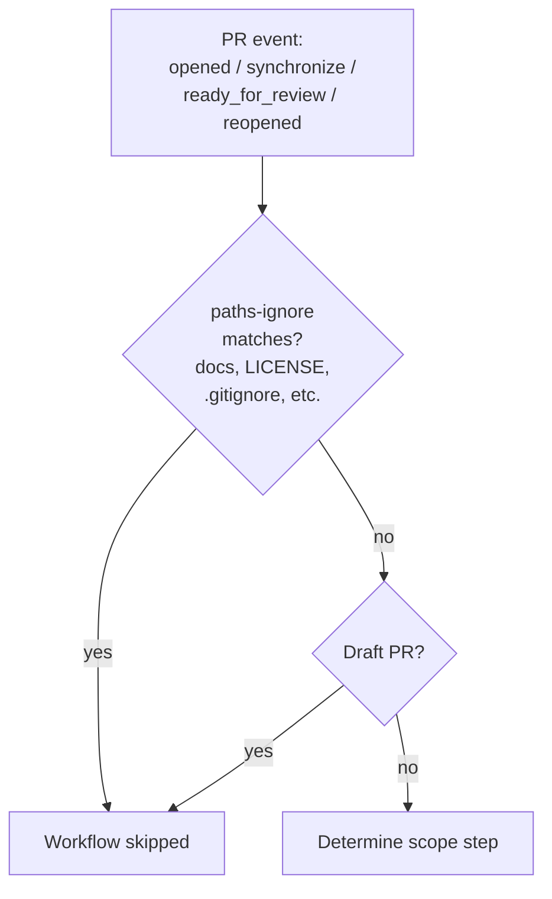
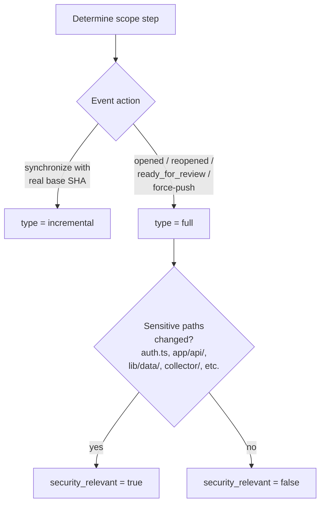
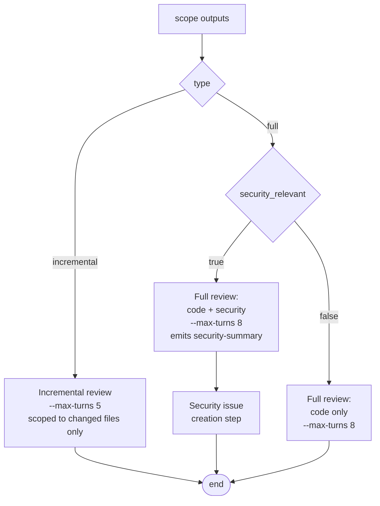
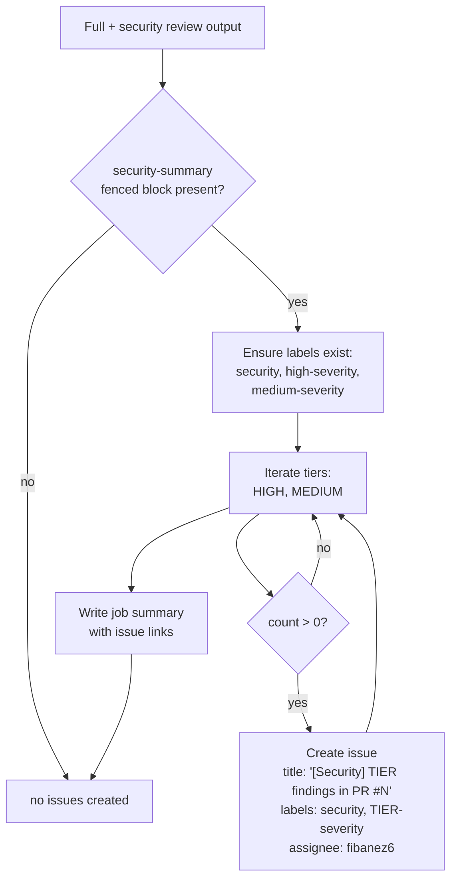

# GitHub Actions

This folder holds the project's GitHub-side automation. Today there are two
workflows; over time this is where the deployment and release pipelines will
land too.

| File | Purpose |
| --- | --- |
| [`workflows/claude-code-review.yml`](workflows/claude-code-review.yml) | Automated AI code + security review on every pull request |
| [`workflows/claude.yml`](workflows/claude.yml) | On-demand `@claude` mention bot for PR / issue threads |

The on-demand `claude.yml` is intentionally minimal — it does exactly what
its name says when someone writes `@claude …` in a comment, and there's
not much to configure. The rest of this document walks through the
**automatic review workflow** in detail: what it does, why it's set up the
way it is, what you need before it can run, and how to change its
behaviour.

---

## Why this workflow exists

Reviewing every pull request manually doesn't scale, and asking a human
reviewer to scan for security issues on top of correctness slows the
feedback loop further. This workflow uses
[`anthropics/claude-code-action@v1`](https://github.com/anthropics/claude-code-action)
to run Claude as an automated reviewer on every PR. It posts inline
comments on the diff, files GitHub issues for HIGH and MEDIUM severity
security findings, and updates the PR's check run with a verdict.

The trade-off with any LLM-based reviewer is **token cost**: each
invocation bills the Anthropic account whose OAuth token the workflow
uses. A naive setup ("run a full review on every event") gets expensive
fast on a busy repo. This workflow therefore puts a lot of effort into
**reviewing only what needs to be reviewed**, and **only when it needs to
be reviewed** — see [Cost characteristics](#cost-characteristics) for the
full list of optimisations. The aim is roughly half-to-one-third of the
token spend of a default configuration, without weakening review
coverage on substantive changes.

---

## Prerequisites

Before the review workflow will run on a fresh clone of this repo, the
following has to be in place. None of this is per-PR — set it up once per
repository.

### Required repository secrets

Add these under **Settings → Secrets and variables → Actions → Repository
secrets**:

#### `CLAUDE_CODE_OAUTH_TOKEN` (required)

This is how `anthropics/claude-code-action@v1` authenticates against the
Claude API. Usage is billed pay-as-you-go to the Anthropic account that
minted the token.

To create one, run `claude setup-token` inside a local Claude Code session
and paste the resulting token into the secret. If you're starting from
scratch, the [official quickstart docs](https://code.claude.com/docs/en/github-actions)
have a `/install-github-app` slash command in Claude Code that automates
the whole setup — secret creation, GitHub App install, and a sample
workflow.

#### `GITHUB_TOKEN` (built-in)

You don't need to add this yourself — GitHub Actions provides it
automatically on every workflow run. The workflow uses it for `gh api`
calls (fetching changed files, detecting force-pushes) and for creating
security issues and labels.

### Required repository configuration

A handful of repository-level settings need to be in the right state:

| Item | Why it matters | How to set it |
| --- | --- | --- |
| **Actions enabled** | Obviously the workflow can't run otherwise. | Settings → Actions → General → "Allow all actions and reusable workflows". |
| **Workflow permissions** | The job needs to write PR comments and create issues. | Settings → Actions → General → Workflow permissions → "Read and write permissions". The workflow YAML also declares a per-job `permissions:` block as a belt-and-braces measure. |
| **`fibanez6` is a collaborator** | Security issues are auto-assigned to this user. | Settings → Collaborators → Add people. If you fork this repo, change the assignee in the workflow YAML (search for `assignees:`). |

### What gets created automatically — don't pre-create these

A few things look like prerequisites but are handled at workflow runtime:

- **Issue labels** (`security`, `high-severity`, `medium-severity`) are
  created idempotently by the workflow on first use, so you can ignore
  them until they appear.
- **The `code-review` Claude plugin** is installed by the action itself
  via its `plugin_marketplaces` and `plugins` inputs — no manual install
  step is needed.
- **An `ANTHROPIC_API_KEY` secret** is *not* needed. The workflow uses
  OAuth (`CLAUDE_CODE_OAUTH_TOKEN`) instead.

### Optional: cloud-provider authentication

This workflow uses **direct Claude API auth**. If a future variant routes
through Amazon Bedrock or Google Vertex AI, the job's `id-token`
permission has to flip back from `none` to `write` and an OIDC credential
step gets added — see the
[official multi-provider docs](https://code.claude.com/docs/en/github-actions#using-with-amazon-bedrock-%26-google-vertex-ai)
for the pattern. Rule 50.1 of this project forbids static AWS keys, so
OIDC is the only acceptable upgrade path.

---

## How the workflow decides what to do

At a high level: when a PR event arrives, the workflow first decides
whether it should run at all, then figures out **how much** of the PR to
look at, then picks one of three review modes.

The three review modes exist because not every PR needs the same level of
scrutiny:

1. **Full review (code + security)** — a fresh PR (or a force-push) that
   touches security-sensitive paths. Claude reads the diff in its full
   project context and produces both a correctness review and a security
   audit in a single invocation, then emits a structured summary block
   that the workflow parses to create issues.
2. **Full review (code only)** — a fresh PR that doesn't touch
   security-sensitive paths. Same correctness review as above, but the
   security audit is skipped entirely. This is the common case for
   front-end-only or test-only changes.
3. **Incremental review** — a subsequent push to an existing PR. The
   reviewer focuses only on the files that changed since the previous
   push, on the assumption that the rest of the PR was already reviewed
   on the previous run.

### Step 1: should the workflow run at all?

Two early exits keep tokens off the table for changes that don't warrant a
review:

- The `paths-ignore` filter at the top of the workflow drops PRs whose
  changes are entirely under `docs/**`, markdown files, `LICENSE`,
  `.gitignore`, or issue templates. Documentation reviews itself when a
  human author reads the change.
- Draft PRs are skipped via a job-level `if`. Draft PRs are
  work-in-progress by definition; reviewing them prematurely wastes
  tokens on code the author hasn't finished writing. When the author
  marks the PR ready, the `ready_for_review` event fires and the
  workflow runs once at that point.

A `concurrency` block at the top of the workflow also cancels any
in-flight review when a newer push arrives, so a `git push` followed by a
`git push --force` 30 seconds later doesn't pay for two parallel
reviews.

### Step 2: full or incremental? sensitive or not?

If the workflow does run, the first job step (`Determine scope`) computes
two outputs:

- **`type`** is `incremental` when the event is a `synchronize` (a push
  to an existing PR) and GitHub gives us a real base commit. In every
  other case — first open, reopen, ready-for-review, or a force-push
  that nulls out the base — it's `full`.
- **`security_relevant`** is `true` when at least one changed file
  matches a regex of paths the project considers security-sensitive
  (Auth.js entry points, server-only data access, the AWS Lambda
  collector, env / lockfiles, the workflow itself). The exact list is in
  [Sensitive paths](#sensitive-paths-current-regex) below; it derives
  from project Rules 10 and 50.

These two outputs decide which of the three review modes runs.

### Step 3: dispatch to the right review

Each of the three review steps is an `anthropics/claude-code-action@v1`
invocation with its own prompt and `claude_args` block. The `claude_args`
cap turns, pin the model to `claude-sonnet-4-6`, and restrict the
allowed tool list to what the reviewer actually needs (`Read`, `Glob`,
`Grep`, a handful of `gh pr …` commands, and the inline-comment MCP
tool). The action cannot use `Write`, `Edit`, or arbitrary shell — a
defence-in-depth measure as well as a way to stop Claude from burning
turns on speculative file writes.

### Step 4: turn the security summary into GitHub issues

When the security-audit branch runs, Claude is instructed to end its
response with a fenced `security-summary` block that lists per-severity
counts and one-line descriptions of HIGH and MEDIUM findings. A
follow-up `actions/github-script` step parses this block and opens one
GitHub issue per non-zero severity tier:

LOW-severity findings are still reported in the summary block, but they
don't generate issues. The reasoning: HIGH and MEDIUM are actionable
before merge; LOW is best-practice noise that the inline review comments
already surface.

---

## A walk-through example

To make the dispatch logic concrete, here's what happens for a few
representative PRs:

1. **You open a draft PR with a docs-only change.** `paths-ignore` skips
   the workflow before it starts. Cost: 0 tokens. The draft status would
   have skipped it anyway.
2. **You convert that draft to ready and add a new chart component under
   `apps/dashboard/components/charts/`.** The `ready_for_review` event
   fires. `paths-ignore` no longer matches; the PR is not draft; scope is
   `full`; sensitive paths did **not** change → `Full review (code only)`
   runs with `--max-turns 8`. No security issues are created. Cost: one
   correctness review.
3. **You push a fix to that PR adding a single Recharts import.**
   `synchronize` event fires. The previous run is cancelled (concurrency).
   Scope is `incremental` → `Incremental review` runs with `--max-turns
   5`, looking only at the one file you just changed. Cost: a small
   delta review.
4. **You open a new PR that adds a Route Handler under
   `apps/dashboard/app/api/usage/route.ts`.** Scope is `full`;
   sensitive paths **did** change → `Full review (code + security)`
   runs. Claude reviews correctness, then audits for missing Auth.js
   checks, AWS SDK boundary violations, hardcoded secrets, etc., and
   emits a `security-summary` block. If it finds one HIGH and two MEDIUM
   issues, two GitHub issues are filed (one per tier) and assigned to
   `fibanez6`. Cost: one combined correctness + security review.

The common case in this repo (front-end changes that don't touch
sensitive paths) costs one mid-sized full review on PR open and a small
incremental review per push. PRs that touch `lib/data/**`,
`app/api/**`, or the collector pay for the security audit as well — but
only on the events that warrant it, never on every push.

---

## Configuration knobs

All knobs live inside
[`workflows/claude-code-review.yml`](workflows/claude-code-review.yml).
Most users won't need to touch these; they're documented here so that
future maintainers don't have to reverse-engineer the file.

| Knob | Location in the YAML | What it controls |
| --- | --- | --- |
| `paths-ignore` | top of file, under `on.pull_request` | File globs that skip the workflow entirely. Currently: docs, markdown, license, gitignore, issue templates. |
| `concurrency.group` | top-level | One in-flight review per PR; new pushes cancel the previous run. |
| `timeout-minutes` | `jobs.review` | Hard ceiling on a single run (currently 25 min). Stops runaway token spend if the action ever loops. |
| `--max-turns` | inside each `claude_args` block | Per-invocation turn cap: **8** for full reviews, **5** for incrementals. The action's own default is 10, which is more than the `/code-review:code-review` skill needs. |
| `--model` | inside each `claude_args` block | Currently pinned to `claude-sonnet-4-6`. Switch to `claude-haiku-4-5-20251001` for cheaper incremental passes if the trade-off is acceptable. |
| `--allowed-tools` | inside each `claude_args` block | Allowlist of tools the action may invoke. Anything not listed (`Write`, `Edit`, arbitrary shell, etc.) is blocked. |
| `SENSITIVE` regex | inside the `Determine scope` step | Which file paths trigger the security audit. Source-of-truth for "what counts as sensitive in this repo". |
| `assignees` | inside the issue-creation script | Who is auto-paged on HIGH / MEDIUM security findings. Currently `fibanez6`. |

### Sensitive paths (current regex)

The full review runs the security audit only when the PR touches one of
the following. Update the regex in the YAML **and** this list together
when the project's layout shifts:

- `apps/dashboard/auth.ts`, `apps/dashboard/middleware.ts`
- `apps/dashboard/app/api/**` — Route Handlers (Rule 10's HTTP boundary)
- `apps/dashboard/lib/data/**`, `apps/dashboard/lib/dynamodb.ts`, `apps/dashboard/lib/auth/**`
- `apps/collector/**` — the AWS Lambda collector (Phase 6)
- `infrastructure/**`
- `packages/shared/src/env/**`, `packages/shared/src/auth/**`
- Any `.env*` file
- `package.json`, `pnpm-lock.yaml`
- `.github/workflows/**` — changes to CI itself

---

## Cost characteristics

Cumulative effect of the optimisations baked into this workflow:

| Lever | Saving |
| --- | --- |
| Draft PR skip + `paths-ignore` | Doc-only PRs and WIP drafts: zero Claude invocations |
| `concurrency` with `cancel-in-progress` | Rapid pushes: the older review is cancelled mid-flight instead of running to completion |
| Always-incremental on `synchronize` | Subsequent pushes review only the push delta, not the whole PR diff |
| Path-aware `security_relevant` | PRs touching only components, tests, or other non-sensitive paths skip the security audit entirely |
| `--max-turns` cap | Hard ceiling on action iterations (5 for incrementals, 8 for full) instead of the default 10 |
| `--allowed-tools` allowlist | The action can't burn turns on speculative `Write`, `Edit`, or shell |
| `timeout-minutes: 25` | A stuck or looping run dies after 25 minutes instead of GitHub's 6-hour default |

See the official
[cost optimisation guidance](https://code.claude.com/docs/en/github-actions#ci-costs)
for the upstream recommendations these are derived from.

---

## Overriding behaviour

The most common reasons to deviate from the defaults:

| You want to… | Do this |
| --- | --- |
| Skip review on a specific PR | Mark it as a draft. Convert back to ready when you want the review. |
| Get a fresh review without pushing | Close and reopen the PR — that fires `reopened`, which is a full event. |
| Block the workflow on a file class | Add the glob to `paths-ignore` at the top of the YAML. |
| Force a security audit even on a non-sensitive change | Either touch a tracked sensitive file (e.g. add a no-op comment in `package.json`), or widen the `SENSITIVE` regex temporarily. |
| Change who is paged on HIGH / MEDIUM findings | Edit `assignees: ['fibanez6']` in the issue-creation script. Removing the line means no auto-assignee. |
| Tighten the security audit | Edit the bulleted checklist under the `Full review (code + security)` step's prompt. Project-specific checks live there; OWASP Top 10 is implicit. |

---

## Troubleshooting

**The workflow didn't run on a PR.**
Check, in order: is the PR a draft? Did the changed files match a
`paths-ignore` glob? Are Actions enabled on the repo? Was the run
cancelled mid-flight by a newer push (concurrency)? The Actions tab
shows skipped and cancelled runs explicitly.

**The action failed with an authentication error.**
The `CLAUDE_CODE_OAUTH_TOKEN` secret is either missing, expired, or
scoped to the wrong Anthropic account. Run `claude setup-token`
locally to mint a fresh one and replace the secret value.

**The security audit didn't run on a change you expected to be sensitive.**
The `Determine scope` step writes its decision (and the count of
sensitive files it matched) to the job summary in the Actions log.
Read that first — if your file isn't matched, the regex needs
extending.

**Claude reported HIGH findings but no issue was created.**
The script parses a fenced `security-summary` block at the end of the
review output. If Claude added prose after the block (e.g. "Hope this
helps!"), parsing fails. The `Create issues for security findings`
step logs `No security-summary block found.` in that case. Re-run the
review (close + reopen the PR) to get a fresh response.

**Issues are being created with the wrong assignee.**
Either `fibanez6` is no longer a collaborator on this fork, or the
user doesn't exist on this GitHub instance. Edit the `assignees` array
in the issue-creation script; remove the line entirely if no
auto-assignee is wanted.

**You want to see what the action is actually doing.**
Add `--debug` to the relevant `claude_args` block and re-run. The
action will dump its full conversation log into the Actions output.
Remove the flag once you're done — it's noisy.

---

## Related project rules and specs

The workflow's design is grounded in this repo's rules and specs. If
you're extending the workflow or arguing about whether a path is
"sensitive," start with these:

- [`.claude/rules/10-server-only-boundary.md`](../.claude/rules/10-server-only-boundary.md) — defines which paths are server-only (drives the `SENSITIVE` regex)
- [`.claude/rules/50-security-and-secrets.md`](../.claude/rules/50-security-and-secrets.md) — credential rules, no static AWS keys, gitleaks pre-commit, etc.
- [`.claude/rules/30-phase-discipline.md`](../.claude/rules/30-phase-discipline.md) — branching and PR conventions the workflow audits PRs against
- [`docs/specs/2026-05-15-system-architecture.md`](../docs/specs/2026-05-15-system-architecture.md) — overall system design the security audit references
