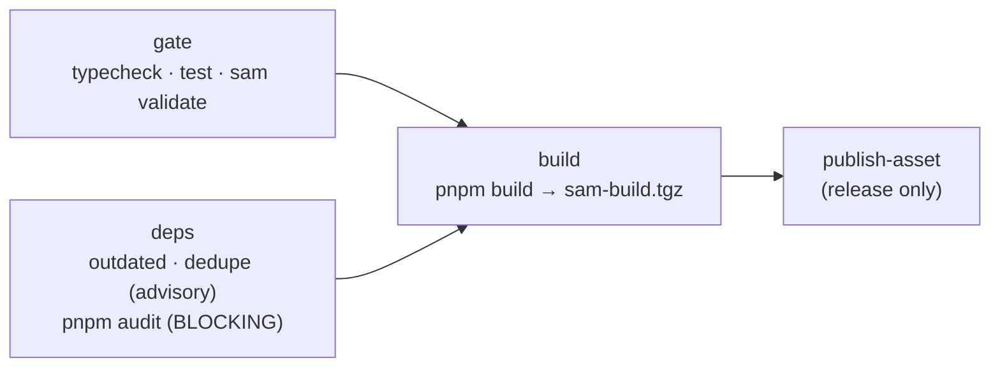
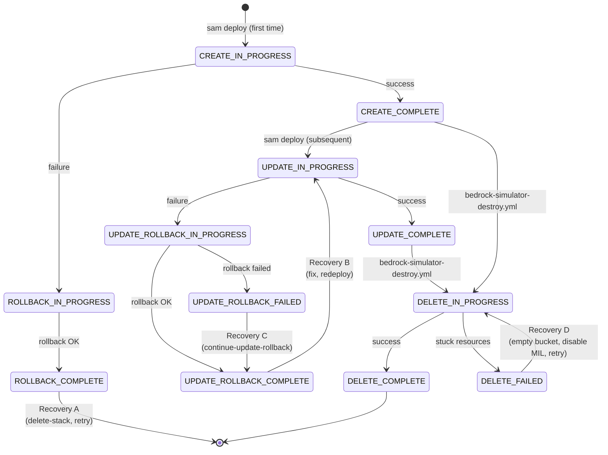

# Bedrock simulator — operational guide

The playbook for the standalone Bedrock test harness in [`tools/bedrock-simulator/`](../../tools/bedrock-simulator/). Read the spec ([`docs/specs/2026-05-24-bedrock-simulator.md`](../specs/2026-05-24-bedrock-simulator.md)) for the design; this file is the runbook.

**Reminder:** every `aws` / `sam` command in this guide runs **from an operator terminal with sandbox-account SSO credentials** (or from the GitHub Actions runner). Claude Code is hard-blocked from `sam delete`, `aws cloudformation delete-stack`, and `aws *delete-*` via [`.claude/settings.json`](../../.claude/settings.json) — that is by design. If you find yourself wanting Claude to run a destructive command, you are doing something wrong.

## Prerequisites runbook

These six items are operator one-time setup. None can be created by the SAM template.

### 1. Sandbox member account in the AWS Organisation

Required for the simulator itself. The CloudWatch cross-account observability link to the dashboard's observability account is a **deferred prerequisite** — Phase 6 hasn't built that account yet, so set up the link when Phase 6 begins, not now.

```bash
# Verify the sandbox is in the org (run in management account)
aws organizations list-accounts \
  [--profile <your-profile-name>] \
  --query 'Accounts[?Status==`ACTIVE`].[Id,Name]' \
  --output table

# Later, when the observability account exists, enrol the sandbox as a CWO source.
# (Not done today.)
```

### 2. Bedrock model access

**As of mid-2025, the Bedrock Model Access page has been retired.** Serverless foundation models are now automatically enabled on first invocation — no manual activation required. For Anthropic models, first-time users in a new account may be prompted to submit use case details before the first call succeeds; follow the console link in the error response if that happens.

The template defaults (after updating from the original Claude 4 May 2025 IDs) are:

| Canonical key | Model ID | Invocation | Regions needed |
|---|---|---|---|
| `claude-opus` | `anthropic.claude-sonnet-4-6` | `us.*` cross-region profile | auto-enabled on first call in each region |
| `claude-sonnet` | `anthropic.claude-sonnet-4-6` | `us.*` cross-region profile | auto-enabled on first call in each region |
| `claude-haiku` | `anthropic.claude-haiku-4-5-20251001-v1:0` | `us.*` cross-region profile | auto-enabled on first call in each region |
| `other` | `meta.llama3-3-70b-instruct-v1:0` | bare ID, `us-east-1` only | auto-enabled on first call |

The `us.*` cross-region profiles for Sonnet route across `us-east-1`, `us-west-2`, and `us-east-2` — access activates in each region on first routing there, which the deploy workflow's smoke test triggers automatically.

```bash
# Verify active models in the sandbox account (sanity check):
aws bedrock list-foundation-models --region us-east-1 \
  --profile <aws-profile> \
  --query 'modelSummaries[?modelLifecycle.status==`ACTIVE` && contains(modelId,`anthropic`)].[modelId]' \
  --output text

# Optional: trigger a first invocation to surface any use-case-details prompt early.
# Claude 4.x models (including Haiku 4.5) require the us.* cross-region inference
# profile prefix — bare model IDs fail with "on-demand throughput isn't supported".
# Use the Converse API (bedrock-runtime converse) rather than invoke-model for
# newer models; it handles the request/response envelope automatically.
aws bedrock-runtime converse \
  --profile <aws-profile> \
  --region us-east-1 \
  --model-id us.anthropic.claude-haiku-4-5-20251001-v1:0 \
  --messages '[{"role":"user","content":[{"text":"hi"}]}]'

# With inference config
aws bedrock-runtime converse \
    --profile <aws-profile> \
    --model-id arn:aws:bedrock:us-east-1:469515554732:inference-profile/global.anthropic.claude-haiku-4-5-20251001-v1:0 \
    --messages '[{"role":"user","content":[{"text":"hi"}]}]' \
    --inference-config '{"maxTokens":32000,"stopSequences":[],"temperature":1}' \
    --additional-model-request-fields '{"top_k":250}' \
    --performance-config '{"latency":"standard"}' \
    --region us-east-1
```

### 3. Bedrock per-region service quotas

Defaults are tight. Verify quotas for the test mix before raising `totalCalls` toward the cap.

```bash
# Check the Bedrock service quota codes for InvokeModel (Claude 3.5 Haiku example):
aws service-quotas list-service-quotas --service-code bedrock --region us-east-1 \
  --query 'Quotas[?contains(QuotaName, `Haiku`)].[QuotaName,Value]' --output table

# Request an increase (example — replace QuotaCode + DesiredValue):
aws service-quotas request-service-quota-increase \
  --service-code bedrock --region us-east-1 \
  --quota-code L-XXXXXXXX --desired-value 100
```

### 4. GitHub OIDC IdP in the sandbox account

One per account; not per stack.

```bash
# Check if it already exists:
aws iam list-open-id-connect-providers \
  --query 'OpenIDConnectProviderList[?contains(Arn, `token.actions.githubusercontent.com`)]'

# If empty, create it (thumbprint may change — verify from GitHub docs):
aws iam create-open-id-connect-provider \
  --url https://token.actions.githubusercontent.com \
  --client-id-list sts.amazonaws.com \
  --thumbprint-list 6938fd4d98bab03faadb97b34396831e3780aea1
```

### 5. SNS topic confirmation for the budget alarm

The SAM template creates the topic + email subscription. The confirmation link **must be clicked manually** — there is no API for it. After the first deploy:

```bash
# Confirm the subscription is Confirmed (not PendingConfirmation):
aws sns list-subscriptions --query 'Subscriptions[?contains(TopicArn, `bedrock-simulator`)].[Endpoint,SubscriptionArn]' \
  --output table
```

If the subscription is `PendingConfirmation`, find the AWS SNS email in your inbox and click the confirm link.

### 6. Organisation CloudTrail captures Bedrock data events

The most-missed prerequisite. `InvokeModel` is a CloudTrail **data event**, not a management event — and data events require explicit opt-in. Without this, simulator calls never appear in CloudTrail Lake and the dashboard's per-user / per-service breakdown gets nothing from the sandbox account.

```bash
# Run in the management account:
aws cloudtrail get-event-selectors --trail-name <org-trail-name> \
  --query 'AdvancedEventSelectors[?contains(to_string(FieldSelectors), `Bedrock`)]'
```

Expected result includes a selector with `eventCategory = Data` and a `resources.type` matching `AWS::Bedrock::*` (or an inclusive selector). If empty, this needs to be added — coordinate with whoever owns the org trail. **Flag this to the Phase 6 owner**: the dashboard's `docs/specs/2026-05-15-system-architecture.md` implies but does not explicitly require this configuration.

## Bootstrap: first deploy

`DeployerRole` is defined inside the SAM stack — it does not exist until the stack is deployed for the first time. This creates a chicken/egg problem: the OIDC-based GitHub Actions workflow assumes `DeployerRole`, but the role cannot exist until after the first deploy. The solution is a one-time manual deploy using operator SSO credentials.

**Do this once only.** After the stack exists, all subsequent deploys go through `bedrock-simulator-deploy.yml`.

```bash
cd tools/bedrock-simulator
pnpm install --frozen-lockfile
pnpm build   # tsc + esbuild → dist/*.mjs + sam build packages .aws-sam/
sam deploy --guided --profile Sandbox-AdministratorAccess-469515554732
```

`pnpm build` chains type-check → esbuild → `sam build` in one command. Re-run it after every `src/` change. See the [tool README](../../tools/bedrock-simulator/README.md) for details.

`sam deploy --guided` will prompt for each parameter. Use these values (accept defaults for the rest):

| Parameter | Value |
|---|---|
| Stack name | `bedrock-simulator` |
| AWS Region | `us-east-1` |
| `SandboxAccountId` | `469515554732` |
| `GitHubOwner` | your GitHub org/username |
| `GitHubRepo` | `aws-bedrock-cost-tracker` |
| `GitHubEnvironment` | `bedrock-simulator-sandbox` (default) |
| `BudgetAlertEmail` | your alert email address |

Accept the generated `samconfig.toml` when prompted — it is gitignored and must not be committed. Once you save it, future `sam deploy` calls in this directory pick it up automatically (used only for manual recovery runs, not the normal workflow).

After the deploy completes:
- Run the post-deploy verification checks (2a–2c below) by hand to confirm the stack is healthy.
- Click the SNS email confirmation link (Prereq #5).
- From this point on, use `bedrock-simulator-build.yml` → `bedrock-simulator-deploy.yml` for all subsequent deploys.

## Build / deploy / run / destroy

`run` and `destroy` are `workflow_dispatch` only and bound to the `bedrock-simulator-sandbox` GitHub Environment (required-reviewer protection). `deploy` is the same. `build` holds no AWS credentials (an access boundary, not a cost claim), so it is **not** bound to the Environment (no approval, runnable from any branch). Trigger from the GitHub Actions UI or `gh workflow run`.

Build and deploy are **separate workflows** so a known-good build can be re-deployed (rollback) without rebuilding — see [Rollback / redeploy](#rollback--redeploy).

### Build

```bash
gh workflow run bedrock-simulator-build.yml
gh run watch
```

The workflow runs `gate` + `deps` in parallel, then `build` (which needs both):



1. `gate` — `pnpm typecheck` + `pnpm test` + `sam validate --lint`.
2. `deps` — `pnpm outdated` + `pnpm dedupe --check` (advisory, to the run summary) and `pnpm audit` (**blocking**: any vulnerability fails the job, so no artifact ships with a known CVE). Both jobs cache the pnpm store.
3. `build` — needs `gate` **and** `deps`; runs `pnpm build` (`tsc --noEmit` + esbuild → `dist/*.mjs`, then `sam build`), packages `.aws-sam/` as `sam-build.tgz`, and uploads it as a **7-day** Actions artifact. The run summary prints the `build_run_id` to pass to deploy.

When a `vX.Y.Z` **release** is published, build also fires on `release: [published]` and attaches `sam-build.tgz` to that GitHub Release as a **durable** asset (release assets don't expire), so any release stays redeployable.

### Deploy

```bash
# Deploy the latest successful build:
gh workflow run bedrock-simulator-deploy.yml -f confirm=deploy
# Deploy a specific build run (7-day artifact):
gh workflow run bedrock-simulator-deploy.yml -f confirm=deploy -f build_run_id=<run-id>
# Redeploy a release by tag (durable asset):
gh workflow run bedrock-simulator-deploy.yml -f confirm=deploy -f release_tag=v1.2.3
gh run watch
```

Deploy downloads a *previously built* bundle and deploys it — it does **not** rebuild or re-test. Which bundle (precedence `release_tag` > `build_run_id` > latest):

- `release_tag=vX.Y.Z` → the durable `sam-build.tgz` asset on that release.
- `build_run_id=<id>` → that build run's 7-day Actions artifact.
- neither → the latest successful build on `main`.

It then runs, in order:

1. Resolves + downloads the bundle, extracts `.aws-sam/`, and prints the build's provenance (commit SHA) to the run summary.
2. `sam deploy --no-confirm-changeset` against the prebuilt `.aws-sam/build/template.yaml` — creates or updates the stack.
3. **Post-deploy verification** (see below). On failure, the stack remains so you can inspect it.

### Rollback / redeploy

To roll back, deploy points at an earlier bundle instead of the current source:

- **Within 7 days** — `-f build_run_id=<run-id>` (from the build run's summary or the Actions UI). Once the artifact expires, re-run the build workflow on that commit.
- **Any release, anytime** — `-f release_tag=vX.Y.Z`. Release assets are durable, so a release built once stays redeployable indefinitely.

### Run (generate Bedrock traffic)

```bash
gh workflow run bedrock-simulator-run.yml \
  -f totalCalls=10 \
  -f guardrailRatio=0.2
gh run watch
```

The workflow builds the full-matrix payload (all 4 models × 3 services × 3 users) and invokes the Lambda once. The Lambda fans out `totalCalls` invocations and returns a structured response (see "Inspecting results" below).

Defaults are deliberately small (10 calls, 20% guardrail) — see [Cost guardrails](#cost-guardrails) before raising.

### Destroy

```bash
gh workflow run bedrock-simulator-destroy.yml \
  -f confirm="destroy bedrock-simulator"
gh run watch
```

Two-phase teardown:

1. `aws bedrock put-model-invocation-logging-configuration` with empty destinations — disables the account-level setting that pins the S3 bucket and log group in place.
2. `aws s3 rm s3://<bucket> --recursive` + abort any multipart uploads — empties the bucket so CFN can delete it.
3. `sam delete --no-prompts` — tears down the stack.

If step 3 lands in `DELETE_FAILED`, run [Recovery D](#recovery-d----delete_failed) by hand.

## Post-deploy verification

The deploy workflow runs three checks in order. Each gates the next.

### 2a — Stack-status assertion

```bash
aws cloudformation describe-stacks --stack-name bedrock-simulator \
  --query 'Stacks[0].StackStatus' --output text
```

Must be exactly `CREATE_COMPLETE` or `UPDATE_COMPLETE`. Anything else (including `ROLLBACK_COMPLETE`, `UPDATE_ROLLBACK_COMPLETE`, `CREATE_FAILED`) fails the workflow. On failure the workflow dumps:

```bash
aws cloudformation describe-stack-events --stack-name bedrock-simulator \
  --query 'StackEvents[?contains(ResourceStatus,`FAILED`)].[Timestamp,LogicalResourceId,ResourceStatus,ResourceStatusReason]' \
  --output table
```

…and uploads the full event log as a workflow artifact.

### 2b — Resource existence

| Check | Command | Pass criterion |
|---|---|---|
| Lambda is `Active` | `aws lambda get-function --function-name "$LAMBDA_NAME"` | `Configuration.State == "Active"` and `Configuration.LastUpdateStatus == "Successful"` |
| Each inference profile is `ACTIVE` | `aws bedrock get-inference-profile --inference-profile-identifier "$ARN"` (×3) | `status == "ACTIVE"` |
| Guardrail is `READY` | `aws bedrock get-guardrail --guardrail-identifier "$GUARDRAIL_ID"` | `status == "READY"` |
| Logging destinations wired | `aws bedrock get-model-invocation-logging-configuration` | `loggingConfig.s3Config.s3BucketName` and `loggingConfig.cloudWatchConfig.logGroupName` match the stack's outputs |

Any failing check fails the workflow with a specific message naming which resource is wrong.

### 2c — Functional smoke test

```bash
aws lambda invoke \
  --function-name "$LAMBDA_NAME" \
  --payload '{"totalCalls":1,"models":["claude-haiku"],"services":["chat"],"users":["engineering"],"guardrailRatio":0}' \
  --cli-binary-format raw-in-base64-out \
  /tmp/response.json
```

Pass criteria: `StatusCode == 200`; the response JSON has `summary.totalCalls == 1` and `summary.errored == 0`. Cost ~$0.001.

Failure causes (typical): first-time Anthropic use-case-details prompt not yet submitted (see Prereq #2), inference profile region mismatch, guardrail still provisioning. Re-running the workflow usually clears transient issues.

## Deploy/verify/fix sequence (Diagram 2)

```mermaid
sequenceDiagram
    autonumber
    participant Dev as Developer
    participant CCD as Claude Code<br/>(/build-feature)
    participant Repo as GitHub repo
    participant GA as GitHub Actions<br/>(env: bedrock-simulator-sandbox)
    participant AWS as AWS sandbox account

    Dev->>CCD: /build-feature "change X"
    CCD->>CCD: Rule 70 loop<br/>(typescript-developer → test-engineer → quality-reviewer)
    CCD->>Repo: Open draft PR with template + code changes
    Dev->>Repo: Review, merge to main
    Dev->>GA: workflow_dispatch bedrock-simulator-build.yml
    Note over GA: build touches no AWS — no Environment, no approval
    GA->>GA: gate (tests + lint) ‖ deps (audit blocks on vuln) → build → upload sam-build.tgz
    Dev->>GA: workflow_dispatch bedrock-simulator-deploy.yml (build_run_id / release_tag / latest)
    Note over GA: Required-reviewer protection from the GitHub Environment
    GA->>GA: download the chosen sam-build.tgz bundle
    GA->>AWS: sam deploy (prebuilt artifact)
    GA->>AWS: 2a describe-stacks (assert CREATE_COMPLETE)
    GA->>AWS: 2b resource-existence checks
    GA->>AWS: 2c smoke test (1 InvokeModel; Lambda assumes a SimUserRole)
    alt Deploy + verify succeed
        GA-->>Dev: ✓ Workflow green
    else Any check fails
        GA-->>Dev: ✗ Workflow red + artifact (CFN events + Lambda logs)
        Dev->>CCD: /build-feature with artifact as input
        Note over CCD,Dev: Loop back to the top
    end
```

The Lambda's per-call `AssumeRole` is the load-bearing detail for per-user attribution — without it, every CloudTrail event would carry the Lambda execution role's name and the dashboard's per-user breakdown would collapse to a single bucket.

## Inspecting results

Each run produces a structured Lambda response. The workflow surfaces `summary` in the job output; full results are in the artifact.

```jsonc
{
  "results": [
    {
      "user": "engineering",
      "service": "chat",
      "model": "claude-haiku",
      "status": "success",            // "success" | "error" | "guardrailBlocked"
      "inputTokens": 213,
      "outputTokens": 187,
      "guardrailIntervention": false,
      "errorCode": null,
      "errorMessage": null,
      "latencyMs": 1247
    }
    // ...one entry per call
  ],
  "summary": {
    "totalCalls": 10,
    "success": 8,
    "errored": 0,
    "guardrailBlocked": 2
  }
}
```

Per-call errors do not abort the run; one bad `(user, service, model)` triple appears as `status: "error"` with `errorCode` populated, and the rest still execute. `guardrailBlocked` counts entries where a guardrail intervention prevented the model from producing output.

To verify the five downstream signals (the whole point of the simulator), give CloudWatch ~5 minutes and Cost Explorer ~24 hours, then check:

```bash
# 1. CloudWatch invocation metrics
aws cloudwatch get-metric-statistics --namespace AWS/Bedrock \
  --metric-name InvocationCount \
  --start-time "$(date -u -d '1 hour ago' +%Y-%m-%dT%H:%M:%SZ)" \
  --end-time "$(date -u +%Y-%m-%dT%H:%M:%SZ)" \
  --period 300 --statistics Sum --region us-east-1

# 2. CloudTrail per-user attribution
aws cloudtrail lookup-events \
  --lookup-attributes AttributeKey=EventName,AttributeValue=InvokeModel \
  --max-results 10 --region us-east-1 \
  --query 'Events[].[EventTime,Username]' --output table

# 3. Cost Explorer (next day)
aws ce get-cost-and-usage \
  --time-period "Start=$(date -u -d 'yesterday' +%Y-%m-%d),End=$(date -u +%Y-%m-%d)" \
  --granularity DAILY --metrics UnblendedCost \
  --filter '{"Dimensions":{"Key":"SERVICE","Values":["Amazon Bedrock"]}}'

# 4. Guardrail invocations — check the Bedrock console:
#    https://console.aws.amazon.com/bedrock/home?region=us-east-1#/guardrails

# 5. Invocation log payloads in S3
aws s3 ls s3://"$BUCKET_NAME"/AWSLogs/ --recursive | head -5

# 5b. Invocation log payloads in CloudWatch Logs
aws logs filter-log-events --log-group-name "$LOG_GROUP_NAME" --max-items 5
```

## Troubleshooting (runtime errors)

Per-call errors appear in the Lambda response's `results[]` with `errorCode` populated.

| Symptom | Likely cause | Fix |
|---|---|---|
| `AccessDeniedException` on `AssumeRole` | `SimUserRole-*` trust policy doesn't list `SimulatorLambdaRole`'s ARN | Re-deploy; trust is set in the template |
| `ValidationException: Invocation of model ID … with on-demand throughput isn't supported` | Model needs a cross-region wrapper, missing from `models.ts` | Add the `us.*` cross-region profile ID to `models.ts`; redeploy |
| `AccessDeniedException` on `InvokeModel` for a Claude model | First-time Anthropic invocation in a new account may require use case details | Follow the console link in the error response; re-run after submitting |
| `ThrottlingException` | Per-region Bedrock TPM/RPM limit | Lower `totalCalls` or request quota increase (see Prereq #3) |
| `guardrailIntervention: true`, `status: "guardrailBlocked"` | Call blocked by guardrail policy | Working as intended — the simulator's job is to produce these for the dashboard to display |
| Smoke test fails with `Cost is bounded by …` workflow error | `prompts.ts` has been edited and exceeds the ≤500 input-token cap | Shorten the prompt or revert; the cap is enforced by the build |

## Recovery procedures

The CloudFormation state machine (Diagram 3 below) shows which failure state maps to which procedure. Run these from an operator terminal with sandbox-account SSO credentials.

### Recovery A — `ROLLBACK_COMPLETE` after first-deploy failure

The most common gotcha. CloudFormation **does not** allow `UPDATE` on a stack in `ROLLBACK_COMPLETE` — fix-and-redeploy will fail with `ROLLBACK_COMPLETE state and can not be updated`. Delete the failed stack first.

```bash
# 1. Confirm the state
aws cloudformation describe-stacks --stack-name bedrock-simulator \
  --query 'Stacks[0].StackStatus' --output text

# 2. Read the failure reason
aws cloudformation describe-stack-events --stack-name bedrock-simulator \
  --query 'StackEvents[?ResourceStatus==`CREATE_FAILED`].[LogicalResourceId,ResourceStatusReason]' \
  --output table

# 3. Delete the failed stack
aws cloudformation delete-stack --stack-name bedrock-simulator
aws cloudformation wait stack-delete-complete --stack-name bedrock-simulator

# 4. Fix the root cause from step 2, re-run bedrock-simulator-build.yml, then
#    deploy that build. To get unblocked immediately, deploy a known-good
#    earlier build/release instead: bedrock-simulator-deploy.yml with
#    build_run_id=<prior-run> or release_tag=vX.Y.Z.
```

### Recovery B — `UPDATE_ROLLBACK_COMPLETE`

CloudFormation restored the previous good state. The stack is functional at its prior version; only the new change was rejected.

```bash
# 1. Confirm the state
aws cloudformation describe-stacks --stack-name bedrock-simulator \
  --query 'Stacks[0].StackStatus' --output text

# 2. Identify which resource update failed
aws cloudformation describe-stack-events --stack-name bedrock-simulator \
  --query 'StackEvents[?ResourceStatus==`UPDATE_FAILED`].[LogicalResourceId,ResourceStatusReason]' \
  --output table

# 3. Fix the template change, re-run bedrock-simulator-build.yml, then deploy that
#    build — no delete needed. (Or roll back now: deploy build_run_id=<prior-run>
#    or release_tag=vX.Y.Z.)
```

### Recovery C — `UPDATE_ROLLBACK_FAILED`

CloudFormation could not even roll back. The stack is wedged.

```bash
# 1. Identify which resource(s) are stuck
aws cloudformation describe-stack-events --stack-name bedrock-simulator \
  --query 'StackEvents[?ResourceStatus==`UPDATE_ROLLBACK_FAILED`].[LogicalResourceId,ResourceStatusReason]' \
  --output table

# 2. Skip the stuck resources and continue the rollback.
#    Only skip resources you have manually verified are safe to leave in their current state.
aws cloudformation continue-update-rollback --stack-name bedrock-simulator \
  --resources-to-skip <LogicalId1> <LogicalId2>

# 3. Wait, then re-deploy
aws cloudformation wait stack-update-rollback-complete --stack-name bedrock-simulator
```

### Recovery D — `DELETE_FAILED`

Almost always: the S3 logging bucket still has objects, or the Bedrock model-invocation-logging configuration still points at the (now-deleted) destinations.

```bash
# 1. Identify stuck resources
aws cloudformation describe-stack-events --stack-name bedrock-simulator \
  --query 'StackEvents[?ResourceStatus==`DELETE_FAILED`].[LogicalResourceId,ResourceStatusReason]' \
  --output table

# 2. Empty the bucket (versioning is off, but multipart uploads may persist)
aws s3 rm s3://"$BUCKET_NAME" --recursive
aws s3api list-multipart-uploads --bucket "$BUCKET_NAME" \
  --query 'Uploads[].[Key,UploadId]' --output text \
  | while read -r key id; do
      aws s3api abort-multipart-upload --bucket "$BUCKET_NAME" --key "$key" --upload-id "$id";
    done

# 3. Disable model invocation logging if it still references stack resources
aws bedrock delete-model-invocation-logging-configuration

# 4. Retry the delete. Use --retain-resources ONLY when a specific resource
#    must be kept and removed manually outside CFN (rare).
aws cloudformation delete-stack --stack-name bedrock-simulator
aws cloudformation wait stack-delete-complete --stack-name bedrock-simulator
```

### Recovery E — Stuck `*_IN_PROGRESS`

A genuinely stuck operation (rare; usually a custom-resource Lambda timing out).

```bash
# Only valid during an in-progress UPDATE, not during CREATE:
aws cloudformation cancel-update-stack --stack-name bedrock-simulator
```

For `CREATE_IN_PROGRESS`, wait the full operation timeout (default 1h), then handle the resulting failure with Recovery A.

### Recovery F — Drift from template

Manual changes outside CloudFormation (e.g. an IAM policy edited by hand) make `sam deploy` behave unpredictably. Detect first, then decide.

```bash
aws cloudformation detect-stack-drift --stack-name bedrock-simulator
# Poll until detection completes:
aws cloudformation describe-stack-drift-detection-status --stack-drift-detection-id <id>
# Inspect drifted resources:
aws cloudformation describe-stack-resource-drifts --stack-name bedrock-simulator \
  --stack-resource-drift-status-filters MODIFIED DELETED
```

Decide whether to revert the manual change (preferred — CFN owns the resource) or update the template to match reality.

## CFN state machine (Diagram 3)



## Cost guardrails

Per [Cost posture](../../CLAUDE.md), the paid resources here (KMS CMK, Lambda, Bedrock calls) are accepted and documented, not hidden. These caps protect the sandbox account from surprise spend.

| Guardrail | Where |
|---|---|
| `totalCalls` capped at 50 by Zod schema | `handler.ts` (Rule 60.16) |
| `guardrailRatio` capped at 1.0 | `handler.ts` |
| Same caps validated again on workflow inputs | `bedrock-simulator-run.yml` |
| `SimulatorBudgetAlarm`: 80% forecast (~$8 projected) + 100% actual ($10 spent), monthly | Template; email comes from the `BUDGET_ALERT_EMAIL` GitHub Actions secret |
| Invocation-logging S3 lifecycle: 7-day expiration of current + noncurrent versions | Template |
| CloudWatch Logs retention: 7 days on both Lambda and invocation log groups | Template |
| `prompts.ts` ≤500 input tokens per fixture | Enforced by a Vitest test in `tests/` |
| `max_tokens` per profile: smoke=200, default=1000, heavy=2000 | `handler.ts` constants — heavy profile requires a code change to use |

Worked cost examples (per spec):

| Scenario | Cost |
|---|---|
| Smoke test in deploy workflow (1 Haiku call) | ~$0.001 |
| Default workflow run (10 calls, even split, 20% guardrail) | $0.05–$0.10 |
| Max workflow run (50 calls, same mix) | $0.25–$0.50 |
| Heavy Opus-only (requires code change) | $5–$10 |

Verify Bedrock pricing at https://aws.amazon.com/bedrock/pricing/ before raising any cap.

## On completion of a deploy

After the deploy workflow succeeds and `bedrock-simulator-run.yml` produces visible signals:

1. Confirm CLAUDE.md's "Out-of-scope tooling" section points at this guide and the spec.
2. Confirm `bedrock-simulator-*` workflows are visible in the GitHub Actions tab and require approval on dispatch (the GitHub Environment's required-reviewer protection).
3. Flag Prerequisite #6 (CloudTrail Bedrock data events) to the Phase 6 owner so the data-source assumption is explicit before the collector goes live.
4. Record the sandbox account ID and stack name in the team's runbook store — not in the repo. `samconfig.toml` stays gitignored.

Tear down with `bedrock-simulator-destroy.yml` when the dashboard's Phase 6 collector is running against real production traffic and the simulator no longer provides diagnostic value.
