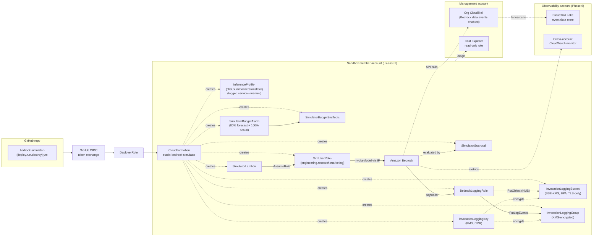

# Bedrock simulator — specification

> **Out-of-scope tooling — not part of the dashboard build phases.**
> This spec describes a standalone test harness in `tools/bedrock-simulator/`. It is independent of the Bedrock Cost Dashboard project: it does not participate in `.claude/rules/30-phase-discipline.md`, is not in the pnpm workspace, and can be built/deployed/destroyed without touching `apps/dashboard` or `apps/collector`.

## Scope

The Bedrock Cost Dashboard collector (Phase 6) ingests data from CloudWatch, CloudTrail Lake, and Cost Explorer. Until someone is invoking Bedrock in the target AWS organisation, the dashboard has nothing to display and the collector has nothing to read — making end-to-end testing impossible.

The simulator solves this by:

- Deploying to a dedicated **sandbox member account** in the same AWS Organisation.
- Running a Lambda on demand (no schedule) that invokes real Amazon Bedrock models via `InvokeModel` and routes a configurable fraction through a Guardrail.
- Generating the five signals the dashboard cares about: CloudWatch metrics, CloudTrail events, Cost Explorer line items, Guardrail evaluations, and full prompt/response payloads via model invocation logging.
- Exercising the same attribution dimensions the dashboard surfaces: **per-model** (4 models), **per-service** (3 tagged application inference profiles), **per-user** (3 IAM roles the Lambda assumes in rotation).

What it is **not**:

- A production system. It runs against synthetic prompts only (see "Security & regulatory compliance" below).
- A safety-policy reference. The Guardrail configuration is deliberately broad to produce visible interventions, not tuned for real user traffic.
- Part of the dashboard's build phases. Rule 30 does not apply.

## Prerequisites — operator one-time setup

Each item must be in place before the first deploy can succeed. None can be created by the SAM template.

1. **Sandbox member account exists in the AWS Organisation.** Required for the simulator itself. The account should additionally be enrolled as a **CloudWatch cross-account observability source account** linked to the dashboard's observability monitoring account — but that account does not exist until Phase 6 begins, so this is a **deferred prerequisite**: the simulator can be deployed and exercised before the link is established; the simulator's data simply will not surface in the dashboard until then. Track the link as a Phase 6 dependency, not a simulator blocker.
2. **Bedrock model access approved** in the sandbox account for every model in the test set (Claude Opus 4, Sonnet 4, Haiku 3.5, plus the "other" model — e.g. Llama 3.3 70B). Anthropic-model approval can take days on first request. **Important:** for models invoked through a system cross-region inference profile (Claude Opus 4, Claude Sonnet 4 — both in the v1 set, using `us.*` profiles), model access must be granted in **every region the profile spans** — for `us.*` profiles that is `us-east-1`, `us-west-2`, **and** `us-east-2`. Approving only in the deploy region will succeed for Haiku and the bare "other" model but fail with `AccessDeniedException` on the Claude 4 models when the profile routes a call to another region.
3. **Bedrock per-region service quotas verified** for the test model mix (default per-region on-demand TPM/RPM limits are often low). Request quota increases in the AWS Service Quotas console before running heavy mixes.
4. **GitHub OIDC IdP registered in the sandbox account** (one per account, not per stack): `arn:aws:iam::<acct>:oidc-provider/token.actions.githubusercontent.com`. The SAM template assumes this exists.
5. **SNS topic with a confirmed email subscription** for `SimulatorBudgetAlarm`. The template creates the topic + subscription; the email confirmation link must be clicked manually.
6. **Organisation CloudTrail is configured to capture Bedrock data events.** `InvokeModel` / `InvokeModelWithResponseStream` are CloudTrail **data events**, not management events, and require explicit opt-in in the trail's event selectors. Without this, simulator calls never reach CloudTrail Lake and the dashboard's per-user / per-service attribution receives nothing from the sandbox account — even though the simulator itself is healthy. Verify with `aws cloudtrail get-event-selectors --trail-name <org-trail>` in the management account; the result must include an `AdvancedEventSelector` with `eventCategory = Data` and a `resources.type` matching `AWS::Bedrock::*` (or an inclusive `resources.type` field). The dashboard system-architecture spec (`docs/specs/2026-05-15-system-architecture.md`) implies but does not explicitly require this — flag the gap to the dashboard owner.

## Architecture overview (Diagram 1)



**Mermaid note:** `<` and `>` must be HTML-escaped as `&lt;` / `&gt;` inside node labels. The Observability subgraph is dashed-arrowed because it does not exist until Phase 6 — the simulator runs without it; the data just stays in the sandbox account until the cross-account link is configured.

## Infrastructure inventory

Single SAM stack `bedrock-simulator`. All resources in the sandbox member account, `us-east-1` only.

| Resource | Purpose | Key properties |
|---|---|---|
| `SimulatorLambda` | Reads the invocation payload, fans out InvokeModel calls | Node.js 22, ARM64, 512 MB, 5 min timeout |
| `SimulatorLambdaRole` | Lambda execution role | Permits `sts:AssumeRole` on the three `SimUserRole-*` ARNs only; `logs:CreateLogStream` + `PutLogEvents` on its own log group. No Bedrock perms |
| `SimUserRole-engineering` / `-research` / `-marketing` | The three "user" roles the Lambda assumes per call. Each one's name appears in CloudTrail `userIdentity.sessionIssuer.userName` | Trust policy: `SimulatorLambdaRole`'s ARN as `Principal.AWS`. Inline policy: `bedrock:InvokeModel` + `InvokeModelWithResponseStream` + `ApplyGuardrail`, Resource-scoped to the foundation models, inference profiles, and guardrail created in this stack (no wildcards) |
| `InferenceProfile-chat` / `-summarizer` / `-translator` | Customer application inference profiles, tagged `service=<name>` per `docs/specs/2026-05-15-system-architecture.md:27` | Each wraps either a foundation model ID or a system cross-region profile (see "Cross-region wrapper compatibility" below) |
| `SimulatorGuardrail` | Bedrock Guardrail — see "Guardrail policy" below for the full configuration | Configurable fraction (`guardrailRatio`) of calls route through it |
| `InvocationLoggingBucket` (S3) | Destination for Bedrock model invocation logging — full prompt + response payloads | Block Public Access = all four flags ON; bucket policy `Deny s3:*` when `aws:SecureTransport != true`; resource policy allows `Put*` only from the Bedrock service principal and from `BedrockLoggingRole`; SSE-KMS with `InvocationLoggingKey`; versioning off; 7-day lifecycle expiration of current + noncurrent versions; multipart abort after 1 day |
| `InvocationLoggingKey` (KMS, CMK) | Encryption key for the S3 bucket + log group | Annual automatic rotation; key policy grants `Encrypt`/`Decrypt`/`GenerateDataKey*` to the Bedrock service principal scoped by `aws:SourceAccount`, and to `BedrockLoggingRole` by ARN |
| `InvocationLoggingGroup` (CloudWatch Logs) | Destination for Bedrock model invocation logging — full payloads | KMS-encrypted with `InvocationLoggingKey`; 7-day retention; resource policy permits `bedrock.amazonaws.com` to `CreateLogStream` + `PutLogEvents` |
| `BedrockLoggingRole` | Role the **Bedrock service** assumes to write invocation log payloads | Trust: `bedrock.amazonaws.com` with `aws:SourceAccount` AND `aws:SourceArn` conditions (confused-deputy mitigation). Permits `s3:PutObject` on `InvocationLoggingBucket/*`, `logs:CreateLogStream` + `PutLogEvents` on `InvocationLoggingGroup`, `kms:GenerateDataKey*` on `InvocationLoggingKey`. Nothing else |
| `BedrockInvocationLoggingConfig` (custom resource Lambda) | Calls `PutModelInvocationLoggingConfiguration` on Create/Update; `DeleteModelInvocationLoggingConfiguration` on Delete so destroy cleans up the account-level setting | Own role with `bedrock:PutModelInvocationLoggingConfiguration` / `GetModelInvocationLoggingConfiguration` / `DeleteModelInvocationLoggingConfiguration` + `iam:PassRole` on `BedrockLoggingRole` only |
| `DeployerRole` (IAM, OIDC trust) | Role the GitHub workflows assume | Trust policy scopes by `repo:<owner>/<repo>`, `ref:refs/heads/main`, the three `job_workflow_ref` values for the AWS-touching workflow files (`bedrock-simulator-deploy.yml` / `-run.yml` / `-destroy.yml`), `environment:bedrock-simulator-sandbox`, and an explicit `Condition` requiring `aud = sts.amazonaws.com`. `bedrock-simulator-build.yml` (which compiles the deploy artifact) touches no AWS and is deliberately **excluded** from this trust — it must never need to assume the role. Permissions: `cloudformation:*` scoped to stacks named `bedrock-simulator*`; `iam:PassRole` on `SamCfnRole` only with `iam:PassedToService = cloudformation.amazonaws.com`; `s3:Put*` on the SAM artifact bucket; `lambda:InvokeFunction` on `SimulatorLambda`; `bedrock:GetInferenceProfile` / `GetGuardrail` / `GetModelInvocationLoggingConfiguration` / `PutModelInvocationLoggingConfiguration` (for destroy pre-step); `s3:DeleteObject*` + `ListBucket` on `InvocationLoggingBucket`. No `iam:*` outside `PassRole`; no `*` actions |
| `SamCfnRole` | CloudFormation service role for `sam deploy`. Trust: `cloudformation.amazonaws.com` only | Permissions enumerated per service category — `iam:CreateRole`/`AttachRolePolicy`/`PutRolePolicy`/`DeleteRole*`/`PassRole` scoped to stack-role ARN patterns; `lambda:Create*`/`Update*`/`Delete*`/`AddPermission`/`Tag*` on the two stack Lambdas only; `bedrock:Create*`/`Delete*`/`Tag*` on inference profiles + guardrail; `s3:Create*`/`Delete*`/`PutBucket*` on the logging bucket; `logs:Create*`/`Delete*`/`PutRetentionPolicy` on the two log groups; `kms:Create*`/`PutKeyPolicy`/`Schedule*` on the logging key; `sns:Create*`/`Delete*`/`Subscribe`/`Unsubscribe` on the budget topic; `budgets:Create*`/`Delete*`/`Update*` on the budget. No `*:*`. Inline policies are preferred for stack-private permissions; managed-policy lifecycle actions (`iam:CreatePolicy`/`DeletePolicy`/`CreatePolicyVersion`/`DeletePolicyVersion`/`GetPolicy`/`GetPolicyVersion`/`ListPolicyVersions`/`TagPolicy`/`UntagPolicy`) are permitted only when scoped to `arn:aws:iam::<acct>:policy/bedrock-simulator-*` and used for permissions shared by multiple stack roles (e.g. `SimUserBedrockInvokePolicy` attached to all three `SimUserRole-*`) |
| `SimulatorBudgetSnsTopic` + email subscription | Notification target for the budget alarm | KMS-encrypted (own alarm key or `InvocationLoggingKey`). Email address comes from a GitHub Actions secret `BUDGET_ALERT_EMAIL`, passed as a CFN parameter with `NoEcho: true`. Confirmation link is manual (prerequisite #5) |
| `SimulatorBudgetAlarm` | AWS Budgets, $10/month threshold | Two notifications on the same SNS topic: (a) `FORECASTED >= 80%` (~$8 projected) — early warning; (b) `ACTUAL >= 100%` ($10 spent) — confirmed breach. Threshold deliberately above the cost of a single Heavy-Opus run so routine testing does not page; a sustained breach indicates repeated heavy runs or unexpected idle cost |

CFN `Outputs:` section must export every name the workflows need (Lambda function name, bucket name, log group name, guardrail ID, inference profile ARNs). Workflows resolve these at runtime — nothing is hard-coded in workflow YAML.

**Build / deploy split (artifact-based rollback).** Building is separated from deploying so a known-good build can be re-deployed without rebuilding. `bedrock-simulator-build.yml` (holds no AWS credentials — an access boundary, not a cost claim) runs the gate + `sam build`, packages `.aws-sam/` as `sam-build.tgz`, and publishes it two ways: a **7-day GitHub Actions artifact** (every dispatch build), and — on `release: [published]` — a **durable GitHub Release asset** (assets do not expire). `bedrock-simulator-deploy.yml` downloads a chosen bundle and runs `sam deploy` against it (no rebuild, no re-test), selecting by precedence `release_tag` (durable asset) > `build_run_id` (7-day artifact) > latest successful build. The build workflow's only elevated scope is `contents: write` on its `publish-asset` job (the GitHub token, used for `gh release upload`) — it never obtains AWS credentials.

## Bedrock access mode — on-demand only

The simulator uses **on-demand (serverless) Bedrock** exclusively. Every call is `InvokeModel` / `InvokeModelWithResponseStream` billed per input/output token.

- **No provisioned throughput.** Hourly model-unit cost ($40–$300+) is wildly wasteful for an occasional test harness. Provisioned throughput is a manual `PurchaseProvisionedModelThroughput` purchase — not creatable by the template — but this spec forbids it so nobody "optimises" the simulator into it.
- **No Bedrock Batch.** Async batch is cheaper per token but minutes-to-hours latency; the simulator assumes synchronous responses.

### Cross-region wrapper compatibility

Some newer foundation models (Claude Sonnet 4.x, Claude Opus 4.x) can only be invoked on-demand through a **system-defined cross-region inference profile** (e.g. `us.anthropic.claude-sonnet-4-…`), not via the bare foundation model ID. Calls to the bare ID return `ValidationException: Invocation of model ID … with on-demand throughput isn't supported`.

The customer application inference profile (the one tagged `service=<name>`) wraps either a foundation model ID *or* a system cross-region profile depending on the model. `tools/bedrock-simulator/src/models.ts` records the wrapper requirement per model; the SAM template uses that to construct the profiles correctly.

Starter compatibility table for the v1 test set (verify against the current AWS Bedrock model support page at https://docs.aws.amazon.com/bedrock/latest/userguide/models-supported.html before merging template changes — on-demand support boundaries shift):

| Canonical key | Foundation model ID | Cross-region wrapper required? | Wrapped ID to use |
|---|---|---|---|
| `claude-opus` | `anthropic.claude-opus-4-…` | **Yes** | `us.anthropic.claude-opus-4-…` |
| `claude-sonnet` | `anthropic.claude-sonnet-4-…` | **Yes** | `us.anthropic.claude-sonnet-4-…` |
| `claude-haiku` | `anthropic.claude-3-5-haiku-…` | No | n/a — pass the bare ID |
| `other` (Llama 3.3 70B example) | `meta.llama3-3-70b-instruct-v1:0` | No | n/a — pass the bare ID |

Canonical keys are the same keys defined by the dashboard's `packages/shared/src/models.ts` (Rule 20.5). If a model the simulator wants to exercise is not in `packages/shared/src/models.ts` yet, add it there first — do not fork the normalisation table.

## Attribution model

The simulator exercises three orthogonal attribution dimensions, each surfaced by a different mechanism the dashboard reads.

| Dimension | Source the dashboard reads | How the simulator produces it |
|---|---|---|
| Per-model | CloudWatch `AWS/Bedrock` metrics; Cost Explorer line items | Each call selects a model from `models.ts` and invokes via the matching inference profile or bare ID |
| Per-service | CloudTrail Lake — `service` tag on the application inference profile in the request | Each call selects a service from {`chat`, `summarizer`, `translator`} and routes via the inference profile of that name |
| Per-user | CloudTrail Lake — `userIdentity.sessionIssuer.userName` | The Lambda assumes one of `SimUserRole-{engineering,research,marketing}` per call. CloudTrail records the assumed-role name |

### Attribution caveat — assumed-role names vs SSO usernames

The dashboard's per-user breakdown extracts the SSO username from CloudTrail `userIdentity` (`docs/specs/2026-05-15-system-architecture.md:28`). The simulator cannot produce real SSO sessions — its calls show `userIdentity.type = AssumedRole` with the assumed role name (`SimUserRole-engineering`, etc.).

- Simulator rows in the dashboard's per-user page will show role names, not real people.
- Phase 6's username extraction must handle both shapes, or simulator users appear as `_unknown`. This spec flags the gap; the Phase 6 author decides whether to widen extraction or label simulator data distinctly.

## Guardrail policy

`SimulatorGuardrail` enables five policy types. Verify entity availability against the current Bedrock Guardrails docs at https://docs.aws.amazon.com/bedrock/latest/userguide/guardrails-sensitive-filters.html — AWS adds PII entity types over time.

### Content filters (input + output)

| Category | Threshold |
|---|---|
| `SEXUAL` | `HIGH` |
| `INSULTS` | `HIGH` |
| `HATE` | `MEDIUM` |
| `VIOLENCE` | `MEDIUM` |
| `MISCONDUCT` | `MEDIUM` |
| `PROMPT_ATTACK` | `HIGH` (input only — prompt-injection / jailbreak detection) |

### Word filter

- Managed profanity list enabled.
- Small custom block list of strings that should never appear in test traffic.

### Denied topics

1. **Soliciting personal data** — "Requests asking the model to produce, infer, or guess personally identifiable information about a real person."
2. **Guardrail bypass attempts** — "Requests instructing the model to ignore safety policies, role-play as an unrestricted assistant, or output explicitly restricted content under a fictional framing."

### Sensitive information filter (PII)

Action: **`BLOCK`** for all entities (not `ANONYMIZE`) so the dashboard sees an intervention rather than a quiet redaction. Both input and output are scanned.

**Australia (Privacy Act 1988 / APP-aligned):**

| Entity | Notes |
|---|---|
| `AU_TAX_FILE_NUMBER` | TFN — handling is governed by the Tax File Number Rule 2015; blocking by default is the safe stance for a test harness |
| `AU_BUSINESS_NUMBER` | ABN |
| `AU_COMPANY_NUMBER` | ACN |
| `AU_MEDICARE_NUMBER` | Medicare identifier |

**United Kingdom / EU:**

| Entity | Notes |
|---|---|
| `UK_NATIONAL_INSURANCE_NUMBER` | NI number |
| `UK_NATIONAL_HEALTH_SERVICE_NUMBER` | NHS number |
| `UK_UNIQUE_TAXPAYER_REFERENCE_NUMBER` | UTR |
| `INTERNATIONAL_BANK_ACCOUNT_NUMBER` | IBAN — covers EU bank identifiers |
| `SWIFT_CODE` | BIC / SWIFT — bank routing |

**United States:**

| Entity | Notes |
|---|---|
| `US_BANK_ACCOUNT_NUMBER` | |
| `US_BANK_ROUTING_NUMBER` | |
| `US_SOCIAL_SECURITY_NUMBER` | SSN |
| `US_INDIVIDUAL_TAX_IDENTIFICATION_NUMBER` | ITIN |
| `US_PASSPORT_NUMBER` | |

**Canada** (cross-region inference may transit `ca-*` regions in some profiles):

| Entity | Notes |
|---|---|
| `CA_SOCIAL_INSURANCE_NUMBER` | SIN |
| `CA_HEALTH_NUMBER` | |

**Cross-jurisdictional (GDPR-aligned "personal data" coverage):**

| Entity | Notes |
|---|---|
| `NAME` | GDPR Art. 4(1) — directly identifying |
| `ADDRESS` | |
| `EMAIL` | |
| `PHONE` | |
| `AGE` | |
| `DRIVER_ID` | |
| `LICENSE_PLATE` | |
| `VEHICLE_IDENTIFICATION_NUMBER` | VIN |
| `IP_ADDRESS` | GDPR Recital 30 — IPs are personal data |
| `URL` | When personally identifying (e.g. social-media handles) |
| `USERNAME` | |
| `PASSWORD` | Never legitimately in a prompt; always block |
| `PIN` | |
| `CREDIT_DEBIT_CARD_NUMBER` | PCI-DSS overlap |
| `CREDIT_DEBIT_CARD_CVV` | |
| `CREDIT_DEBIT_CARD_EXPIRY` | |

### Regex-based filters

For region-specific identifiers Bedrock does not have a built-in for (e.g. Australian state-issued driver's-licence formats, organisation-specific employee IDs), add custom regex patterns with `BLOCK` action at implementation time. Review the prevailing Bedrock built-in entity list before writing custom regex — do not duplicate built-ins.

### What this policy is *not*

This is a **synthetic-test-harness** guardrail. It is intentionally aggressive (`BLOCK` on broad PII categories) because the simulator's job is to produce guardrail interventions for the dashboard to display. **It is not a production-grade safety policy for real user traffic** — a production deployment would tune thresholds per use case, choose `ANONYMIZE` over `BLOCK` for some categories to preserve usability, and run a Data Protection Impact Assessment (DPIA) per GDPR Art. 35 / an equivalent Privacy Impact Assessment for Australian APP 11.

## Lambda contract

### Invocation payload (input)

```jsonc
{
  "totalCalls": 10,           // hard-capped at 50 by handler validation
  "models": ["claude-opus", "claude-sonnet", "claude-haiku", "other"],
  "services": ["chat", "summarizer", "translator"],
  "users":    ["engineering", "research", "marketing"],
  "guardrailRatio": 0.2       // 0–1; portion of calls routed via Guardrail
}
```

`handler.ts` Zod-validates the payload (Rule 60.16), then for each call randomly picks `(user, service, model)`, assumes `SimUserRole-<user>`, and invokes either the raw model ID or the matching inference profile ARN. With probability `guardrailRatio` it passes `guardrailIdentifier` + `guardrailVersion`.

### Response shape (output)

```jsonc
{
  "results": [
    {
      "user": "engineering",
      "service": "chat",
      "model": "claude-haiku",
      "status": "success",            // "success" | "error" | "guardrailBlocked"
      "inputTokens": 213,
      "outputTokens": 187,
      "guardrailIntervention": false,
      "errorCode": null,              // e.g. "AccessDeniedException", "ThrottlingException", "ValidationException"
      "errorMessage": null,
      "latencyMs": 1247
    }
  ],
  "summary": {
    "totalCalls": 1,
    "success": 1,
    "errored": 0,
    "guardrailBlocked": 0
  }
}
```

Per-call errors do not abort the run — every `(user, service, model)` triple appears in `results` with its own status. The deploy workflow's smoke step asserts `summary.totalCalls == requested && summary.errored == 0`.

### Prompt and token caps

All cost claims in this spec rely on hard caps in code:

| Constant | Value | Where |
|---|---|---|
| Maximum input tokens per prompt fixture in `prompts.ts` | ≤500 | Enforced by a `prompts.ts` unit test that token-counts each fixture and fails the build if any exceeds the cap |
| `max_tokens` (per-call output cap) — smoke profile | 200 | `handler.ts` constant; used only for the deploy workflow's smoke invocation |
| `max_tokens` — default profile | 1000 | `handler.ts` constant; used for `bedrock-simulator-run.yml` runs |
| `max_tokens` — heavy profile | 2000 | `handler.ts` constant; selectable only by a code change, never by workflow input |

Raising any of these constants invalidates the cost claims and requires updating the Cost section.

## Cost expectations

Per [Cost posture](../../CLAUDE.md): paid resources here (KMS CMK, Lambda, Bedrock on-demand calls) are accepted, not avoided — the figures below document every cost so none is silent.

Figures are **illustrative at spec-author date**. Verify against current Bedrock pricing at https://aws.amazon.com/bedrock/pricing/ before running.

### Setup — $0
CFN stack ops, IAM, S3 bucket creation, CWL group creation, Bedrock model access enablement, inference profile creation, Guardrail creation, model-invocation-logging enablement — all free at create.

### Idle (deployed, no runs) — under $0.10/month
S3 bucket: <$0.01 with 7-day lifecycle. CWL log group: <$0.05 at low call volume + 7-day retention. KMS key: $1/month per CMK in use (one CMK here). Everything else free at rest. **Recommended posture: leave deployed between runs.**

### Per-run cost — main variable

Bedrock on-demand, us-east-1, ~200 in + 200 out tokens per call:

| Model | $/M in | $/M out | Per call |
|---|---|---|---|
| Claude Haiku 3.5 | $0.80 | $4.00 | ~$0.001 |
| Claude Sonnet 4 | $3.00 | $15.00 | ~$0.004 |
| Claude Opus 4 | $15.00 | $75.00 | ~$0.018 |
| "other" (Llama 3.3 70B) | $0.72 | $0.72 | ~$0.0003 |

Per-call extras: Lambda exec ~$0.00003; guardrail eval (if used) ~$0.0002; invocation log payload <$0.0001.

Worked examples:

| Scenario | Calls | Mix | Cost |
|---|---|---|---|
| Smoke test in deploy workflow | 1 | Claude Haiku, no guardrail | ~$0.001 |
| Default workflow run | 10 | Even split 4 models, 20% via guardrail | $0.05–$0.10 |
| Max workflow run | 50 | Same mix | $0.25–$0.50 |
| Heavy Opus-only (code change required) | 50 | All Opus, 50% guardrail, ~1k in + 1k out | $5–$10 |

### Cost guardrails enforced in code/config

| Guardrail | Where |
|---|---|
| `totalCalls` capped at 50 by Zod | `handler.ts` (Rule 60.16) |
| `guardrailRatio` capped at 1.0 | `handler.ts` |
| Same caps validated again on workflow inputs | `bedrock-simulator-run.yml` |
| `SimulatorBudgetAlarm`: 80% forecast (~$8) + 100% actual ($10), monthly | Template; email destination is a deploy parameter |
| Invocation-logging S3 lifecycle: 7-day expiration | Template |
| CloudWatch Logs retention: 7 days on both Lambda and invocation log groups | Template |

### Not metered to the simulator
Dashboard ingest (CloudWatch GetMetricData, CloudTrail Lake scans, Cost Explorer queries) is paid by the dashboard's observability account, not the sandbox account.

## Security & regulatory compliance

The simulator's threat model is "developer test harness in an isolated sandbox account, never receives real user data." Every control below reinforces that boundary.

### Synthetic-data-only constraint (non-negotiable)

- The only prompt source is `tools/bedrock-simulator/src/prompts.ts`, a static set of fixtures committed to the repo and code-reviewed (CODEOWNERS at `.github/CODEOWNERS` requires security-team review on every change).
- The Lambda **does not** accept prompt text from the invocation payload. The workflow-dispatchable inputs (`totalCalls`, `guardrailRatio`) are bounded numerics — no string body can reach Bedrock from outside the repo.
- Modifying the simulator to read prompts from an external source (HTTP, S3, DynamoDB, EventBridge payload, etc.) is **out of scope** and requires re-running the security review plus a DPIA/PIA before merge.

### Region & data-residency posture

- Deployed in `us-east-1` only. Newer Claude models route via the `us` cross-region inference profile, so payloads transit `us-*` regions (typically `us-east-1`, `us-west-2`, `us-east-2`).
- This is **only acceptable because the data is synthetic**. Processing real EU or Australian personal data in `us-*` would require:
  - **GDPR**: a transfer mechanism under Art. 44–49 (Standard Contractual Clauses or an adequacy decision), a Transfer Impact Assessment, and a DPIA per Art. 35.
  - **Australian Privacy Act**: APP 8 cross-border-disclosure obligations met by ensuring the overseas recipient handles data consistently with the APPs, or recipient is in a country with substantially similar protection.
- For real EU traffic the natural deployment region is `eu-west-1` or `eu-central-1` with `eu` cross-region profiles. For real Australian traffic, `ap-southeast-2` (Sydney) with `ap` cross-region profiles. Neither is supported by this simulator's v1 template; switching regions is a separate proposal.

### Alignment to specific obligations

| Obligation | What the simulator does to align |
|---|---|
| **GDPR Art. 5** (lawful basis, minimisation, storage limitation) | Synthetic data only; 7-day S3 lifecycle + log retention enforces storage limitation; no consent capture needed because no personal data is processed |
| **GDPR Art. 25** (privacy by design) | KMS encryption at rest; TLS-only in transit; PII guardrail scoped broadly across jurisdictions; least-privilege IAM |
| **GDPR Art. 32** (security of processing) | KMS keys + bucket policies + block-public-access + TLS enforcement + 7-day data minimisation |
| **GDPR Art. 35** (DPIA) | Spec explicitly states a DPIA is required before pointing the simulator at real user data — not waived |
| **Australian Privacy Act APP 6** (use & disclosure) | Synthetic prompts only; no secondary use because there is no personal data to use |
| **Australian Privacy Act APP 8** (cross-border disclosure) | Acknowledged above — synthetic data exempts the simulator; flagged as a blocker for any real-data deployment |
| **Australian Privacy Act APP 11** (security of personal info) | Encrypted storage, encrypted transport, access controls, retention limits |
| **Australian Notifiable Data Breaches scheme** | Synthetic data → no notifiable breach is possible from this harness. Extending to real data requires an NDB response runbook |
| **PCI-DSS** | Credit-card entities are in the guardrail's `BLOCK` list. Bucket is not in PCI scope because no real PAN data is processed |

### IAM least-privilege checklist (security reviewer must verify)

The `ecc:security-reviewer` agent run against `tools/bedrock-simulator/template.yaml` must confirm each item before merge:

- [ ] No `*` in any `Action` or `Resource` block in any role policy.
- [ ] `iam:PassRole` everywhere uses an `iam:PassedToService` condition.
- [ ] All S3 bucket policies include the `aws:SecureTransport == true` deny clause.
- [ ] All KMS key policies grant access by ARN (not just service principal) and include `aws:SourceAccount` conditions on service-principal grants.
- [ ] `BedrockLoggingRole` trust policy includes both `aws:SourceAccount` and `aws:SourceArn` (confused-deputy mitigation).
- [ ] `DeployerRole` OIDC trust includes `aud = sts.amazonaws.com`, `repo:<owner>/<repo>:ref:refs/heads/main`, and `environment:bedrock-simulator-sandbox`.
- [ ] Block Public Access ON (all four flags) at the bucket level and account level.
- [ ] Every IAM role has an explicit `MaxSessionDuration`.
- [ ] No long-lived IAM users created. SSO + OIDC only.
- [ ] No secrets in CloudFormation parameters with `NoEcho: false`. `BudgetAlertEmail` parameter has `NoEcho: true`.
- [ ] CloudTrail in the sandbox account is enabled or covered by the org trail (verify, do not assume).

### Secret handling pattern

- **GitHub Actions secret `BUDGET_ALERT_EMAIL`** — read at workflow time, passed to `sam deploy --parameter-overrides`, never echoed.
- **GitHub Actions OIDC token** — short-lived, exchanged for `DeployerRole` credentials, never stored.
- **`samconfig.toml`** — gitignored; contains the sandbox account ID and region as deploy defaults, no secrets.
- **No AWS access keys** anywhere — OIDC + SSO only (Rule 50.1).
- **No prompts in workflow inputs.** Reinforces the synthetic-data-only constraint.

### Bedrock-specific safety controls

- The simulator does **not** opt the sandbox account into Anthropic's model-improvement data-sharing setting (off by default in Bedrock; the spec requires confirmation that it stays off).
- Bedrock model-invocation-logging is enabled by this stack and torn down by destroy — never left dangling.
- Custom inference profiles are tagged for cost-allocation, not used as a security control.

### Operational monitoring — deliberate non-decisions

- **No CloudWatch alarm on Lambda errors.** The simulator is operator-driven via `workflow_dispatch`; every invocation's success/failure is visible in the workflow output and the Lambda log artifact uploaded by the deploy/run workflows.
- **No CloudWatch alarm on Bedrock throttling.** Throttling appears as a per-call status in the run-workflow response payload.
- **No SNS topic for Lambda errors.** The budget SNS topic exists for cost notifications only; reusing it for operational errors would muddle two distinct concerns.

If the simulator ever moves to scheduled invocation, all three become mandatory — they are not added now to avoid noise on an interactively-driven harness.

## What lives in the guide, not here

The operational runbook — deploy / run / destroy procedures, Recovery Procedures A–F with verbatim commands, the Mermaid deploy-sequence and CFN-state-machine diagrams, troubleshooting tables — lives in `docs/guides/bedrock-simulator.md`. This spec is the design; the guide is the playbook.
